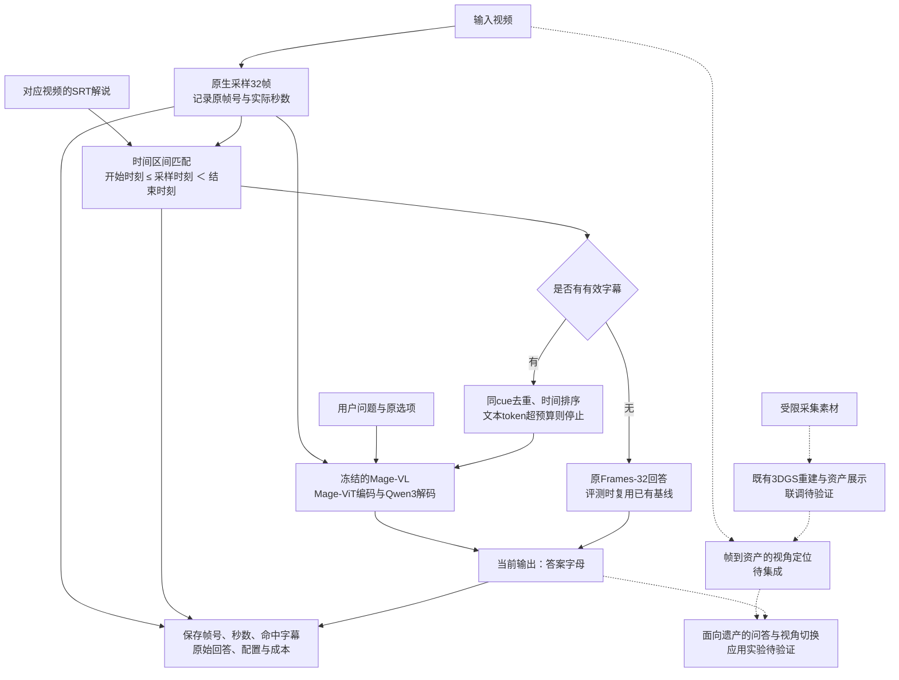

# 面向文旅遗产展示的时间对齐字幕辅助视频问答：研究总结与实验清单

更新：2026-11-03（Asia/Shanghai）｜项目分支：`vlm`  
定位：在既有三维重建与导览系统中集成免训练问答配置，优先验证实用收益；本文不是新算法或完整系统已成功的声明。  
状态：原字幕路线dev180为110→117，val90为53→52，验证未支持稳定提升，暂停当前配置全量。新增连续补句＋时间标记开发对照及DeepSeek真实帧独立答题／证据复核工程，当前仅完成CPU准备，未有新GPU或真实API结果；test225和文旅应用闭环未完成。最新操作见[新实施说明](PLAN_continuous_deepseek_pilot.md)。除另有标注，所有应用案例与后续实验均为待验证设计。

## 1. 研究背景：主要解决什么问题

### 1.1 问题界定

文化遗产数字展示同时面临两类信息缺口：受限采集造成几何与外观覆盖不足，有限视频帧则未必包含问答需要的解说、人物关系和历史背景。三维重建解决“资产能否被完整观看”，视频与解说辅助问答解决“用户能否围绕当前所见获得有依据的解释”；两者需要分别验证，再建立应用关联。

当前问答路线研究：**在固定视觉采样配置下，加入与采样时刻相符的解说文本，能否提高回答准确率，同时控制额外开销和误伤？** 不研究新的视觉编码器、联合训练架构或门控网络。

可检验的研究问题：

- **RQ1：信息补充。** 对齐字幕相对同一Mage视觉配置能否获得正净收益，收益是否在未用于选型的数据上保持？
- **RQ2：作用条件。** 哪些题型、视频时长和字幕可用条件受益，哪些会被噪声文本误导？
- **RQ3：成本。** 在不增加视觉token的情况下，新增文本token、时间和显存是否值得付出？
- **RQ4：应用关联。** 对文旅视频与数字资产的实际交互是否有帮助，重建质量与字幕信息分别贡献多少？本项尚无现成实验结论。

### 1.2 当前证据与论文主张的上限

相同60个视频、180题开发集：Codec无字幕111/180（61.67%），Frames-32无字幕110/180（61.11%），Frames-32＋对齐字幕117/180（65.00%）。相对Frames-32救回14题、误伤7题，净增7题（+3.89个百分点）；视频聚类bootstrap 95%区间为[-1.67,9.44]个百分点，尚不能宣称统计显著。

新增90题从54题正确提高到58题，净增4题；中等时长96题从60提高到67，长视频84题仍为50。162题实际使用字幕，18题缺字幕并保留原视觉回答，审计通过、非法回答为0。视觉token总数保持828,672，额外加入61,677个字幕文本token；总输入预算并未保持不变。

可写为：**“集成时间对齐字幕辅助问答模块，并在固定视觉配置的开发实验中观察到正向收益。”** 不能写成“提出新的时序对齐算法”“已显著优于原版带字幕Mage”“全面提升长视频理解”或“已证明重建改善带来了问答提升”。采样帧对齐字幕是已有评测做法，Mage也已有带字幕结果。[Video-MME官方协议](https://github.com/MME-Benchmarks/Video-MME#-evaluation-pipeline)、[Mage官方结果](https://microsoft.github.io/Mage/vl/)

## 2. 文旅保护中的应用场景

以下例子用于定义应用任务，不是已运行成功的演示。视频对应的讲解应来自核验过的馆方解说、展陈说明或人工转写；现有实现只接收时间对齐SRT，没有自动ASR、知识库问答或保护诊断能力。

### 2.1 古建筑导览：看到构件，也理解用途

- 输入：游客拍摄门楼、斗拱或牌匾的短视频，以及该视频对应的可信讲解字幕。
- 问题：“镜头中的这组构件有什么作用？”视觉提供构件外观，解说补充功能说明；“哪一次修缮形成了现在的外观？”需要可靠历史资料，不能从造型直接猜测年代。
- 目标交互：回答后进入三维资产相应视角细看。帧到资产的定位、构件关联与视角跳转仍需集成和独立评测，当前字幕实验没有实现这些能力。

### 2.2 石刻与雕塑展示：区分可见细节和史实解释

- 输入：石刻表面与侧面的拍摄视频、人工核验的解说字幕，以及既有三维重建资产。
- 问题：“哪一侧存在缺损？”主要依赖视觉；“碑文所记事件是什么？”需要可读文字或可信解释；没有可读证据时应标为证据不足，不能让三维外观代替史实依据。
- 目标交互：自由换视角检查形态，再阅读对应解说。若视频来自三维渲染，字幕必须重新绑定渲染时间轴或明确的资产区域，不能沿用原视频SRT时间戳直接匹配。

### 2.3 工艺与非遗讲解：动作过程加口述知识

- 输入：修复工序、传统木作或陶艺制作视频及其讲解字幕。
- 问题：“演示者在这一工序使用了什么工具，为什么这样处理？”画面提供动作和工具线索，口述说明提供材料与工艺理由。
- 评测应同时包含可见动作题、口述事实题、跨模态综合题，检查模型是否真正利用视觉，而不是只读字幕。

### 2.4 保护档案辅助检索：提供线索，不代替专业判定

- 输入：同一遗产不同时期的记录视频、时间明确的修缮解说与三维资产。
- 目标：“哪段记录提到了某构件的修缮？”当前对齐记录可为人工查证提供时间线索；跨时期匹配、病害变化测量和专业保护结论均需额外方法与人工核验。
- 当前回答仍是基准测试的选项字母；自然语言回答、来源引用展示与拒答策略尚未实现，不能直接宣称已经具备可信导览服务。

## 3. 核心思路

固定视觉输入，用真实采样时刻对齐的解说文本补充视觉难以直接确定的语义信息，缺少文字证据时保持原视觉回答。实线为当前已实现并完成开发评测的问答流程，虚线为尚待完成应用验证的三维资产联动。

## 4. 核心方法／模块与来源

### 4.1 方法定义与贡献定位

令采样帧及实际秒数为`{(f_i,t_i)}，i=1…32`，字幕为`{(a_j,b_j,s_j)}`，取满足`存在i：a_j ≤ t_i < b_j`的字幕段，按时间排序后与视频、问题共同输入冻结Mage。单个cue多次命中只保留一次，不同时间出现的相同台词仍保留；无有效字幕时使用原Frames-32路径。

这个模块是**输入证据组织与系统适配**：没有新训练参数，没有独立的字幕编码器，没有自研跨模态注意力层，也没有模型生成的证据验证器。模型原有的多模态条件生成完成回答；目前的对齐记录证明“输入用了哪些字幕”，不证明“模型答案因果上依赖这些字幕”。

论文贡献可拆成三项，分别给出证据：

1. **系统集成：** 固定视觉配置下，接入真实时间对应的解说证据及缺失回退，服务遗产展示应用。
2. **实证分析：** 配对报告纠错、误伤、分时长收益和成本，说明新增信息在哪些条件下有效。
3. **应用验证：** 将重建资产、定位和问答连接起来；这是待完成项，必须用文旅场景实验证实。重建本身的算法贡献需由其独立方法与指标支持。

以上定位不能单独保证顶刊顶会的创新性；若需要更强方法贡献，应先明确新的可检验机制或有价值的应用评测问题，而不是给标准字幕匹配重新命名。

### 4.2 已实际使用的基础架构与协议

- **Mage-VL：** [官方仓库](https://github.com/microsoft/Mage)。使用已有Mage-ViT视觉编码器和Qwen3语言解码器；当前主路线是Frames后端，不是新Codec选区方法。没有改视觉权重、语言权重、3D RoPE或流式门控。项目代码为`VQA/mage_vl/models/`及`VQA/mage_vl/practical/`。
- **Video-MME：** [官方仓库与评测协议](https://github.com/MME-Benchmarks/Video-MME#-evaluation-pipeline)。遵循采样帧对应字幕的输入范围，保持单选题准确率统计。这是已有做法，不作为原创算法主张。
- **VLMEvalKit：** [官方仓库](https://github.com/open-compass/VLMEvalKit)。参考其带字幕评测组织方式；没有直接执行会落盘抽帧的完整字幕构建入口，也没有混用其采样索引。字幕由Mage本次实际采样时间匹配。
- **本项目适配：** `subtitle_common.py`负责SRT解析、真实时间匹配与恢复校验；`practical_subtitles.py`负责原生输入捕获、冻结推理和回退；`subtitle_analyze.py`只在离线阶段读取GT并统计。阶段结果带代码、数据、字幕和模型身份记录；该可追溯性属于工程保证，不等于事实正确性保证。

固定设置：32帧，`max_pixels=150000`、`min_pixels=3136`，原选项顺序，`max_new_tokens=32`，`do_sample=False`；匹配字幕最多2048个模型token，超限即停，当前没有截断或预算选择器。缺文件、空字幕和未命中分别标记，不根据GT或置信度选择回退。

### 4.3 只参考、未实现为当前模块的工作

- **Video-RAG：** [官方实现](https://github.com/Leon1207/Video-RAG-master)。可借鉴“辅助文本补充视觉信息、按问题检索证据”的思路；当前没有实现其检索、ASR、OCR或检测管线，不能称为Video-RAG复现。只有当长视频错误分析表明对齐字幕漏掉关键台词时，才考虑一个受限的全文字幕检索候选。读取全片SRT后检索属于独立协议，需与同样可访问全文、相同文本预算的简单基线比较。
- **A.I.R.：** [官方实现](https://github.com/UCF-AIR/A.I.R.)。参考问题相关视觉证据选择；本轮没有接入CLIP/GMM/多轮选帧。工程已有QueryIP/CLIP选区负结果，暂不重新移植整套流程。
- **VideoHV-Agent：** [官方实现](https://github.com/Haorane/VideoHV-Agent)。参考候选假设与证据核查的研究问题；当前没有使用多Agent、外部验证API或完整检测/跟踪工具链。不能把Mage自产解释当成独立验证证据。
- **VCD：** [官方实现](https://github.com/DAMO-NLP-SG/VCD)。参考通过视觉对比减少语言先验偏差的思想；当前没有噪声视觉分支、对比解码或生成循环补丁，不宣称利用了VCD架构。

三个本地参考仓库的来源及关键文件哈希保存在`VQA/eval_results/practical_mage_v1/00_sources/audit.json`；该记录注明本轮未直接导入或复制其运行代码。不能把“读过的论文”写成“已经拼接的模块”。

## 5. 数据集、指标与主表选择

### 5.1 数据集优先级

1. **当前主数据：本地Video-MME子集。** 238个视频、714题：short219、medium258、long237。short已参与开发；medium/long按视频划分为dev180、val90、test225，dev30的90题包含在dev180中。val/test是本轮预先划定的留出集合；工程已有更早全量基线/QueryIP结果，论文需披露历史使用情况，不能将其描述成从未触碰的全新数据。只有在新方案不使用这些留出结果继续调规则时，才构成本轮有效的留出评估。
2. **必须补的应用数据：文旅视频＋解说＋对应三维资产。** 先以可核验、可获得使用授权的场景建立pilot，再确定正式规模。按遗产对象/地点划分训练、验证、测试，避免同一对象邻近轨迹跨集合泄漏。分别标注视觉可答、字幕可答、跨模态综合及证据不足题；给出答案、支持时间段、事实来源和字幕可用性。该数据集尚未建立，不能写成已有benchmark。
3. **最值得扩的公共数据：LongVideoBench。** 面向长视频与视频—语言上下文，适合检验当前长视频净收益为零的问题。[官方数据加载与评测仓库](https://github.com/longvideobench/LongVideoBench)。先核查存储、字幕格式和官方协议；用公开开发/验证部分做适配，不直接迁用Video-MME的字幕截取规则。没有必要先扩多个无字幕动作数据集。
4. **重建数据：复用现有重建场景，再补真实遗产场景。** 对现有重建基线与改进设定分别测质量和下游问答；厨房等通用场景结果不能代替文化遗产应用验证。任何新增下载均需另行决定，本总结不执行下载。

本地714题是覆盖性评测，不是官方完整Video-MME的900视频/2700题。最终应同时保留锁定测试池分数与714题Overall；后者含开发数据，不能代替泛化证据，也不能直接与原论文完整基准分数排名。

### 5.2 指标

- **主要效果：** 单选准确率Acc、相对同配置无字幕基线的提升（百分点）、救回数R、误伤数H、净增`R−H`。非法输出计错且保留分母；同时报告有字幕与缺字幕子集，不能只报获益子集。
- **统计不确定性：** 以视频为聚类单元的配对bootstrap 95%区间，辅以逐题McNemar结果并注明同视频题目相关性。当前区间跨0，不标显著性星号；不能把确定性推理换随机种子当作独立实验重复。
- **诊断：** 时长、题型、字幕可用率、采样时刻命中率、实际字幕token分布。命中率不是证据正确率或模型解释忠实度；若要报告引用正确率、拒答准确率，必须先实现相应输出并人工标注。
- **效率：** 同硬件端到端时间、生成时间、预处理时间、每题延迟分布、峰值显存、视觉与文本token分别统计。历史复用答案仍计逻辑视觉成本，缓存/冷启动口径明确；不能把少做的新调用当部署时必然加速。
- **应用关联：** 重建PSNR/SSIM/LPIPS与下游Acc分别报告；若有定位模块，另测位姿误差/重定位成功率。当前模块未输出定位和自然语言引用，不提前报告这些能力。

### 5.3 最值得参考的原论文表

- **Table 4：主性能表。** 先做相同本地子集上的Mage与Qwen3-VL-4B-Instruct，分别报告无字幕/带字幕、Short/Medium/Long/Overall。外部模型优先只增加[Qwen3-VL-4B-Instruct](https://huggingface.co/Qwen/Qwen3-VL-4B-Instruct)，不用先装Phi-4-15B。保持相同题目、可用字幕与可比采样规则，保留各模型原生处理器并报告实际预算。
- **Table 5：性能—成本表。** 在同一4090 D、同一批样本、统一预处理/缓存口径下实测。原图采用8×B200，不能直接拿其秒数计算本系统加速；原表tc8/tc16/tc32是Codec canvas预算，不是Frames-32/48/64，不能混填。
- **其余表不作为当前优先任务。** Table 1编码器表征、Table 3图像/空间任务、Table 7流式任务、Table 9 SFT/RL训练均不能直接证明字幕配置收益；Table 2跨Codec比较只有在实际研究HEVC/DCVC-RT差异时才需要。

若原版Mage Frames-32＋对齐字幕与当前配置完全相同，只能作为同一行标注“本系统采用的配置”，不能拆成Baseline和Ours制造算法差异。若比较Codec＋字幕与Frames＋字幕，应明确视觉后端与采样差异，并公平说明各自字幕选取协议。

## 6. TODO：实验、图表与交付

### 6.1 P0：先完成留出评估，不再叠加方法

- [x] Frames-32＋对齐字幕开发评估完成：180题65.00%，新增90题保持正净收益；保留长视频净收益为零的限制。
- [x] 换序/置信度门控/纯增加帧数的弱或负结果保留，不再追加无边界参数搜索。
- [x] 固化本摘要使用的结果来源和协议；2026-11-03已归档`07_archive/subtitles_dev60_v1.json`并登记`10_subtitle_holdout/candidate_val_v1.json`，当前配置作为唯一验证候选，不按题型或GT改用不同输出。
- [x] 新增独立val90配对入口：`run_subtitle_holdout.sh`，本次生成同题无字幕／带字幕两路，缺字幕复用本次无字幕回答，保留旧开发签名。78项CPU检查通过、真实清单已准备，助手未运行验证推理；详见[`SUBTITLE_HOLDOUT_README.md`](../VQA/mage_vl/practical/SUBTITLE_HOLDOUT_README.md)。
- [ ] 验证后冻结与test225入口尚待补齐；现有新入口只支持val，不因准备了候选清单就宣称已完成独立验证或测试冻结。
- [x] val90已完成并披露负结果：无字幕53/90、对齐字幕52/90，救回7、误伤8；不据此冻结原配置进入全量。val已参与诊断，后续不再称为未参与改进的独立证据。
- [ ] 用户授权连续补句＋时间标记、DeepSeek实际图片序列首答及证据复核，工程已搭建；先分别执行开发对照和API smoke，再判断是否扩pilot。test225保留，暂不训练、不开全量。
- [ ] 最后补齐714题，按开发/验证/测试/short历史开发分开汇总；复用身份一致的已完成单元，保存provenance，不自动重跑或丢弃旧结果。
- [ ] 结果、日志、断点与新缓存继续统一到`VQA/eval_results/practical_mage_v1/`；每次准备运行检查df/du，默认保留10GiB、实验根1GiB软预算。助手不代跑推理/训练/下载，不删除旧文件。

### 6.2 P1：对比与消融

- [ ] **主要对比：** Mage Frames-32无字幕/带字幕，Mage Codec无字幕；补Codec带字幕后再做同模态比较。预算允许时增加Qwen3-VL-4B无字幕/带字幕，不因外部模型更强就更换题目或字幕范围。
- [ ] **模态消融：** 视觉only（已有）、视觉＋对齐字幕（已有）、字幕only（待做）。字幕only用于检验增益是否主要来自文本，不将其结果伪装为多模态协同证据。
- [ ] **对齐消融（可选）：** 在开发池固定一种时间错位或同视频无关字幕对照，尽量匹配文本量并披露剩余差异；不跨测试集搜索偏移量。它只能检验对齐信息的作用，不证明标准对齐规则的原创性。
- [ ] **结构消融（可选）：** 原顺序与同一批字幕的固定乱序对照，保持文字内容和预算一致，观察时间组织是否有作用。
- [ ] **真实应用对照：** 相同问题、轨迹、字幕条件下比较原始视频、基线重建渲染、改进重建渲染；重新建立渲染时间与字幕对应关系。再做重建版本×有/无字幕的交叉对照，将几何贡献与文本贡献分开。若某题本来仅靠字幕可答，不能将其正确率当作重建效果。
- [ ] 按题型分析14道救回与7道误伤，人工核查画面和已输入字幕是否真的支持答案。不要从已知GT手工补入模型未见的台词。

### 6.3 P2：扩展与训练，只在必要时执行

- [ ] **外部泛化：** 先选择LongVideoBench一个官方可评测划分；如果只运行预先固定子集，明确标注子集，不与完整榜单直接排名。
- [ ] **字幕检索（条件性）：** 仅当错误分析证实稀疏采样漏掉关键解说时，登记一个受限全文SRT检索候选。需要同样可访问全文、相同文本预算的简单对照；与当前帧对齐协议分开报告，不直接移植整个Video-RAG环境。
- [ ] **Cultural LoRA（非必做）：** 只有获得可靠、与评测对象隔离的文旅训练数据后，才比较冻结基座与LoRA。固定视觉与字幕协议、训练步数和选型规则，冻结视觉编码器等设置需明示；只保存adapter。已有旧LoRA冒烟不代表当前32帧＋字幕配置的正式训练结果，不能直接写进主表。
- [ ] 若做训练，给出训练损失/验证Acc随步数曲线、训练开销及可承受的多种子复现；不能用Video-MME评测答案训练后仍称原协议零样本结果。没有高质量训练数据就维持免训练方案，不为增加工作量强行SFT/RL。
- [ ] 重建分支的训练与消融沿既有计划独立执行，以真实重建指标判断贡献；本次字幕结果不替代该证据。

### 6.4 论文图、表、图片清单

每项输出对应一个研究问题，开发图和最终测试图明确分开；当前均只是制作计划，本文件没有生成任何图像或新增实验结果。

**建议两张主表：**

- [ ] **表A／参考Table 4：** 同数据同协议的性能表，列出模型、视觉后端、字幕设置、样本数、分时长Acc、Overall、配对提升与区间；外部模型和标准带字幕Mage如实命名。
- [ ] **表B／参考Table 5：** 性能与成本表，列出视觉/文本token、预处理/生成/端到端时间、峰值显存、缓存状态及硬件；实际新增调用成本与完整逻辑成本分开。

**建议五至六张分析图：**

- [ ] **图1：方法流程图。** 使用第3节Mermaid；投稿图导出SVG/PDF，保留实线已实现、虚线待验证边界，最终定稿删除未完成模块或继续标明状态。
- [ ] **图2：主结果与区间。** 锁定测试集Acc点图/柱图＋视频聚类区间，回答是否有留出收益；不能只画三根没有样本数的开发集高低柱。
- [ ] **图3：时长与题型收益。** 分组点图/热图，显示样本数、净纠错和不确定性，保留长视频无净收益结果。类别是离散量，不为凑折线图把题型连线。
- [ ] **图4：纠错—误伤分解。** 四象限或堆叠图显示都对、救回、误伤、都错；配合当前14/7的逐题核查，不能把Oracle选边当实际可部署方法。
- [ ] **图5：性能—成本散点图。** 同批样本比较Frames-32、Frames-64和Frames-32＋字幕；只对具有可比计时口径的点作Pareto解释。现有180题可先画开发图，不把历史缓存复用计时当严格速度收益。
- [ ] **图6：应用与证据案例图。** 选择纠错、误伤、仍失败各类案例，展示少量帧、真正输入的字幕、预测与支持时间；文旅应用再附三维视角/区域。所有示例注明选择规则，不能只展示成功案例或把未输入的字幕画成模型依据。

**合理的折线图仅在横轴有实际顺序时制作：**

- [ ] 复用开发记录绘制32/48/64帧的Acc—帧数曲线，标清原无字幕配置与样本范围，不冒充原表tc预算；不为补曲线再跑96/128帧。
- [ ] 字幕采样覆盖率—视频时长的分箱曲线可先做离线诊断；相关性不作因果结论。
- [ ] 文本预算—Acc曲线需新增受控实验。当前实际每视频最高752个字幕token，1024/2048/4096上限不会改变现有输入；当前超限即停，也没有截断选择器，不能直接扫上限后声称预算消融。若确有必要，应先登记整句选取规则和会改变输入的预算点，再在开发池运行。
- [ ] 训练实验开展后再画损失/验证Acc—步数；重建实验有真实记录后再画重建质量—输入视角数，以及下游Acc—重建质量的关系，注明场景差异和控制变量。

### 6.5 当前证据索引与论文落笔

- 主结果：`../VQA/eval_results/practical_mage_v1/09_subtitles/dev60/f32_px150000_aligned_sub_v1/summary.json`及同目录`predictions.json`。
- 原始字幕单元与时间证据：`../VQA/eval_results/practical_mage_v1/cache/subtitles/d0595146a0a8ace17ca37b906c2030fbabeefface296824dd8206a3305484d4e/`。
- 旧换序/加帧归档与结果：`../VQA/eval_results/practical_mage_v1/07_archive/`、`03_dev60/`、`08_coverage/`。
- 全部实施约定：[`PLAN_r2v_practical_accuracy_gain.md`](PLAN_r2v_practical_accuracy_gain.md)；旧双门控归档：[`PLAN_r2v_mage_cfsar.md`](PLAN_r2v_mage_cfsar.md)；运行说明：[`SUBTITLES_README.md`](../VQA/mage_vl/practical/SUBTITLES_README.md)。旧计划顶部状态可能停留在实施时点，当前180题事实以本摘要所指的实际结果文件为准。

原开发结果的描述（当前必须同时披露后续val90负结果）：

> 面向文化遗产交互展示的需求，我们实现了无需额外训练的时间对齐字幕辅助问答模块，在保持视觉采样与编码配置不变的条件下补充文本证据，并支持字幕缺失回退。在60个视频、180道问题的开发子集上，该配置将准确率从61.11%提高至65.00%；后续30视频、90题验证中准确率从58.89%变为57.78%，未支持稳定收益。连续字幕组织与外部模型复核仍处于待验证阶段。

文旅应用、三维资产联动和重建贡献只有在相应TODO完成后才能改写为已验证成果；本摘要不把尚未完成的模块、标准评测协议或参考论文架构计入原创算法贡献。
