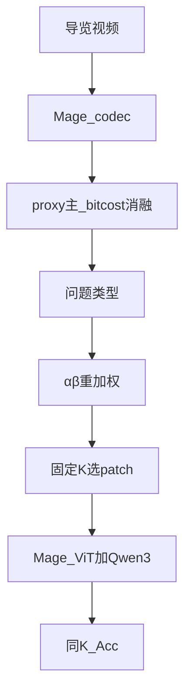

# Mage Query-IP：按问题调 codec 选区（定稿）

> **日期：** 2026-10-15（修订：2026-10-21）  
> **状态：** **定稿 · 主推 `queryip`（proxy）**；K 扫描已完成（0.3–0.75 赢 random，0.9 不赢）。  
> **命令：** [`VQA/Explore-Then-Select/COMMANDS.md`](../VQA/Explore-Then-Select/COMMANDS.md)  
> **产物：** [`VQA/eval_results/README.md`](../VQA/eval_results/README.md) · 做图 [`ksweep_proxy/`](../VQA/eval_results/queryip_samek/ksweep_proxy/)  
> **路线 A：** 已归档 → [`PLAN_routeA_true_mv.md`](PLAN_routeA_true_mv.md)

---

## 0. 贡献与口径（必读）

**一句话：** 在**已经减 token** 的固定预算 K 下，按问题类型重加权选 patch，比同预算乱砍（prefix / random）更准；**不重训**；**不声称**超过满预算 Mage。

**场景：** 景区导览边拍边问——手持晃动多、算力有限；静态题少被 ego-motion 占满预算（对齐 [`thesis.md`](thesis.md) / 毕设：Mage「看懂」支路）。

**主推分数源：** 像素 **proxy**（`queryip`）。官方 bitcost / hybrid = **失败消融**（附录）。开放栈无真 MV+残差。

| 问题倾向 | 权重 | 效果 |
|----------|------|------|
| 静态（纹饰、题记、材质） | 压低运动/高代价分 | 少被晃动占满 K |
| 动态（人流、仪式、动作） | 抬高运动分 | 更保留变化区 |

```text
# 主推
score' = α(q) · motion ± β(q) · residual_proxy   （static 对 motion 取反）
→ 预算 K 内 top-K → 稠密打包 → Mage-ViT + Qwen3

# 消融（不作主推）
score' = α(q) · s_bit   （或 hybrid：miss→proxy）
```

| 项 | 决定 |
|----|------|
| 主创新 | 问题类型 → 重加权选区，固定 K |
| QuoTA / FlexSelect / 真 MV / ego-motion 估参 | 可选或**不做** |
| Cultural LoRA | 新选区前向就绪后再训（另文） |
| 同 K 全量 714 | **不建议**（n=200 已够） |

**实现注：** 第二刀只在 Mage codec **已留下的** canvas patch 上再砍到 K。上界是同 K 优于乱砍，不是拉回满预算 Short ~75%。

---

## 1. 与毕设三路的关系

| 路 | 职责 | 本文件 |
|----|------|--------|
| 3DGS | 呈现数字资产 | 否 |
| 定位 | 手机视角 ↔ 3D 区域 | 否 |
| Mage | 看懂 / 问答 | **是（仅选区）** |

缺视角仍靠 3DGS + 定位。本方法只服务：**现场少 token 时仍尽量答对**。

---

## 2. 主表结果（2026-10-21 定稿）

### 2.1 同 K 消融（主贡献证据）

`keep_ratio=0.75`；short 前 **200** 题。目录：[`queryip_samek/n200/`](../VQA/eval_results/queryip_samek/n200/)

| 同 K | Acc | 题数 |
|------|-----|------|
| prefix | 57.5% | 115/200 |
| random | 59.5% | 119/200 |
| **queryip（proxy）· 主推** | **64.0%** | **128/200** |
| bitcost 纯 | 58.5% | 117/200 |
| bitcost hybrid | 58.0% | 116/200 |

Δ(queryip − random)=**+4.5 pp**。bitcost / hybrid 均 **低于** random → 失败消融。

配套闸门：soccer `SAMEK4_OK`；n=60 弱正（61.7 vs random 58.3）→ 以 n=200 为准。

### 2.2 行 A / 行 B（效率旁证 · 非同 K）

| 设置 | overall | Short | 相对 token |
|------|---------|-------|------------|
| A. 默认 Mage（满 codec） | **63.7%** | 75.8% | 1.00× |
| B. QueryIP `keep_ratio=0.75`（非同 K） | **62.3%** | 75.3% | **≈0.75×** |

Δ(B−A) overall **−1.4**：略降 Acc 换更少 token，**不能**写成「同预算涨点」。同预算故事看 §2.1。

产物：[`baseline_mage/`](../VQA/eval_results/baseline_mage/) · [`queryip_rowB_full/`](../VQA/eval_results/queryip_rowB_full/)

### 2.3 Proxy keep_ratio 扫描（Acc–K 曲线 · 已完成）

目录：[`queryip_samek/ksweep_proxy/`](../VQA/eval_results/queryip_samek/ksweep_proxy/)  
**做图用：** `plot_acc_vs_keep_ratio.csv` / `plot_acc_long.csv`（勿删）。

| keep_ratio | prefix | random | queryip | Δ(q−rand) |
|------------|--------|--------|---------|-----------|
| 0.30 | 53.0% | 51.5% | **55.5%** | +4.0 |
| 0.50 | 53.0% | 57.0% | **61.0%** | +4.0 |
| 0.75 | 57.5% | 59.5% | **64.0%** | **+4.5** |
| 0.90 | 58.0% | **61.5%** | 60.5% | **−1.0** |

**结论：** 0.3～0.75 queryip 稳赢 random；**0.9 优势消失**（略低于 random）。叙事 =「受限预算下有用」，**禁止**写全程碾压。主卖点仍是 §2.1 的 0.75。

### 2.4 写论文 / 答辩不要写

- 超过满预算 Mage；Video-MME overall 硬涨点  
- 「使用了 codec 真 MV」；主推官方 bitcost  
- keep_ratio=0.9 上「queryip 仍优于 random」  

---

## 3. 方法要点（实现）

```text
encode_codec → score_patches(proxy|bitcost) → α/β(q) → top-K → dense pack → generate
modes: prefix | random | queryip | queryip_bitcost
```

- 代码：[`VQA/Explore-Then-Select/mage_query_ip/`](../VQA/Explore-Then-Select/mage_query_ip/)（**不改** `mage_vl`）  
- 模型名：`Mage-VL`（行 A）/ `Mage-VL-QueryIP`（行 B）  
- 说明：[`README_MAGE_QUERY_IP.md`](../VQA/Explore-Then-Select/README_MAGE_QUERY_IP.md)



冒烟（soccer，`SMOKE_OK`）：同 K 下 static/dynamic kept 不同；`SAMEK_OK` / `SAMEK4_OK` 见 `eval_results/queryip_samek/soccer/`。

---

## 4. 后续预案

| 优先级 | 项 | 状态 | 说明 |
|--------|----|------|------|
| — | proxy keep_ratio 扫描 | **已完成** | §2.3；数据 `ksweep_proxy/` |
| P1 | 论文图：Acc vs keep_ratio | 待画 | 用 `plot_acc_*.csv` |
| P2 | **效率曲线：满 token Mage vs 减 token** | **预案 · 未做** | 见 **§5**；可复用 ksweep |
| P3 | SEED=1 @0.75 n=200 | 可选 | 加固 |
| P4 | Cultural LoRA（接新选区前向） | 延期 | [`PLAN_mage_cultural_lora_location.md`](PLAN_mage_cultural_lora_location.md) |
| — | 同 K 全量 714；主推 bitcost；真 MV；FlexSelect | **不做** | — |

---

## 5. 预案：满 token Mage ↔ 减 token 效率曲线（后续再做）

> **目的：** 补一条「不用 QueryIP 选区、满 / 分级 token」相对「QueryIP 同预算」的效率叙事。  
> **不是**今天主贡献（主贡献已是同 K：queryip > random）。  
> **Agent 不代跑。**

### 5.1 要回答的问题

在同一批题上：

1. **满预算默认 Mage**（行 A 口径）Acc 与 Avg #vis-token  
2. **无问题条件化、只砍到 K**（prefix 或 random @ 多个 `keep_ratio`）Acc–token  
3. **QueryIP proxy @ 同一组 K** Acc–token  

期望读图：QueryIP 曲线在多数 K 上 **不低于** 同 K 的 random/prefix；相对满预算 Mage，用略降或持平 Acc 换 token（行 B 已有单点 0.75×）。

### 5.2 建议协议（省墙钟）

| 项 | 建议 |
|----|------|
| 子集 | 先 **short 前 200**（与主表对齐）；不要一上来 714 |
| K 点 | 与 ksweep 对齐：`0.3 / 0.5 / 0.75 / 0.9` + **满预算**（`keep_ratio=1.0` 或关闭第二刀） |
| 模式 | `mage_full`（或 prefix@1.0）· `random` · `queryip`；**不要**再带 bitcost |
| 指标 | Acc、Avg #vis-token、相对满预算 token 比；可选墙钟 |
| 产物目录 | `VQA/eval_results/queryip_samek/efficiency_curve/` |
| 复用 | `ksweep_proxy` 已有 0.3/0.5/0.75/0.9 的 random/queryip；**只补满预算 Mage 一点**即可拼曲线 |

### 5.3 判定口径

- 曲线服务于「部署可省 token」；**禁止**写成「全面超过满预算 Mage」。  
- 若某 K 上 queryip ≤ random：该 K 不写进卖点，或只报 n=200 主表 0.75。

### 5.4 命令形态（占位 · 脚本可后补）

```bash
# 满预算一点（示例；具体 flag 以实现为准）
# N=200 KEEP_RATIO=1.0 MODES=prefix ./...  或单独 Mage-VL 短评

# 减 token 多 K：优先复用 / 续跑
./VQA/Explore-Then-Select/scripts/eval_proxy_ksweep.sh   # 已有 0.3/0.5/0.9
# 再补满预算 Mage Acc，合并进 efficiency_curve CSV
```

---

## 6. 实验条件

| 项 | 值 |
|----|-----|
| GPU | 4090 D 24GB |
| 环境 | `VLMEvalKit/vlmeval_env` |
| 推理 | codec + HEVC；32 frame；`max_pixels≈150000` |
| 主表 K | `keep_ratio=0.75` |

---

## 7. 阶段摘要

```text
[定稿] queryip proxy；n=200：64.0 > random 59.5；bitcost 失败消融
[已完成] 冒烟；SAMEK4；行 B 62.3%；proxy K 扫描（0.3–0.75 赢，0.9 不赢）；路线 A 归档
[待画]   Acc–K 图（ksweep_proxy/plot_acc_*.csv）
[预案]   §5 满 token Mage 效率曲线（后续）
[延期]   Cultural LoRA
[不做]   同 K×714；主推 bitcost；真 MV；FlexSelect
```

---

## 附录 A · 简要过程备忘（可略读）

| 阶段 | 要点 |
|------|------|
| Soccer 冒烟 | `SMOKE_OK`：同 K 下 static/dynamic kept 不同 |
| 行 B 全量 | 62.3%、≈0.75× token；qtype 偏 dynamic，遗产静态动机在本榜弱 |
| 同 K n=60 | queryip 61.7 > random 58.3（噪声大） |
| bitcost 双模式 | n=200 纯/hybrid 均 ≤ random → 不作主推 |
| 路线 A | 开放栈无分开的 MV+残差；归档见 `PLAN_routeA_true_mv.md` |
| proxy K 扫描 | 0.3–0.75 赢 random；0.9 略负 → 受限 K 叙事 |
