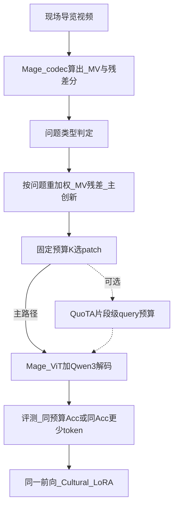

# Mage 按问题调 I/P 配额（Query-aware codec 选区）— 实验计划

> **日期：** 2026-10-15（修订：突出「问题类型 × Mage MV/残差重加权」）  
> **状态：** 设计定稿；实现与评测待启动。  
> **范围：** 仅 `VQA/mage_vl` 选区前向；不改 3DGS / 定位主线；不做新 KV / 记忆系统。  
> **顺序：** ① 本选区落地并评测 Base → ② 同一前向再训 Cultural LoRA（见 [`PLAN_mage_cultural_lora_location.md`](PLAN_mage_cultural_lora_location.md)）。

---

## 0. 锁定方案（必读 · 主创新）

**简单版（推荐，本计划只做这一档）：**

> Mage 已有 **运动向量（MV）与残差（residual）评分**，不必从零开发。  
> 根据**问题类型**，**动态调整**这两路分数的权重，再在固定总 token 预算下做 patch 选留。  
> **不重训** Mage-ViT / LLM；实现难度不大；叙事是「Query × codec 联合评分」，不是两库硬拼接。

| 问题倾向 | 权重倾向 | 效果 |
|----------|----------|------|
| 静态细节（纹饰、题记、材质） | **压低** MV/残差权重（或相对抬高 I/锚帧、低运动区） | 少被 ego-motion / 晃动背景占满预算 |
| 动态事件（人流、仪式、动作） | **抬高** MV/残差权重 | 更保留真正变化的 P patch |

```text
score' = α(q) · score_MV + β(q) · score_residual
         （α、β 由问题类型决定；实现时可用离散两档或简单规则表）
→ 在预算 K 内按 score' 选 patch（I 帧策略与 Mage 默认兼容，见实现注）
```

| 项 | 决定 |
|----|------|
| 主创新 | 上式：**问题类型 → 重加权 Mage 已有 MV/残差**（ETS 的 query-adaptive 思想落在 codec 分数上） |
| QuoTA | **保持可选**（流程图虚线；时间够再加片段级预算） |
| Cultural LoRA | 新选区就绪后、同一前向再训 |
| FlexSelect / 新记忆系统 / 完整 ego-motion 估参 | **不做**（见 §7） |

**实现注（避免踩坑）：** Mage 默认常「I 帧全留」；静态题若只改 `patch_positions` 而不动锚帧/帧间预算，I 侧可能加不上去。落地时优先改 **MV/残差权重与 P 侧 top-k**，必要时再调锚帧密度或 I/P 帧间预算比——仍不重训。

---

## 1. 背景（解决什么问题）与题目关系

题目见 [`thesis.md`](thesis.md)（仓外原文 `/root/autodl-tmp/毕设.md`）：

> 受限采集下的 3DGS 三维重建方法以及在文化遗产数字展示中的应用研究

系统三路：

| 路 | 职责 | 本文件是否覆盖 |
|----|------|----------------|
| 3DGS | 「呈现」：稀疏/拍不全 → 可漫游数字资产 | 否（拍不全/缺视角仍归此路） |
| 定位 | 「对上」：手机视角 ↔ 3D 资产区域 | 否 |
| Mage | 「看懂」：现场视频 → 导览问答 | **是（仅选区）** |

**本文件只补 Mage 看懂侧的缺口：**

- 景区手持拍摄时，「运动」多半是摄像者在动（ego-motion），不是文物在动。
- Mage codec 粗筛保留的是「相对上一帧变了的 patch」，**不等于**「对当前问题有用的 patch」。
- 因此：保留 codec 减 token，再在接缝上按**问题类型重加权 MV/残差**（遗产/静态题压运动分、偏保细节）——见 **§0**。

**明确不声称：** 用选区解决「有些视角拍不到」——缺视角仍靠 3DGS + 定位进 3D。

**边界：** 不做实时；长视频非优先；不做新滑动窗口 / KV / 记忆系统（沿用 Mage 现成窗与 gate 即可）。

---

## 2. 核心思路

> 细节与公式以 **§0** 为准；本节展开流程与依赖关系。

### 2.1 一句话

```text
Mage codec（保留 MV / residual 分数）
  + 按问题类型重加权 α(q)·MV + β(q)·residual，固定预算 K 选 patch  ← 主创新（简单版）
  ± QuoTA 片段级 query 预算（可选）
  ✗ FlexSelect 不做
→ 同一前向再 Cultural LoRA
```

### 2.2 接缝规则（与 §0 同一套）

| 问题倾向 | 对 Mage 已有分数做什么 | 典型问法 |
|----------|------------------------|----------|
| 静态细节（纹饰、题记、材质、形制） | **降低** MV/残差权重（静态偏细节 / 偏 I） | 「这块纹样是什么」「碑上写了什么」 |
| 动态事件（人流、仪式、明显动作） | **提高** MV/残差权重（动态偏 P） | 「刚才谁走过」「仪式怎么进行」 |

- 不重训；ETS 只提供「按问题调 static/dynamic」的思想，**分数来自 Mage codec**，联合加权是本仓接缝。
- 「你走不走」≠「该抬 MV」：走路是采集状态；权重由**问题类型**决定。
- 通用榜不承诺硬涨点；主打 **同预算 Acc / 同 Acc 更少 token** + `heritage_zh`。

### 2.3 方法流程图

主路径实线；QuoTA 为可选虚线。



---

## 3. 依赖的已有工作

| 组件 | 定位 | 作用 / 提供什么 | GitHub / 路径 |
|------|------|-----------------|---------------|
| **Mage-VL codec** | 底座粗筛（保留） | I 全 patch、P 按 MV/residual 稀疏；>75% 减 token；codec+HEVC / 流式接口 | https://github.com/microsoft/Mage ；本地 [`VQA/mage_vl/`](../VQA/mage_vl/) |
| **Explore-Then-Select** | 思想来源（非原样搬代码） | query-adaptive static/dynamic；本仓落成「问题类型 → 重加权 Mage MV/残差」 | https://github.com/ANDgate99/Explore-Then-Select |
| **QuoTA** | **可选**（流程图虚线，保持可选） | 用户提问时片段/帧级 query 预算 | https://github.com/MAC-AutoML/QuoTA |
| **Cultural LoRA（本仓）** | 域适配（排在选区后） | 冻 `model.visual`，只训 LLM LoRA；MSVD 8k + CiQi 16k | [`VQA/mage_vl/cultural_lora/`](../VQA/mage_vl/cultural_lora/)；计划 [`PLAN_mage_cultural_lora_location.md`](PLAN_mage_cultural_lora_location.md) |
| FlexSelect | **不做** | — | 见 §7 |

**本地接入点（实现时）：**

- [`VQA/mage_vl/inference_base.py`](../VQA/mage_vl/inference_base.py)、[`inference_streaming.py`](../VQA/mage_vl/inference_streaming.py)：`codec_config`（`patch=16`、`max_pixels`）；在 **MV/残差打分之后、最终选 patch 之前** 插入 §0 重加权（勿只当改 `patch_positions` 的事后掩码）
- 评测壳：[`VQA/VLMEvalKit/vlmeval/vlm/mage_vl.py`](../VQA/VLMEvalKit/vlmeval/vlm/mage_vl.py)
- 评测硬约束：对比组 **总 token 预算对齐**；记录真实墙钟耗时 + Avg #vis-token

---

## 4. 依赖的数据集、权重与产物

### 4.1 权重

| 项 | 路径 / 来源 |
|----|-------------|
| Mage-VL 基座 | `VQA/mage_vl/models/`（HF `microsoft/Mage-VL`，`local_files_only`） |
| Cultural LoRA | 仅存 `adapter/`；**须在新选区前向下重训**后才进主表 |

### 4.2 训练数据（LoRA，选区就绪后）

| 数据 | 用量 | 路径 |
|------|------|------|
| MSVD-QA | 8k QA | `VQA/mage_vl/data/MSVD-QA/train_8k/` |
| CiQi-VQA | 16k | `VQA/mage_vl/data/CiQi-VQA/`（`train_16k.jsonl`） |
| 合计磁盘（基座+子集） | ≈ **18.6 G** | 见 Cultural LoRA 计划 |

### 4.3 评测数据

| 集 | 用途 | 状态 |
|----|------|------|
| **Video-MME**（codec+HEVC，32frame） | 通用对照；效率/消融 | Base overall **63.7%** 已有 → [`VQA/eval_results/Video-MME.md`](../VQA/eval_results/Video-MME.md) |
| **OmniVDCBench `heritage_zh`** | 域内主表（纹饰/静态题更易见差别） | 待跑 |
| 效率日志 | Avg #视觉 token、相对默认 Mage 的 token 比 | 实现时在前向统计 |

---

## 5. 预估实验表

**主结论写法：** 同 token 预算下比准确率，或同准确率下比更少 token。  
**不承诺** Video-MME 硬涨 1–2 点；差别优先看 `heritage_zh`。

| 设置 | Video-MME overall | Short | Medium | Long | heritage_zh Acc | Avg #vis-token | 相对 token 比 |
|------|-------------------|-------|--------|------|-----------------|----------------|---------------|
| A. 默认 Mage codec | **63.7%**（已有） | 75.8% | 63.6% | 52.7% | 待测 | 待测 | 1.00× |
| B. A + 问题类型重加权 MV/残差（主·§0） | 待测 | 待测 | 待测 | 待测 | 待测 | 待测 | 待测 |
| C. B + QuoTA（可选） | 待测 | 待测 | 待测 | 待测 | 待测 | 待测 | 待测 |
| D. B（或 C）前向 + Cultural LoRA | 待测 | 待测 | 待测 | 待测 | 待测 | 待测 | 待测 |

建议消融（实现后补行）：**固定总 token 预算**对齐的 B vs A（必做）；墙钟耗时；仅静态题子集上的 B vs A。

---

## 6. 实验条件（单卡 4090D）

摘自 [`reproduction/README.md`](reproduction/README.md) 与 Cultural LoRA 计划。

| 项 | 值 |
|----|-----|
| GPU | NVIDIA GeForce RTX **4090 D 24GB** |
| 评测 / 训练环境 | `VLMEvalKit/vlmeval_env`（PyTorch 2.11+cu128 等，见 `envs/requirements-vlmevalkit.txt`） |
| 推理设定（对齐已有 Video-MME） | codec + HEVC；**32 frame**；`max_pixels ≈ 150000` |
| LoRA 训练 knobs | bf16；gradient checkpointing；`max_seq_len=3072`；超长则减帧/降 `max_pixels`，**不裁答案** |
| LoRA 冒烟（参考） | 1000 step ≈ **11.5 min**；adapter ≈ **132 MB** |
| LoRA 全量 1 epoch（延期估） | **5–12 h** / 卡 |
| 新选区额外权重 | **无**（仅 α/β 规则重加权；不另存大模型） |
| 显存策略 | 24GB 内：推理按现网 Mage；训练开 grad ckpt；OOM 时降 `max_pixels` / 帧数 |

---

## 7. 文末注释（后续可再想）

### 7.1 明确不做：FlexSelect

- 固定总 token 下再按 LLM attention 精筛；在他模上有 Video-MME 涨点叙事，但接到 Mage 性价比低，且本计划不追通用榜硬涨点。
- GitHub（备查）：https://github.com/yunzhuzhang0918/flexselect

### 7.2 后续注释：ego-motion（本计划不做模块）

景区「运动≈人在动」是问题动机，可写进论文背景。  
**完整 ego-motion 估参 / 全局光流降权模块本计划不做**；是否另开设计留给后续再想。

### 7.3 与 Cultural LoRA 计划的互锁

[`PLAN_mage_cultural_lora_location.md`](PLAN_mage_cultural_lora_location.md) 已规定：不在默认 Mage 选区上跑正式全量 LoRA。  
本文件产出的新选区前向，才是正式 LoRA 与 `heritage_zh` / Video-MME 复测的前提。

---

## 8. 阶段（摘要）

```text
[进行中] §0：问题类型重加权 Mage MV/残差 + 固定预算选 patch → Base 评测（表 §5 行 B）
[可选]   QuoTA 片段预算（表 §5 行 C）——保持可选，不挡主线
[延期]   同一前向 Cultural LoRA 全量 + heritage_zh / Video-MME（行 D）
[不做]   FlexSelect；新记忆/KV 系统；完整 ego-motion 估参模块
```
