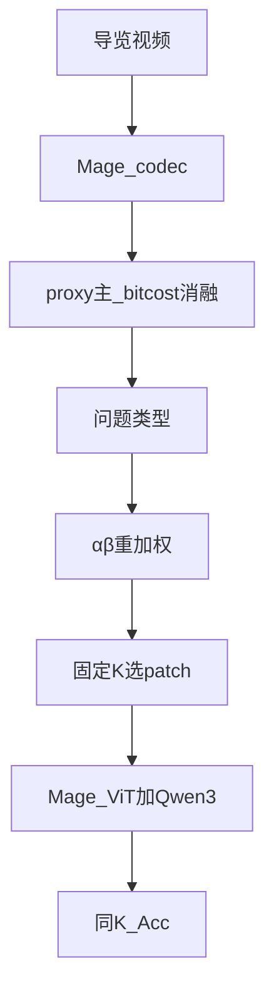

# Mage Query-IP：按问题调 codec 选区（定稿）

> **日期：** 2026-10-15（修订：2026-10-23 · **结论定稿**）  
> **状态：** **主推 `queryip`（proxy · 63.5%）**；CLIP 语义选区 / bitcost / 题型 α/β **均失败或不作贡献**；**停 QueryIP「CLIP 重排区域」路线**。  
> **命令 / 产物：** [`COMMANDS.md`](../VQA/Explore-Then-Select/COMMANDS.md) · [`eval_results/`](../VQA/eval_results/README.md)  
> **后续优先：** §8.1 McNemar · Acc–K 图 · 失败消融表 ·（可选）§5 效率曲线；Cultural LoRA 后置。  
> **不做：** 真 MV 路线 A · 完整 v2 · 扩大 CLIP 选区 · 同 K×714。

---

## 结论与后续（2026-10-23）

### 结论

| 结论 | 说明 |
|------|------|
| **主推** | 同 K 下 proxy `queryip` > random（复现 **63.5% vs 59.5%**；主表目录曾 64.0%） |
| **停语义选区** | 帧 CLIP / 宽池 v1 / 边界 edge 均伤底或 shuffle 反向；**不值得继续** |
| **否定范围** | 否定「用 CLIP 相似度重排局部区域」这套方法，**不是**一切语义引导 |
| **不作贡献** | 题型 α/β、官方 bitcost、完整 v2 ρ |
| **真 MV（路线 A）** | 开放栈无分开 MV+残差；**不做**（短注已删，口径见此行） |

### 后续需补（按优先级）

1. **McNemar**（§8.1）：`queryip` vs `random` 逐题配对（`clip_frame_n200` jsonl）  
2. **失败消融表定稿**（§8.2）进论文  
3. **Acc–K 图**（§8.3）：已有 `ksweep_proxy/plot_acc_*.csv`  
4. （可选）**效率曲线**（§5）：补满预算 Mage 一点 + ksweep  
5. 后置：流式 / Cultural LoRA  

---

## 0. 贡献与口径（必读 · 2026-10-23 修订）

**一句话（现行）：** 在**已经减 token** 的固定预算 K 下，用 Mage codec **像素 proxy**（运动 / 残差）对候选 patch 排序再 top-K，比同预算 **random / prefix** 更准；**不重训**；**不声称**超过满预算 Mage。

**保留：** `queryip`（proxy 选区）。同跑复现：相对 random **约 +4.0 pp**（63.5% vs 59.5%，[`clip_frame_n200/`](../VQA/eval_results/queryip_samek/clip_frame_n200/)）；主表目录曾报 +4.5（64.0%）。**点估计已有，配对显著性尚未做**（§8.1）。

**暂时不作为贡献：**

| 项 | 证据 | 口径 |
|----|------|------|
| Static/Dynamic **α/β 自适应**（关键词题型） | E2：`queryip`≡`queryip_dyn`=63.5%；`queryip_sta`=64.0%（+1 题） | **不作贡献**；论文勿主推「按问题调 α/β」 |
| CLIP 帧级预算 `queryip_clip` | 58.5% < random | **失败消融** |
| 区域语义 v1（宽池+2×2 CLIP） | B=58.5% / C=60.5% vs A=63.5%；B−C=−2.0pp | **失败消融** |
| 边界 edge（冻结+ band CLIP） | B=60.0% / C=62.0% vs A=63.5%；B−C=−2.0pp | **失败消融**；**停语义选区路线** |
| 官方 bitcost / hybrid | ≤ random | **失败消融** |

**场景（动机可写，勿绑死题型开关）：** 景区导览边拍边问——算力紧、须减 token；第二刀在 codec 候选上保留变化/结构区（对齐 [`thesis.md`](thesis.md)）。

```text
# 主推（现行叙事）
score = w_m · motion + w_r · residual_proxy   # 默认可固定 dynamic 权重
→ 同预算 K top-K → 稠密打包 → Mage-ViT + Qwen3
# 对照：同 K random / prefix

# 已否决 / 不作贡献（QueryIP 语义选区路线停）
α(q)/β(q)；CLIP 帧预算；区域 v1；边界 edge；官方 bitcost；完整 v2 ρ
# 注意：否定的是「CLIP 相似度重排区域」这套方法，不是一切语义引导
```

| 项 | 决定 |
|----|------|
| 主创新（现行） | **同 K 下 proxy 选区 > 乱砍**（**63.5%**） |
| 题型 α/β / CLIP **帧** / 区域 v1 / **edge** | **不作贡献**；**停 QueryIP 语义选区** |
| 其他语义机制（非 CLIP 重排） | **未否定**；无新假设前不继续试错 |
| Cultural LoRA | 后置（景区另贡献） |
| 同 K 全量 714 | **不做** |

**实现注：** 第二刀只在 Mage codec **已留下的** canvas patch 上再砍到 K。上界是同 K 优于乱砍，不是拉回满预算 Short ~75%。

---

## 1. 与毕设三路的关系

| 路 | 职责 | 本文件 |
|----|------|--------|
| 3DGS | 呈现数字资产 | 否 |
| 定位 | 手机视角 ↔ 3D 区域 | 否 |
| Mage | 看懂 / 问答 | **是（仅选区）** |

缺视角仍靠 3DGS + 定位。本方法只服务：**现场少 token 时仍尽量答对**。

---

## 2. 主表结果（2026-10-21 定稿）

### 2.1 同 K 消融（主贡献证据）

`keep_ratio=0.75`；short 前 **200** 题。目录：[`queryip_samek/n200/`](../VQA/eval_results/queryip_samek/n200/)

| 同 K | Acc | 题数 |
|------|-----|------|
| prefix | 57.5% | 115/200 |
| random | 59.5% | 119/200 |
| **queryip（proxy）· 主推** | **64.0%** | **128/200** |
| bitcost 纯 | 58.5% | 117/200 |
| bitcost hybrid | 58.0% | 116/200 |

Δ(queryip − random)=**+4.5 pp**（本目录点估计）。bitcost / hybrid 均 **低于** random → 失败消融。  
**注意：** 2026-10-23 同设定复现（[`clip_frame_n200/`](../VQA/eval_results/queryip_samek/clip_frame_n200/)）为 queryip **63.5%** / random **59.5%**（**+4.0 pp**）；对外可写「约 +4 pp」，显著性见 §8.1。

配套闸门：soccer `SAMEK4_OK`；n=60 弱正（61.7 vs random 58.3）→ 以 n=200 为准。

### 2.2 行 A / 行 B（效率旁证 · 非同 K）

| 设置 | overall | Short | 相对 token |
|------|---------|-------|------------|
| A. 默认 Mage（满 codec） | **63.7%** | 75.8% | 1.00× |
| B. QueryIP `keep_ratio=0.75`（非同 K） | **62.3%** | 75.3% | **≈0.75×** |

Δ(B−A) overall **−1.4**：略降 Acc 换更少 token，**不能**写成「同预算涨点」。同预算故事看 §2.1。

产物：[`baseline_mage/`](../VQA/eval_results/baseline_mage/) · [`queryip_rowB_full/`](../VQA/eval_results/queryip_rowB_full/)

### 2.3 Proxy keep_ratio 扫描（Acc–K 曲线 · 已完成）

目录：[`queryip_samek/ksweep_proxy/`](../VQA/eval_results/queryip_samek/ksweep_proxy/)  
**做图用：** `plot_acc_vs_keep_ratio.csv` / `plot_acc_long.csv`（勿删）。

| keep_ratio | prefix | random | queryip | Δ(q−rand) |
|------------|--------|--------|---------|-----------|
| 0.30 | 53.0% | 51.5% | **55.5%** | +4.0 |
| 0.50 | 53.0% | 57.0% | **61.0%** | +4.0 |
| 0.75 | 57.5% | 59.5% | **64.0%** | **+4.5** |
| 0.90 | 58.0% | **61.5%** | 60.5% | **−1.0** |

**结论：** 0.3～0.75 queryip 稳赢 random；**0.9 优势消失**（略低于 random）。叙事 =「受限预算下有用」，**禁止**写全程碾压。主卖点仍是 §2.1 的 0.75。

### 2.4 写论文 / 答辩不要写

- 超过满预算 Mage；Video-MME overall 硬涨点  
- 「使用了 codec 真 MV」；主推官方 bitcost  
- keep_ratio=0.9 上「queryip 仍优于 random」  
- 「CLIP 帧预算进一步涨同 K Acc」  
- 「Static/Dynamic α/β 自适应是核心贡献」（E2 已否）  
- 在未做配对检验前写「显著优于 random」（§8.1 待补）  

### 2.5 阶段 2 · CLIP 帧预算同 K（2026-10-23 · **失败消融 · 已归档**）

目录：[`queryip_samek/clip_frame_n200/`](../VQA/eval_results/queryip_samek/clip_frame_n200/)  
`summary_n200_kr075_clip.json` · `partial=false` · n=200 · `keep_ratio=0.75` · `seed=0`。

| 同 K | Acc | 题数 |
|------|-----|------|
| ★ E1 random | 59.5% | 119/200 |
| ★ E0 queryip（proxy）· **保留** | **63.5%** | **127/200** |
| ★ E4 queryip_clip | **58.5%** | **117/200** |

| 对比 | Δ |
|------|---|
| queryip − random | **+4.0 pp**（点估计；显著性见 §8.1） |
| queryip_clip − random | **−1.0 pp** |
| queryip_clip − queryip | **−5.0 pp** |

逐题：clip≠queryip **35**；改对 6 / 改错 16，净 −10。  
**结论：** E4 失败 → **不做方案 B**。产物保留作失败消融。

### 2.6 α/β 三角对照 E2（2026-10-23 · **题型开关不作贡献 · 已归档**）

目录：[`queryip_samek/ab_fixed_n200/`](../VQA/eval_results/queryip_samek/ab_fixed_n200/)  
`summary_n200_kr075_ab.json` · `partial=false` · modes=`queryip,queryip_dyn,queryip_sta`。

| 同 K | Acc | 题数 |
|------|-----|------|
| queryip（关键词题型） | 63.5% | 127/200 |
| queryip_dyn（强制 DYNAMIC） | 63.5% | 127/200 |
| queryip_sta（强制 STATIC） | 64.0% | 128/200 |

**判定（对 §4.4.3 门槛）：**

| 预期 | 实测 |
|------|------|
| 若题型有用：`queryip` ≫ 固定路 | **否**：`queryip` ≡ `queryip_dyn` |
| 若运动优先：`dyn` ≫ `sta` | **否**：`sta` 反多 1 题（噪声级） |

**结论：** Video-MME short@0.75 上，**Static/Dynamic α/β 自适应不构成贡献**；与 random 的 +4pp 来自 **proxy 排序本身**（三路 Acc 均落在 63.5–64.0）。实现可继续默认 dynamic 权重；论文贡献句勿写题型开关。

---

## 3. 方法要点（实现）

```text
encode_codec → score_patches(proxy|bitcost) → α/β(q) → top-K → dense pack → generate
modes: prefix | random | queryip | queryip_bitcost
```

- 代码：[`VQA/Explore-Then-Select/mage_query_ip/`](../VQA/Explore-Then-Select/mage_query_ip/)（**不改** `mage_vl`）  
- 模型名：`Mage-VL`（行 A）/ `Mage-VL-QueryIP`（行 B）  
- 说明：[`README_MAGE_QUERY_IP.md`](../VQA/Explore-Then-Select/README_MAGE_QUERY_IP.md)



冒烟（soccer，`SMOKE_OK`）：同 K 下 static/dynamic kept 不同；`SAMEK_OK` / `SAMEK4_OK` 见 `eval_results/queryip_samek/soccer/`。

---

## 4. 阶段 2 核心方案：问题感知二次选区（重点）

> **研究问题（差异化）：** 在 Mage-VL **codec-native 稀疏候选**上，将 **Query–Patch / 帧级语义相关性** 与 **像素变化（proxy codec）信号** 结合，做问题驱动的二次选区，在**固定视觉 Token 预算**下减少关键证据遗漏。  
> **不是**又一篇通用 ETS / QuoTA /「把 CLIP 塞进选区」；也不否定 §2 已有 n=200 主表——阶段 2 是**加固机制证据**。  
> **总顺序：** 离线选区扎实 → 再流式；**Cultural LoRA 后置**（景区/中文，不与 Video-MME 选区涨点混谈）。

### 4.0 为何必须升级（现状风险）

| 风险 | 说明 |
|------|------|
| 关键词几乎全 `dynamic` | `question_type.py` 使 Query-IP **易退化成固定打分**；只压 random 不够 |
| 机制证据不足 | 须压过 **固定 α/β**；最好再有语义分支独立贡献 |
| 外部工作已占坑 | ETS（EMNLP’25）、QuoTA（AAAI’26）、Vista-LLM（粗到细+上下文）→ 必须落在 **Mage codec 二次选区** |

**优先级（关心 Video-MME 同预算 Acc）：**  
① ~~CLIP 帧预算~~ **已否决（§2.5）** → ② α/β / 固定权重对照（可选）＞ ③ Cultural LoRA（景区另贡献）。

**分期：**

| 阶段 | 做什么 | 状态 |
|------|--------|------|
| A0 | CLIP 帧打分 + `queryip_clip` + 冒烟 | **完成** |
| E0/E1/E4 n=200 | 同 K Acc | **完成 · E4 失败** |
| E5 方案 B | 局部区域语义 | **不做**（E4 无增益） |
| 其后 | Acc–K 图 / §5 效率曲线 / LoRA / 流式 | 按需 |

**人工标注 100–200 题：** **可选诊断**，非阻塞；主证据用同 K Acc。  
**Scorer：** 先本地 CLIP \(q_t\)；仅当有增益再考虑 QuoTA 式小 LVLM。

### 4.1 介入点（不改 Mage-ViT / Qwen）

```text
encode_codec（Mage 第一刀 canvas）
  → [新] 问题感知：帧级预算 / 区域语义分
  → proxy codec 分（运动·残差代理）
  → 融合 top-K（固定总预算 K）→ 稠密打包
  → Mage-ViT + Qwen 生成
```

**CLIP 用法戒条：** 值得做低成本语义分支；**不要**第一版就把 CLIP 文本–图像相似度直接当每个 **16×16 patch** 的分数（上下文不足；复杂题上 CLIP 帧相关也不稳，见 A.I.R. 等讨论）。更稳：先 **帧级预算**，再 **多尺度局部区域** 语义。

### 4.2 方案 A（先做）：CLIP 帧级相关性 + 原有 codec 选区

1. 文本 Q（+选项可选）→ CLIP 文本编码；每帧 \(F_t\) → CLIP 图像编码。  
2. \(q_t=\cos(E_I(F_t),E_T(Q))\) → **帧级预算**：相关帧多分 K，并保留时间覆盖。  
3. **帧内**仍用现有 proxy codec 分 top-K。  

**验证：** 静物题（车颜色）不全靠运动；动作题仍能靠 codec。改动小、不训主干。

### 4.3 方案 B / 现 §9：局部区域语义 + codec 融合

> **执行版见 §9**（2026-10-23 拍板）。此处保留思路摘要。

1. **宽候选池 C**（\|C\|≥K），再在池上做区域语义——不能只在已筛剩的 K 里打分。  
2. 区域（2×2 / 4×4）CLIP ↔ 问题得 \(q_{\mathrm{region}}\)；与 proxy 融合（v1）或 **结构保底**分席（v2，Vista 弱仿）。  
3. **三臂：** codec-only / +真实 Q / +shuffle Q。  
4. **不做**帧 CLIP、**暂不** Q-Former；默认不落区域特征盘。

### 4.4 研发顺序与消融（同 K · Agent 不代跑 Acc）

| 步 | 做什么 | 目的 | 状态 |
|----|--------|------|------|
| **A0** | CLIP 帧打分 + `queryip_clip` + 冒烟 | 接口 | **完成** |
| **E0/E1/E4** | n=200 同 K | 帧语义是否涨 Acc | **完成 · E4 失败** §2.5 |
| **E2** | α/β 三角 | 题型开关有无贡献 | **完成 · 不作贡献** §2.6 |
| **E5 / §9** | 宽池 + 区域语义（Vista 弱仿） | 问题相关是否真增益 | **试验草案** · 先小规模 |
| **§8** | 必要消融补强 | 配对检验等 | **当前待办** |
| Cultural LoRA / 流式 | 景区 / 部署 | 后置 |

对照表（一律**相同视觉 Token 预算**）：

| ID | 方法 | 结果 |
|----|------|------|
| ★ E0 | Query-IP proxy | **63.5% · 保留主推** |
| ★ E1 | Random @ 同 K | 59.5%（Δ=+4.0 pp · 待配对检验） |
| ★ E2 | dyn / sta 固定 α/β | 63.5% / 64.0% → **题型不作贡献** |
| E3 | 仅 CLIP 帧级预算 | 不优先 |
| ★ E4 | Codec + CLIP 帧级 | **58.5% · 失败**（保留） |
| E5 / §9 | 宽池 + 区域语义 +（v2）结构保底 | **试验**；帧 CLIP / Q-Former **不做** |

产物：[`clip_frame_n200/`](../VQA/eval_results/queryip_samek/clip_frame_n200/) · [`ab_fixed_n200/`](../VQA/eval_results/queryip_samek/ab_fixed_n200/)。

### 4.4.1 有卡时命令（已跑完 · 备复现）

```bash
cd /root/autodl-tmp/Sparse-3DGS-heritage-VQA
export PATH="/root/autodl-tmp/VLMEvalKit/vlmeval_env/bin:$PATH"
export PYTHONPATH="VQA/mage_vl/models:VQA/Explore-Then-Select:${PYTHONPATH:-}"
export HF_HUB_OFFLINE=1

# --- A) 真 CLIP 冒烟（确认 q_t / 预算）---
python VQA/Explore-Then-Select/scripts/smoke_clip_frame_budget.py --with-wire --with-clip --device cuda

# --- B) short 前 200 同 K：E1/E0/E4（默认 --resume；逐题 append 可断点续）---
mkdir -p VQA/eval_results/queryip_samek/clip_frame_n200 VQA/eval_results/logs
pkill -f 'eval_short60_samek.py.*n200_kr075_clip' 2>/dev/null || true
nohup python VQA/Explore-Then-Select/mage_query_ip/eval_short60_samek.py \
  --n 200 \
  --keep-ratio 0.75 \
  --seed 0 \
  --modes random,queryip,queryip_clip \
  --outdir VQA/eval_results/queryip_samek/clip_frame_n200 \
  --tag n200_kr075_clip \
  --resume \
  > VQA/eval_results/logs/clip_frame_n200_nohup.out 2>&1 &
tail -f VQA/eval_results/logs/clip_frame_n200_nohup.out
```

看结果：`clip_frame_n200/*_summary_n200_kr075_clip.json`。判定门槛见 **§4.4.2**。

### 4.4.2 E0/E1/E4 判定（已归档）

| 判定项 | 结果 |
|--------|------|
| `queryip_clip` > `random`？ | **否**（58.5 < 59.5） |
| `queryip_clip` > `queryip`？ | **否**（58.5 < 63.5） |
| 是否进入方案 B（E5）？ | **否** |
| 论文口径 | CLIP 帧预算 = **失败消融**（与 bitcost 同类）；主卖点仍 §2.1 |

### 4.4.3 α/β 三角对照（E2 · **已归档**）

结果见 **§2.6**。复现命令见 [`COMMANDS.md`](../VQA/Explore-Then-Select/COMMANDS.md) §4。  
**口径：** Static/Dynamic α/β 自适应 **暂时不作为贡献**；保留 `queryip` 作为 proxy 选区入口（默认可等同 fixed-dyn）。

### 4.5 其它预案（次优先）

| 项 | 状态 |
|----|------|
| Acc–K 论文图 | 待画 · `ksweep_proxy/plot_acc_*.csv` |
| 满 token 效率曲线 | 预案 · **§5** |
| Cultural LoRA | 延期 · 另文 |
| 同 K×714 / bitcost / 真 MV / FlexSelect / CLIP 语义选区 / 题型 α/β / Q-Former / v2 | **不做** |
| §9 区域 CLIP（v1+edge） | **已失败归档**；停 QueryIP 语义选区 |

---

## 5. 预案：满 token Mage ↔ 减 token 效率曲线（后续再做）

> **目的：** 补一条「不用 QueryIP 选区、满 / 分级 token」相对「QueryIP 同预算」的效率叙事。  
> **不是**今天主贡献（主贡献已是同 K：queryip > random）。  
> **Agent 不代跑。**

### 5.1 要回答的问题

在同一批题上：

1. **满预算默认 Mage**（行 A 口径）Acc 与 Avg #vis-token  
2. **无问题条件化、只砍到 K**（prefix 或 random @ 多个 `keep_ratio`）Acc–token  
3. **QueryIP proxy @ 同一组 K** Acc–token  

期望读图：QueryIP 曲线在多数 K 上 **不低于** 同 K 的 random/prefix；相对满预算 Mage，用略降或持平 Acc 换 token（行 B 已有单点 0.75×）。

### 5.2 建议协议（省墙钟）

| 项 | 建议 |
|----|------|
| 子集 | 先 **short 前 200**（与主表对齐）；不要一上来 714 |
| K 点 | 与 ksweep 对齐：`0.3 / 0.5 / 0.75 / 0.9` + **满预算**（`keep_ratio=1.0` 或关闭第二刀） |
| 模式 | `mage_full`（或 prefix@1.0）· `random` · `queryip`；**不要**再带 bitcost |
| 指标 | Acc、Avg #vis-token、相对满预算 token 比；可选墙钟 |
| 产物目录 | `VQA/eval_results/queryip_samek/efficiency_curve/` |
| 复用 | `ksweep_proxy` 已有 0.3/0.5/0.75/0.9 的 random/queryip；**只补满预算 Mage 一点**即可拼曲线 |

### 5.3 判定口径

- 曲线服务于「部署可省 token」；**禁止**写成「全面超过满预算 Mage」。  
- 若某 K 上 queryip ≤ random：该 K 不写进卖点，或只报 n=200 主表 0.75。

### 5.4 命令形态（占位 · 脚本可后补）

```bash
# 满预算一点（示例；具体 flag 以实现为准）
# N=200 KEEP_RATIO=1.0 MODES=prefix ./...  或单独 Mage-VL 短评

# 减 token 多 K：优先复用 / 续跑
./VQA/Explore-Then-Select/scripts/eval_proxy_ksweep.sh   # 已有 0.3/0.5/0.9
# 再补满预算 Mage Acc，合并进 efficiency_curve CSV
```

---

## 6. 实验条件

| 项 | 值 |
|----|-----|
| GPU | 4090 D 24GB |
| 环境 | `VLMEvalKit/vlmeval_env` |
| 推理 | codec + HEVC；32 frame；`max_pixels≈150000` |
| 主表 K | `keep_ratio=0.75` |

---

## 7. 阶段摘要

```text
[保留]   queryip proxy 同K > random（+4.0pp 复现；主表曾 +4.5）
[失败]   bitcost；CLIP帧E4；区域v1；边界edge → 停语义选区
[不作贡献] E2 α/β题型开关
[待办]   §8.1 McNemar；失败表；Acc–K图；（可选）§5
[后置]   Cultural LoRA / 流式
[不做]   真MV；v2；扩大CLIP选区；同K×714；Q-Former
```

---

## 8. 必要消融与后续 TODO（详细 · 保留 queryip）

> **原则：** 主方法继续叫 / 实现为 `queryip`（proxy top-K）。叙事收敛为「同 K proxy 选区」；**α/β 自适应不作贡献**。下列为论文/答辩前建议补齐项；Agent **不代跑**大评测，可只写脚本。

### 8.1 【优先】配对统计检验：queryip vs random

| 项 | 约定 |
|----|------|
| 目的 | 把「+4.0 pp」从点估计升到可报告的显著性 |
| 数据 | 首选同文件配对：[`clip_frame_n200/..._n200_kr075_clip.jsonl`](../VQA/eval_results/queryip_samek/clip_frame_n200/)（同题有 `random_pred` 与 `queryip_pred`） |
| 方法 | **McNemar 检验**（二项 / 连续校正）；报告 n、b、c、p 值；可选 bootstrap 95% CI for ΔAcc |
| 判据 | 预登记双侧 α=0.05；若 p≥0.05 → 正文写「点估计 +4pp，未达显著」勿硬吹 |
| 产物 | `eval_results/queryip_samek/stats_mcnemar_n200/`（json + 短 md） |
| 备注 | 主表 `n200/` 若与 clip 跑非同一次 forward，**不要混用非配对 Acc 做 McNemar** |

### 8.2 【建议】失败消融表定稿（已有数，整理进论文表）

一行表即可，目录均已落盘、勿删：

| 消融 | Acc | 目录 |
|------|-----|------|
| random | 59.5% | `clip_frame_n200/` |
| **queryip** | **63.5%** | 同上 |
| queryip_clip | 58.5% | 同上 |
| queryip_dyn / sta | 63.5% / 64.0% | `ab_fixed_n200/` |
| bitcost 纯/hybrid | 58.5% / 58.0% | `n200/` |

正文一句：增益来自 proxy；CLIP / bitcost / 题型开关均非增益源。

### 8.3 【建议】Acc–K 论文图

数据已在 [`ksweep_proxy/plot_acc_*.csv`](../VQA/eval_results/queryip_samek/ksweep_proxy/)。画出 prefix/random/queryip；标注 0.9 处 queryip 不赢。**不重跑**除非缺满预算点（见 §5）。

### 8.4 【可选 · 非阻塞】

| 项 | 说明 |
|----|------|
| qtype 分布统计 | 统计 short200 上 static vs dynamic 命中率，解释「为何 E2 无差」 |
| §5 效率曲线 | 补满预算 Mage 一点 + ksweep；非主贡献 |
| Cultural LoRA | 景区/中文另文；勿与 Video-MME +4pp 混谈 |
| 固定权重默认化 | 代码默认改成等价 `queryip_dyn`（减题型支路）；**行为应与现 Acc 对齐后再改** |

### 8.5 明确不做

同 K×714；主推 bitcost / 真 MV / FlexSelect；CLIP **帧**预算主推；把 α/β 自适应写成核心创新；未过 §9 闸门前把「Codec+语义」写成创新。

---

## 9. 试验：宽 Codec 候选池 + 区域级语义（Vista 弱仿）· **v1 失败归档**

> **日期：** 2026-10-23  
> **v1 结果（n=200 · 已归档）：** A `queryip` **63.5%**（127/200）· B `queryip_region` **58.5%**（117）· C `queryip_region_shuf` **60.5%**（121）· **B−C=−2.0pp** · 伤底 + shuffle 反向 → **失败消融**（[`region_sem_n200/`](../VQA/eval_results/queryip_samek/region_sem_n200/)）。  
> **根因：** \(q_{\mathrm{region}}\)=图文相似 ≠ 答题证据；语义重排挤掉 proxy 运动/时序块。  
> **边界 edge（n=200 · 已归档）：** A **63.5%** · B `queryip_edge` **60.0%**（120）· C **62.0%**（124）· B−C=−2.0pp → **失败**（[`region_edge_n200/`](../VQA/eval_results/queryip_samek/region_edge_n200/)）。  
> **停 QueryIP 语义选区路线**（帧 CLIP / v1 / edge）；**禁止完整 v2**。否定的是 CLIP 相似度重排，不是一切语义。  
> **禁止：** 再扩大语义选区试错；Vista Q-Former；未过闸写「Codec+语义」贡献句。

### 9.1 为何选这条（效果 × 风险）

| 事实 | 含义 |
|------|------|
| queryip ≈ +4pp vs random | Codec proxy **有底**；新方法须在其上增益，不能毁掉它 |
| E4 帧 CLIP 58.5% < random | 帧级语义预算会**抢掉**运动/时序证据 → **禁止重蹈** |
| E2 题型 α/β 无贡献 | 「弱问题条件」不够；要更细的**区域–问题**相关，并用 **shuffle** 证伪 |
| Vista-LLM | 可借：**解耦剪枝、foveal+结构保底、问题引导**；不可借整机/Q-Former/稠密 ViT 设定 |
| MeToM / 10·9 Codec-Guided | 无 query；「codec 造池 + 特征核验」可作 related；你的差异化只能是 **query 核验 + shuffle** |

**设计取舍：** 区域语义**只重排/占用一部分 K**，大部分名额仍给 proxy → 比「整帧改预算」更不容易伤底。结构保底（Vista peripheral）作 **v2**，先验证区域融合本身。

### 9.2 与相关工作的差分（写论文用）

```text
Mage-VL     : codec 第一刀（底座）
MeToM/10·9  : codec 元数据 / 候选池 + 特征（无 query）
Vista-LLM   : query 引导 + Scout + 结构补偿（稠密 token / 可训 Q-Former）
本试验 §9   : Mage 稀疏第二刀 · 宽池 C · 区域 CLIP · 同K三臂含 shuffle
              （v2 再加结构名额 ρ）
```

**禁止贡献句：**「首次把语义和 codec 结合」。  
**允许贡献句（仅过闸后）：**「在 Mage codec-native 同预算下，区域–问题相关相对 codec-only 与 shuffle 保留更多答题证据」。

### 9.3 先决条件（全部满足再写代码开跑）

| # | 条件 | 说明 |
|---|------|------|
| P0 | 分支 `Mage_LoRA` + `vlmeval_env` | 与既有评测一致 |
| P1 | GPU 可用（4090 级） | 区域 CLIP + Mage generate；CPU 只可测打分模块 |
| P2 | 本地 CLIP-L 已在盘 | `VQA/models/CLIP-ViT-Large-patch14`（≈1.6G）；`HF_HUB_OFFLINE=1` **禁止再下** |
| P3 | Video-MME short 视频可读 | 与 `eval_short60_samek` 同一 TSV/路径 |
| P4 | `queryip` 基线可复现 | 同设定下 Acc 应贴近 63.5%（n=200）或 n=60 历史量级 |
| P5 | 磁盘余量 ≥ **8–10G 安全垫** | 当前 `/root/autodl-tmp` 约 **20G free / 87%**；本试验**几乎不增盘**（见 §9.4），但需防日志/缓存膨胀 |
| P6 | （建议并行）§8.1 McNemar 脚本就绪 | 不阻塞 §9 小规模，但 n=200 升格前最好有显著性口径 |

**阻断条件：** 盘 <5G；无 GPU；试图改 Mage-ViT/Qwen 权重；用帧 CLIP 当主路径。

### 9.4 预计占盘与墙钟

| 项 | 估计 |
|----|------|
| 新模型下载 | **0**（复用 CLIP-L） |
| 代码 / PLAN | <1MB |
| 评测 jsonl+summary（n=60 三臂） | **≪10MB** |
| 评测 jsonl（n=200 三臂） | **≪50MB** |
| 可选区域特征缓存（若开启） | 慎开；默认**不落盘**（省盘，跟现 eval 一样只留单视频内存） |
| nohup 日志 | 数 MB～数十 MB |
| **合计新增** | **通常 <0.5G** |
| 墙钟（4090） | n=60×3 臂 ≈ **0.5–1.5h**；n=200×3 ≈ **5–10h**（区域 CLIP 比纯 proxy 更慢） |

### 9.5 提前准备清单

1. **盘：** `df -h`；确认 ≥10G free；勿清 `clip_frame_n200/` / `ab_fixed_n200/`（对照归档）。  
2. **环境：** `source vlmeval_env`；`HF_HUB_OFFLINE=1` `TRANSFORMERS_OFFLINE=1`。  
3. **冒烟脚本：** `VQA/Explore-Then-Select/scripts/smoke_region_clip_v1.py`（`SMOKE_OK`：\|C\|/K/Jaccard/真题 vs 错题区域分差）。  
4. **Shuffle 协议：** 同 batch 内 **循环错位**（题 i ← 题 i+1；末题用首题）；`eval_short60_samek` 预构建 prompts；generate 仍用真题，仅选区用 shuf。  
5. **产物目录：** `VQA/eval_results/queryip_samek/region_sem_pilot/`（n=60）· 过闸后 `region_sem_n200/`。  
6. **模式名：** `queryip` · `queryip_region` · `queryip_region_shuf`。

### 9.6 方法协议（v1 → v2）

**共同约束：** `keep_ratio=0.75`（主 K）；同一 `encode_codec` 输出；不改 Mage-ViT/Qwen。

```text
encode_codec → 宽候选池 C（|C| ≥ K，默认：该视频全部 codec patch / 或 top-M, M=min(|all|, ⌈1.5K⌉~⌈2K⌉)）
  → 对 C 内构造区域（默认 2×2 patch 块；消融可试 4×4）
  → CLIP：region ↔ question → q_region
  → 融合选满 K → dense pack → generate
```

| 版本 | 选区规则 | 何时做 |
|------|----------|--------|
| **v1（已跑 · 失败）** | \(S = \mathrm{norm}(C_{\mathrm{proxy}}) + \lambda \,\mathrm{norm}(q_{\mathrm{region}})\)；**\(\lambda=0.4\)** · **2×2** | n=200 失败归档 |
| **v2（不做）** | 结构/proxy 保底 ρ 分席 | **禁止**；不作贡献 |
| **edge（§9.12 · 已跑失败）** | 冻结 proxy top-\((K-m)\)；band 填 \(m=\lfloor 0.05K\rfloor\) | n=200：60.0/62.0 vs 63.5 → **停** |

**三臂（同池同 K）：**

| 臂 | 分数 |
|----|------|
| A Codec-only | 仅 proxy（= 现 `queryip`） |
| B Codec+真实 Q | v1/v2 + 本题 question |
| C Codec+Shuffle Q | 与 B **同一融合公式**，question 换为错位题 |

### 9.7 实施顺序

```text
1) 实现宽池 C + 区域 CLIP 打分模块 + 单视频冒烟
2) v1 融合；modes = queryip,queryip_region,queryip_region_shuf
3) Pilot：short 前 n=60（或 soccer + n=30）· seed=0 · resume
4) 看 §9.8 闸门 → 不通过则停或只调 λ/区域尺度后再 pilot 一次
5) 通过 → n=200 三臂（region_sem_n200/）；仍不做 714
6) （可选）v2 结构保底 ρ sweep · 仍须过同一成功标准
```

### 9.8 测什么指标

| 指标 | 用途 |
|------|------|
| **Acc**（主） | 三臂同 K；相对 queryip / shuffle 的 Δ |
| 配对 McNemar | B vs A；B vs C（过闸后强烈建议） |
| kept 集合 Jaccard(A,B) / Jaccard(B,C) | 机制：真问题是否改变选区；shuffle 是否也乱改 |
| 区域 CLIP 额外墙钟 / 题 | 成本；论文可报 |
| Avg #vis-token | 应三臂接近（同 K）；若漂移则 pack bug |
| （可选）静物/属性子集 Acc | Video-MME 全量偏动态时，子集更能显语义 |

### 9.9 升格标准（何时跑「更大范围」）

> 「全局」在本仓 **不是** Video-MME 全量 714（仍不做），而是：**从 pilot → short n=200 同 K 三臂**。

| 阶段 | 最小数据 | **继续/升格**条件 | **停止**条件 |
|------|----------|-------------------|--------------|
| Pilot | n=60 三臂 | B ≥ A − 1pp（不伤底）且 B − C ≥ **+2pp** | B ≤ A − 2pp（伤底）或 B − C ≤ 0（shuffle 打平/更好） |
| 稳妥升格 | 同上 + 换 λ∈{0.3,0.5} 或 2×2↔4×4 一次 | 至少一个设定满足升格 | 两次设定均停 |
| **n=200** | short 前 200 三臂 | Pilot **明确升格** | Pilot 停则 **禁止**开 n=200 |
| n=200 成功写入贡献 | n=200 | **B > A**（建议 ≥+1.5pp）且 **B − C ≥ +2pp**；最好 McNemar p<0.05（B vs C） | 仅点估计漂移、shuffle 无效 |
| 全量 714 / Med·Long | — | **默认不做**；仅答辩硬要扩展且 n=200 已成功 | — |

**灰区：** 完整 v2 **不做**。仅允许 §9.12 边界 edge 一次 n=60；不过闸则停。

### 9.10 风险与回退

| 风险 | 回退 |
|------|------|
| 区域 CLIP 仍噪声（类似 E4） | **已发生（v1）**；停；主表只留 queryip |
| 宽池太慢 / OOM | 降 M；batch 区域编码；关特征缓存 |
| 盘紧 | 不落区域缓存；轮转删超大 nohup；禁止下新权重 |
| 叙事膨胀 | 未过闸禁止改 README 贡献句 |

### 9.11 相关代码落点

| 模块 | 路径 |
|------|------|
| 区域 CLIP | `mage_query_ip/region_clip_score.py` |
| v1 宽池融合（归档模式） | `select_patches_samek` · `queryip_region*` |
| edge 边界填席 | `select_patches_samek` · `queryip_edge*` |
| 接线 / 评测 | `mage_forward` · `eval_short60_samek` |
| 冒烟 | `scripts/smoke_region_clip_v1.py` · `smoke_region_edge.py` |
| 文档 | `COMMANDS.md` §6；本 §9 |

### 9.12 边界证伪（edge · **已失败归档**）

> **定位：** 最后一次低成本证伪（非翻盘）。结果已出 → **停 QueryIP 语义选区**。

**协议：** \(m=\lfloor 0.05K\rfloor\)；冻结 proxy top-\((K-m)\)；band \([K-m,K+m)\) 按 \(q_{\mathrm{region}}\) 填 m 席。

| 臂 | mode | n=200 Acc |
|----|------|-----------|
| A | `queryip` | **63.5%**（127/200） |
| B | `queryip_edge` | **60.0%**（120）· −3.5 pp |
| C | `queryip_edge_shuf` | **62.0%**（124）· B−C=−2.0 pp |

产物：[`region_edge_n200/`](../VQA/eval_results/queryip_samek/region_edge_n200/)。

**验证结论（口径锁死）：**

1. **当前方案不值得继续：** CLIP 区域相似度不能可靠代表答题证据；无收益。  
2. **QueryIP 基线保留：** **63.5%**。  
3. **不做 v2 / 不扩大语义选区**（无新机制假设则停）。  
4. **否定范围：** 否定「用 CLIP 相似度重排局部区域」这套 QueryIP 语义选区方法，**不是**所有语义引导机制。

**禁止：** 完整 v2 ρ；把 edge/结构保底写成创新；重复同一假设的试错。

---

## 附录 A · 简要过程备忘（可略读）

| 阶段 | 要点 |
|------|------|
| Soccer 冒烟 | `SMOKE_OK`：同 K 下 static/dynamic kept 不同 |
| 行 B 全量 | 62.3%、≈0.75× token；qtype 偏 dynamic，遗产静态动机在本榜弱 |
| 同 K n=60 | queryip 61.7 > random 58.3（噪声大） |
| bitcost 双模式 | n=200 纯/hybrid 均 ≤ random → 不作主推 |
| 路线 A 真 MV | 开放栈无分开 MV+残差 → **不做**（短注已删） |
| proxy K 扫描 | 0.3–0.75 赢 random；0.9 略负 → 受限 K 叙事 |
| CLIP 帧预算 E4 | clip 58.5 < random 59.5；相对 queryip −5.0 pp → 失败；禁止再主跑帧 CLIP |
| α/β E2 | queryip≡dyn=63.5；sta=64.0 → 题型不作贡献；保留 queryip 作 proxy |
| §9 区域 v1 | n=200：63.5 / 58.5 / 60.5；B−C=−2.0pp → **失败** |
| §9.12 edge | n=200：63.5 / **60.0** / **62.0**；B−C=−2.0pp → **失败**；**停语义选区** |
