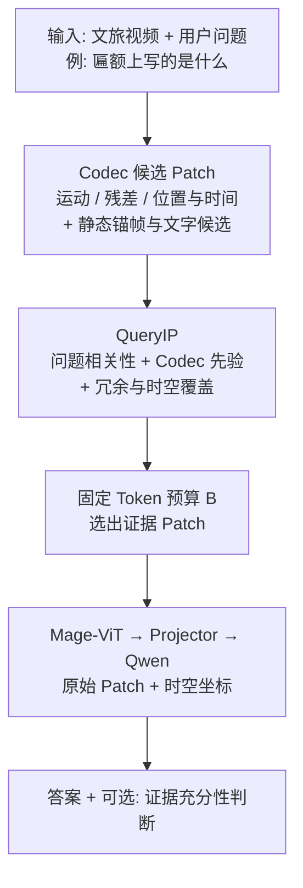

# QueryIP：固定视觉 Token 预算下的问题相关证据选择

> **日期：** 2026-10-23  
> **定位：** 面向**文旅视频问答**的、固定视觉 Token 预算下的**问题相关证据选择**方法（QueryIP）。  
> **不是：** 重做 Mage-VL；不是单纯刷 OCR 榜；不是泛旅游聊天机器人。  
> **是：** 游客视角有限、视觉预算固定时，如何优先保留**真正能回答当前问题**的视觉证据。  
> **一句话贡献（现行实证 · 主线 A）：** Mage 解决「哪些区域因变化值得算」；QueryIP 在**固定预算 K** 下用 Codec **多源融合**选区，同 K 优于乱砍（约 +4 pp）。问题条件选区（加戏 B 软门控）以**持平不伤底**为成功，未过闸不作贡献。  
> **已完成消融（另档）：** [`PLAN_mage_query_IP_select.md`](PLAN_mage_query_IP_select.md)（proxy 主推；CLIP / OCR 硬切 textseat 失败；**主线 A / 加戏 B** 定案）。  
> **应用叙事：** [`VQA/README.md`](../VQA/README.md)。

---

## 0. 研究问题与假设

**应用场景：** 游客随拍、视角不完整的景点问答（牌匾文字、建筑细节、可见空间关系等）。同一段视频，不同问题需要的证据不同。

**技术问题：** 在**相同视觉 Token 预算 \(B\)** 下，将用户问题与 Codec 候选信息结合，对 Patch 选择与排序，使有限预算优先服务当前问题所需证据。

**研究假设：**  
相对仅按 Codec 变化重要性（运动 / 残差等）筛选，引入**问题相关性**（并保持必要时空覆盖与文字/静态候选）后，能否在同预算下更好地保留答题证据，并提升答案质量？

**范围约束（当前）：**

| 做 | 不做（除非另开题） |
|----|-------------------|
| 固定 Mage-VL 权重，只改选区 | 从头复现 Mage 大规模预训练 |
| 公开基准上同预算对比 | **自建大规模文旅证据标注集**（本计划不依赖） |
| 宽候选池上再选（见 §1.2） | 只在 Codec 已砍极窄的 K 内「假重排」 |
| 拒答 / 充分性作扩展评测 | 假定 QueryIP 自动会拒答 |

---

## 1. 主要方法流程

### 1.1 总览（Mermaid）



### 1.2 分步说明

| 步 | 模块 | 做什么 |
|----|------|--------|
| ① | 输入 | 视频 + 问题文本（如匾额文字、屋檐装饰）。 |
| ② | Codec 候选 | 基于 HEVC 等：运动向量、残差能量、时间戳、空间坐标，形成**宽候选池**。**补充**静态锚帧 / 文字区域候选，避免「低运动但关键」的匾额过早被滤掉。依据 Mage-VL 管线：Codec 信息图 → 选 Patch → Mage-ViT（论文 Figure 2）。 |
| ③ | QueryIP | 综合：问题语义、候选视觉、Codec 分数、时空位置；在相关性、冗余度与覆盖之间折中，**重排序 / 重加权**。 |
| ④ | 固定预算 \(B\) | 选出最相关 Patch，同时保留必要时空上下文。 |
| ⑤ | Mage 解码 | 使用选定的**原始视觉 Patch** 与**原始时空坐标**，经 Mage-ViT → Projector → Qwen 生成答案。 |
| ⑥ | 输出 | 答案；扩展：证据充分则答，不足则说明不确定 / 拒答（**单独协议与指标**）。 |

### 1.3 关键设计细节（已从失败消融学到）

1. **宽池，而非窄池内假重排**  
   不能只对 Mage/Codec **已经筛剩的极少量 Patch** 再排一次序——静态匾额可能早已被丢掉。QueryIP 应在**更宽候选池**上工作（全 codec tile 或 top-\(M\ge B\)），再压到预算 \(B\)。

2. **问题参与选择，但不等于「CLIP 余弦即证据」**  
   已归档：帧 CLIP / 区域 CLIP 融合 / 边界 CLIP 在 Video-MME 同 K 上伤底或 shuffle 反向（见旧 PLAN）。后续问题分支须换机制假设（例如文字检测先验、可学习打分、结构化覆盖约束等），**禁止**无新假设地重复「图文相似重排」。

3. **拒答不是 QueryIP 附带能力**  
   须单独标注「可答 / 不可答」子集与评测；不能因换了选区就声称模型会拒答。

4. **知识型问题**  
   「始建于何朝」等超出纯画面证据；本计划默认范围是**画面可支持**的问答；外部知识库后置。

---

## 2. 与 Mage-VL / 现有实现的关系

```text
Mage Codec  —— 提供候选与时空变化信息（基础）
QueryIP     —— 让「当前问题」参与固定预算下的证据选择（本课题）
Mage-ViT+Qwen —— 用选中的视觉 token 生成答案（底座，固定权重）
```

| 项 | 说明 |
|----|------|
| 上游 | [microsoft/Mage](https://github.com/microsoft/Mage) · `mage_vl` |
| 本仓实现 | [`VQA/Explore-Then-Select/mage_query_ip/`](../VQA/Explore-Then-Select/mage_query_ip/) |
| 已验证 | 同 K 下 **proxy `queryip` > random**（约 +4 pp） |
| 已否决 | 官方 bitcost 主推；CLIP 帧/区域/edge 语义重排；题型 α/β 作贡献 |

参考实现（读代码顺序，不必一次读完）：

1. **microsoft/Mage** — 权重、Codec 输入、推理与视觉 token 契约（先 Codec-only 基线）。  
2. **EvolvingLMMs-Lab/OneVision-Encoder** — `Compressed_Video_Reader`、Top-K Patch、时空坐标保留等实现参考。  
3. **qywh2023/OCRbench** — 场景文字识别 / 定位 / 推理评测（匾额类文字证据）。  
4. **longvideobench/LongVideoBench** — 长视频细节检索与评测脚本。  
5. **TencentARC/TimeLens** — 时序定位与时间证据评测工具参考。

---

## 3. 数据与评测（公开集；不建自有大规模标注集）

本计划**不以自建文旅证据问答集为核心**。用公开数据覆盖：文字证据、通用视频理解、长视频细节、时序定位。文旅叙事作为**应用动机与论文故事**，技术有效性靠公开基准 + 同预算消融。

### 3.1 建议公开数据

| 数据集 | 用途 | 备注 |
|--------|------|------|
| **OCRBench v1** | 场景文字主表（Final Score Norm） | **已跑 Mage baseline：83.4**（见 §7.1）；图像 QueryIP §7.2 |
| **OCRBench v2** | 场景文字识别、定位与推理 | 文字证据扩展；Mage baseline 未跑完（后置） |
| **TextVQA** | 读图中文字作答 | 静态文字问答辅助（偏英文） |
| **Video-MME** | 通用视频问答 | 检验选区是否伤一般视频理解；本仓已有 short 同 K 管线 |
| **LongVideoBench** | 长视频细节检索与关联 | 跨时间证据选择压力测试 |
| **TimeLens-Bench**（或同类时序定位基准） | 证据时间覆盖 | 辅助时序命中分析 |

> Mage-VL 论文的大规模图文/视频预训练语料**不必复现**。路线：公开权重 + 固定底座，只改 / 训 QueryIP（或仅推理侧选区），才能归因「提升来自证据选择而非额外猛训底座」。

### 3.2 核心指标（三组 + 扩展）

| 维度 | 指标 | 回答什么 |
|------|------|----------|
| **答案质量** | Accuracy / Exact Match / ANLS | 答对了吗？匾额字符串是否接近？ |
| **证据选择** | Evidence Recall@\(B\)、区域 IoU、时间段 IoU（**有框/时段标注时**） | 预算 \(B\) 下是否保住真正需要的证据？ |
| **效率** | 实际视觉 Token 数、端到端延迟、峰值显存 | 同预算是否更划算？（QueryIP 自身开销计入延迟） |
| **可靠性（扩展）** | 拒答准确率、风险–覆盖、幻觉率 | 证据不足时是否知道不确定？ |

**主指标建议：**

1. QA Acc / ANLS（主表）  
2. 有定位标注时的 **Evidence Recall@\(B\)** / IoU（OCRBench 等）；Video-MME 若无框则以 Acc + Token–Acc 曲线为主，并报告 kept 集合机制指标（Jaccard vs Codec-only / shuffle）  
3. **Token–Accuracy 曲线**（多档 \(B\)）：同预算下谁更好  

无自建证据框时：**不要虚构 Evidence Recall**；改用公开集自带定位标签，或诚实报告「仅 Acc + 选区机制指标」。

---

## 4. 实验安排

### 4.1 公平基线（固定 Mage + Qwen + 问题文本 + 推理设置，只改选区）

| 方法 | 作用 |
|------|------|
| Uniform / prefix | 均匀或前缀基线 |
| Codec-only（proxy / Mage 默认） | 原变化重要性选择 |
| Query-only | 仅问题相关（若实现） |
| **Codec + QueryIP** | 核心方法 |
| Oracle（可选） | 有公开定位标签时的上限估计 |

**必须同视觉 Token 预算 \(B\)。** QueryIP 打分开销计入端到端延迟。

### 4.2 消融（证明「为什么有效」）

在**新机制过冒烟闸门后**再做：

1. 去掉问题相关性  
2. 去掉时空覆盖约束  
3. 去掉 OCR / 文字候选分支（若有）  
4. 去掉 Codec 先验  

若去掉问题分支后 Acc 与证据命中双降，才支撑「提升来自问题引导」。

### 4.3 场景与预算扫描

问题类型（可用公开集子集近似）：文字细节 · 静态空间关系 · 时序事件。  
预算：低 / 中 / 高三档 \(B\)。  
条件分析：近距 / 远距 / 遮挡 / 模糊等（有元数据或可构造时再报）。

### 4.4 泛化与可靠性

- Video-MME / LongVideoBench：通用能力是否明显受损  
- OCRBench / TextVQA：文字证据是否受益  
- 扩展：证据不足拒答子集  

---

## 5. 阶段路线（建议）

```text
阶段 0（已完成）  Mage-VL 复现 + proxy QueryIP 同 K 基线 + 失败消融归档
阶段 1           巩固：McNemar、Token–Acc 图、失败表；宽池选区工程约束写死
阶段 2           新问题分支设计（非重复 CLIP 余弦重排）+ 机制冒烟 + 小规模闸门
阶段 3           公开集主实验：同预算多方法对比 + 消融
阶段 4           OCR / 长视频 / 时序辅助评测 +（可选）拒答协议
阶段 5           论文：应用动机（文旅）↔ 技术问题（固定预算证据选择）↔ 实验闭环
```

闸门建议（与旧 PLAN 一致精神）：新方法相对 Codec-only **不伤底**，且相对 **问题 shuffle / Query 无效对照** 有稳定增益；不过闸则停该分支，不包装成贡献。

---

## 6. 成功标准与禁止项

**成功（可写贡献）：** 同预算下，Codec+QueryIP 在主指标上优于 Codec-only / random，且消融支持「问题分支必要」；效率上 Token–Acc 曲线不劣于对照。

**禁止：**

- 把文旅故事当成已完成用户调研  
- 未过闸把「CLIP 重排」或未验证拒答写成创新  
- 只报 Acc、不报同预算与（在有标签处）证据命中  
- 为刷点复现 Mage 千亿级预训练  

---

## 7. 实验记录（OCRBench · 图像）

### 7.1 Mage-VL × OCRBench v1 baseline（已完成 · 2026-10-27）

| 项 | 值 |
|----|-----|
| 模型 | `Mage-VL` |
| 数据 | OCRBench v1 · 1000 · 本地 parquet→`VQA/datas/lmu/OCRBench.tsv` |
| work-dir | [`VQA/eval_results/baseline_mage_ocrbench_v1/`](../VQA/eval_results/baseline_mage_ocrbench_v1/) |
| eval_id | `T20261027-120048` |
| 耗时 | ~9.5 min · fail 0/1000 |

| 指标 | 分数 |
|------|------|
| Text Recognition | 271 |
| Scene Text-centric VQA | 178 |
| Doc-oriented VQA | 172 |
| Key Information Extraction | 162 |
| HMER | 51 |
| **Final Score** | **834** |
| **Final Score Norm** | **83.4** |

对照：论文 Mage **81.80**（旁证；本地自转 TSV，**+1.6**，不作跨仓硬比）。  
score：`…/T20261027-120048/Mage-VL_OCRBench_score.json`

### 7.2 图像 QueryIP 同 B（v1 · 已跑 · **未过闸** · 2026-10-27）

| 项 | 值 |
|----|-----|
| 目录 | [`ocrbench_v1_image_textseat/`](../VQA/eval_results/queryip_samek/ocrbench_v1_image_textseat/) |
| 预算 | `keep_ratio=0.75` · **无** `--use-ocr` |
| 指标 | 脚本内 substring/exact proxy（≠官方 Final Score Norm） |

| mode | Acc (proxy) | n |
|------|-------------|---|
| full_image | **0.841** | 1000 |
| random_tiles | 0.283 | 1000 |
| queryip_image_textseat | 0.373 | 1000 |
| queryip_image_textseat_shuf | 0.373 | 1000 |

**相对 Mage-VL baseline（§7.1 Norm 83.4）：**  
`full_image` proxy **84.1%** 与官方 Norm **83.4** 同量级（口径不同，可旁证底座正常）。  
**textseat 37.3% 远低于 Mage / full（约 −46 pp）**，不能当「优于 Mage」写。

**闸门：**

| 条件 | 结果 |
|------|------|
| textseat ≥ random（+9.0 pp） | ✅ |
| textseat − shuf ≥ +1 pp（实际 **0.0**） | ❌ 问题分支无效 |
| 相对 full Δ ≥ −3 pp（实际 **−46.8**） | ❌ |

结论：同 B 切块在 OCRBench 上伤底严重；无 OCR 座位 + shuf 打平 → **本轮 textseat 不构成贡献**（已同步 [`PLAN_mage_query_IP_select.md` §2.7](PLAN_mage_query_IP_select.md)）。  
**后续：** 主线 A（视频同 K 收口）→ 可选加戏 B（软门控、持平即成功）；**不再**用 OCR 硬切打 Mage。

> OCRBench v2 Mage baseline 未完成（pkl ~1180/≈10k，静默 `--reuse` 后置）。

---

## 8. 文档与代码索引

| 资源 | 路径 |
|------|------|
| 应用场景与答辩叙事 | [`VQA/README.md`](../VQA/README.md) |
| 已完成同 K 实验定稿 | [`PLAN_mage_query_IP_select.md`](PLAN_mage_query_IP_select.md) |
| 命令 | [`VQA/Explore-Then-Select/COMMANDS.md`](../VQA/Explore-Then-Select/COMMANDS.md) |
| 实现 | `VQA/Explore-Then-Select/mage_query_ip/` |
| 产物 | `VQA/eval_results/queryip_samek/` |
| v1 Mage baseline | [`baseline_mage_ocrbench_v1/`](../VQA/eval_results/baseline_mage_ocrbench_v1/) |
