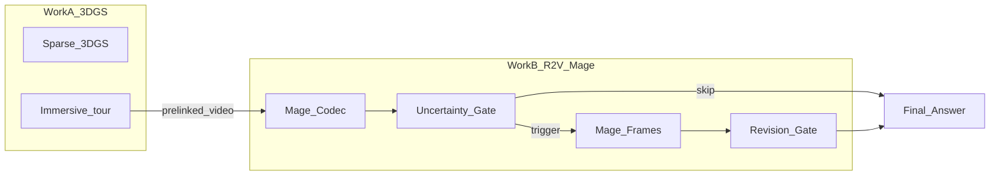

# R2V-Mage / CF-SAR：Codec–Frame 风险感知双视觉复核（实验设计）

> **日期：** 2026-10-28  
> **状态：** **阶段 1/2 已完成，原置信度双门控路线暂停并归档（2026-11-02）**。互补存在，但当前选择器净收益为零；不开发完整双门控，不宣称方法涨点。最终结论、失败原因和成果索引见 **§17**；前文保留为原实验设计，不代表所有后续阶段已实现。  
> **方法名：** R2V-Mage（*Risk-aware Dual-View Verification for Mage-VL*）；研究方向亦称 CF-SAR（*Codec–Frame Selective Answer Revision*）。  
> **主基线：** 原版完整 Mage-VL **Codec**（`traditional` / HEVC，未额外裁剪视觉预算）。  
> **配对方式（锁定）：** Codec 与 Frames **同一脚本全部重跑**；不复用历史 Mage 输出作配对列。  
> **本文件范围：** 背景、应用、问题、系统定位、方法概要、可执行实验步骤、数据集、指标、预计效果、图表与退出条件。  
> **设计与归档说明：** 本文最初只写设计；现已实现并执行配对和字母分数诊断，相关原始产物保留。新目标调整为成熟方法的实用准确率增强，见 [`PLAN_r2v_practical_accuracy_gain.md`](PLAN_r2v_practical_accuracy_gain.md)。

---

## 0. 一句话决策（锁定）

| 事项 | 决策 |
| --- | --- |
| 总策略 | **先验证 Codec–Frames 错误互补，再决定是否开发双门控** |
| 主路径 | 始终以 **Mage-Codec** 为默认答案；Frames 仅作按需复核视图 |
| 触发逻辑 | **双门控**：Gate1 只看 Codec 不确定性；Gate2 再决定是否改答案（**不能**用「两路冲突」触发复核） |
| 主指标 | VideoQA **Accuracy**（多选字母）；成本单独报告 |
| 应用叙事 | 3DGS 沉浸式文化研学 + 离线讲解视频 + **多选知识问答**（非开放闲聊、非 OCR 专用） |
| 与 3DGS | **系统互补、非联合优化**；不承诺视频→3D 自动定位 |
| short219 | **仅作方法筛选**；不作最终调参 / 最终证明测试集 |
| 涨点保证 | **无**；Oracle 上界不足则立即停止 |
| Codec 引擎 | **仅 traditional / HEVC**（`cv-preinfer`）；本路线**不做** neural / DCVC-RT |
| 第一版交付 vs 展望 | **交付**：离线研学多选挂 3D 展项；**展望**：流式 Mage、GSVisLoc 定位（不作本次算法前提） |
| 不做（本路线） | 改 Mage Patch / `_pack_tiles` / 新 ViT / CLIP 选帧 / OCR 旁路 / 自建文旅 QA 真值集 / 复杂深度门控网络 / 用削弱版 Codec 当地板 |

---

## 1. 背景

### 1.1 Mage-VL 的官方双视觉路径

Mage-VL 是 codec-native 视频理解模型：同一套权重 `microsoft/Mage-VL`（本地快照：`VQA/mage_vl/models`）支持离线图像与视频推理。官方仓库 [`Mage/mage_vl/inference_base.py`](../../Mage/mage_vl/inference_base.py) 与 README 明确提供：

| 后端 | 调用要点 | 视觉组织方式 |
| --- | --- | --- |
| **codec** | `--video-backend codec --codec-engine traditional` | `cv-preinfer` 等按压缩域重要性组 canvas；稀疏 patch + 时空位置 |
| **frames** | `--video-backend frames --num-frames N` | 均匀抽帧，整帧稠密 patch |

处理器（`processing_mage_vl.py` / `codec_video_processing_mage_vl.py` / `video_processing_mage_vl.py`）在 `video_backend="codec"` 时走 codec 管线，否则走 `MageVLVideoProcessor` 抽帧管线；下游模型仍消费统一的 `pixel_values` / `image_grid_thw` / `patch_positions`。

**含义：** 不必新建视觉编码器，不必修改 Patch 选择器，不必训练新模型，即可在同权重下得到两种视觉观察。

### 1.2 Codec 与 Frames 不是「同预算的两种打包」

默认 Codec 配置（`CodecConfig`）在 `target_canvas=32` 时：

\[
\text{num\_sampled\_frames}=(32/4)\times 32=256
\]

即 Codec 可先覆盖约 **256** 源帧，再压成约 **32** 个稀疏 canvas；Frames 在 `num_frames=32` 时则是 **32** 张稠密整帧。

| | Mage-Codec | Mage-Frames |
| --- | --- | --- |
| 时间覆盖 | 更宽（多帧汇聚进 canvas） | 更稀（均匀 32 点） |
| 空间密度 | P 帧等区域稀疏 | 每帧接近满格 |
| 视觉 Token / 延迟 | 低（官方效率卖点） | 通常更高 |
| 论文倾向 | VideoMME 等上 codec-native 整体优于均匀抽帧 | 更偏稠密外观类证据 |

因此：若出现互补，只能归因于**整条观察协议差异**，不能直接写成「Codec 漏掉了某个关键 Patch」。R2V-Mage 必须定位为 **按需增加计算的 QA 增强**，不能宣称与原始 Codec **相同**视觉预算。

### 1.3 相关工作与新颖性边界

| 工作 | 已有贡献 | 对本路线的启示 |
| --- | --- | --- |
| Mage-VL | 官方 Codec / Frames 双输入 | 复用接口，不发明新视觉协议 |
| CyberV | 测试时监测与自校正 | 选择性复核有先例；移植成本高，不整体搬 |
| A.I.R.（ICLR 2026） | 自适应 / 迭代选帧 | 不重复 CLIP 选帧路线 |
| VideoHV-Agent（CVPR 2026） | 假设–验证多 Agent | 「答案复核」本身非新概念；不移植多 Agent |
| BOLD（ACL 2025） | 视频多选题选项偏差校正 | 只能作对照，不能当核心创新 |
| Conformal Risk Control | 单调损失下的风险控制 | **不能**直接用来证明「改答案后 Acc 不降」 |

**可能成立的方法贡献（需实验证明，非先验成立）：**

1. **Codec–Frame 错误互补机制分析**（Mage 特有双观察协议）。  
2. **预算约束下的双阶段复核决策**（先是否值得加算力，再是否值得改答案）。

若最终只是「两路都跑、取更高置信度」，更接近已有推理策略的工程组合，**不足以支撑强算法创新**。

### 1.4 为何必须先做生死实验

Mage 官方报告在 VideoMME 等基准上 codec-native 相对均匀抽帧具有更优准确率–效率前沿。因此 **Frames 整体未必更强**；真正有研究空间的前提是：

> 存在足够多「Codec 错、Frames 对」的题目，且（后续）能在不知道真值时部分识别它们。

这两个问题彼此独立：互补空间小 → 停；互补空间大但不可预测 → 也停。

---

## 2. 应用场景

### 2.1 贯穿场景：数字文化展馆的三维漫游与历史活动视频讲解

假设已用 3DGS 重建古建筑 / 展馆（戏台、展柜、工艺区等）。游客在场景中漫游，点击展项打开**预先关联**的离线文化活动视频（戏曲表演、修复过程、营造演示等），再进入**交互式多选知识问答**，例如：

> 视频中，表演者完成转身动作后首先做了什么？  
> A. 拿起道具　B. 走向舞台中央　C. 与另一名演员交谈　D. 离开舞台

系统优先用 Mage-Codec 回答；仅在触发复核时使用 Mage-Frames；最终展示答案。

**正式应用定位：** 基于 3DGS 的沉浸式文化**研学**与视频知识问答（多选），**不是**泛化「智慧旅游大模型」或开放式闲聊助手。

### 2.2 技术分工

| 技术 | 主要解决 | 不擅长 / 本路线不做 |
| --- | --- | --- |
| 3DGS | 场景重建、自由漫游、空间沉浸 | 不足以还原完整历史事件过程（仅静态资产） |
| Mage-Codec | 高效理解动作、事件、时序、场景 | 压缩域选择未必保留每处细节 |
| Mage-Frames | 另一种稠密抽样观察 | 时间点更稀，算力更重 |
| R2V-Mage | 何时需要第二种观察、是否采纳其答案 | **无法保证**每次复核正确 |

### 2.3 与 3DGS 毕设主线的衔接方式

稳妥连接（第一版）：

```text
3DGS 展项 / 导览节点  →  预先关联的视频文件  →  Mage-VL 问答服务  →  最终答案
```

- 视频与展项关联：内容配置 / 少量人工即可；**不需要**新训练集。  
- **不承诺**：视频中物体自动定位到 3DGS 坐标、GSVisLoc、实时手机视角焊回数字资产（仓内 [`docs/system/README.md`](system/README.md) 亦标明定位层尚未实现）。  
- 论文中明确：工作 A（重建与展示）与工作 B（视频问答复核）在**系统层互补**，**不是**「3DGS 几何直接提高 Mage Acc」的联合算法。

#### 2.3.1 第一版交付 vs 展望（答辩防追问）

| | 第一版（本路线可交付） | 展望（不当作本次算法前提） |
| --- | --- | --- |
| 交互 | 3D 漫游 → 点击展项 → 离线视频 → 多选研学问答 | 手机实时流式解说、随问随答 |
| 空间关联 | **预配置**展项↔视频 | 自动视觉定位到 3D 坐标 |
| Mage 模式 | 离线 Codec（+ 按需 Frames） | `inference_streaming` / System1 门控 |
| 旧 `thesis.md` 话术 | 有意识**降级**：不以「定位焊条」为必交付 | 可写进未来工作 |

若答辩仍展示旧「实时流 + 定位」总图，必须口头说明第一版边界，否则会被问「定位模块在哪」。

#### 2.3.2 系统集成落点（薄 glue）

- 仓内 / 旁路已有 Splatour 类导览：`artifacts` + markdown `content` 可挂展项说明。  
- **原生「视频播放 + 多选 QA 面板」**需少量前端/服务 glue（调用 Mage 推理 API 或离线结果），**不需要**新三维算法。  
- 演示视频用自有素材；不把 Video-MME 视频当公开展示资源。

### 2.4 为何用公开 VideoQA 而不是自建文旅集

- **算法评测：** Video-MME（及另选一个公开基准）上的 QA Accuracy、风险–成本曲线。  
- **应用动机 / 切面分析：** Video-MME 元数据含 `Humanity & History`、`Literature & Art`、`Geography`、`Travel`、`Handicraft`、`Stage Play` 等，可作文化旅游相关分析，**不能**单独挑子集当唯一成功标准。  
- **系统演示：** 自有或可授权文旅短视频即可；**不做**人工 QA 真值，**不把演示冒充定量提升**。  
- **合规：** Video-MME 官方对视频传播与商业使用有限制——正式评测可用；**勿**未经许可把该数据集视频再发布为公开展示素材。

### 2.5 研学问答 vs 开放聊天（必须写进论文）

| | 研学多选 QA | 开放式游客提问 |
| --- | --- | --- |
| 输出 | A/B/C/D | 自由文本 |
| 与 Video-MME / NExT-QA | 直接对齐 | 评测协议不同 |
| 分数 / 门控 | 字母 logit、修改预算易实现 | 需另套解析与评测 |
| 本路线正式主张 | **仅多选** | 仅作后续拓展，**不得**用选择题成绩宣称开放对话提升 |

---

## 3. 解决什么实际问题

### 3.1 系统层

在文化遗产数字孪生导览中：游客观看与展项关联的讲解 / 活动视频并回答知识题时，如何在**保留 Mage-Codec 高效主推理**的前提下，降低部分不可靠答案，且不把「始终双跑」当成默认成本。

### 3.2 算法层

1. Mage 的 Codec 观察与 Frames 观察在公开 VideoQA 上是否存在**可利用的错误互补**？  
2. 如何在**不知道标准答案**时，用有限复核预算决定：是否触发 Frames、是否用 Frames 答案替换 Codec 答案？  
3. 准确率收益与最坏退化、额外计算之间如何权衡？

### 3.3 诚实边界

- 公开基准证明的是**通用视频理解 / 相关题型**能力，不是「已在真实景区视频上定量提升」。  
- 不声称零退化；修改预算只给出批次级最坏下降上界 \(\frac{M}{N}\)。  
- 不把应用故事当成算法证据。

---

## 4. 在系统中的定位



| 论文部分 | 内容 | 产出 |
| --- | --- | --- |
| 文化遗产数字化场景构建 | 3DGS 重建、漫游、展项组织 | 重建质量、渲染、展示 |
| 数字文旅视频问答 | Mage-Codec 主推理、多选协议 | 原始 QA Accuracy |
| 双视觉复核方法 | Frames 补充观察、双门控、风险受限选择 | Acc、消融、统计、成本 |
| 沉浸式研学系统集成 | 展项↔视频关联、问答交互 | 流程、功能、响应时间 |
| 综合分析 | 通用 QA、相关子类、失败案例 | 主表与图 |

**建议题目：**

- 整篇毕设含 3DGS 主体：*面向文化遗产沉浸式研学的三维场景重建与可信视频问答方法研究*  
- 方法章节 / 小论文：*基于 Mage-VL 双视觉表征与风险受限复核的视频问答方法研究*

---

## 5. 方法概要（完整实现后置；生死实验前只读）

### 5.1 主路径

\[
A_c=\operatorname{Mage}_{\mathrm{codec}}(V,Q)
\]

始终以完整 Codec 为默认；**不是**任何额外 keep-ratio 裁剪版本。

### 5.2 Gate1：是否复核（只依赖 Codec）

设不确定性 \(U_c\)（第一版：多选第一 / 第二候选字母分数差的相反数，或 top-2 margin 的补）。

\[
g_1(V,Q)=\mathbb{1}\{U_c>\tau_1\}
\]

- \(U_c\) **不是**校准后的正确概率；第一版只作复核优先级。  
- **禁止**用「与 Frames 是否冲突」作为 Gate1（否则必然双跑）。  
- 可选消融特征 \(F_c=(N_{\mathrm{visual}},\text{token 时间分布},\text{视频长度})\)：无收益则删除，勿硬写「Codec 感知」。  
- **经典失败模式（必须报告）：过自信错误** — Codec **高置信（低 \(U_c\)）但答错** → Gate1 不触发 → Frames 永无法救回。阶段 2/3 须单独统计该类占比，不能只报平均 Acc。

### 5.3 Gate2：是否改答案（仅 Gate1 触发后）

\[
A_f=\operatorname{Mage}_{\mathrm{frames}}(V,Q)
\]

若 \(A_f=A_c\)，保留 \(A_c\)。若冲突，用验证集校准后的可靠性估计：

\[
D=\hat P_f(A_f\text{ 正确})-\hat P_c(A_c\text{ 正确})
\]

仅当 \(D>\tau_2\) 且未用尽修改预算时取 \(A_f\)，否则回退 \(A_c\)。  
\(\hat P\) 须分路径校准（温度缩放或带正则的简单校准器即可）；**禁止**直接比较两路 raw logits。

### 5.4 修改预算（约束工具，非创新本体）

\(N\) 题最多改 \(M\) 题时，最坏情况：

\[
\mathrm{Acc}_{\mathrm{new}}\ge \mathrm{Acc}_{\mathrm{Mage}}-\frac{M}{N}
\]

这是计数事实，用于限制退化幅度与画 Accuracy–预算曲线；**不**等于实际 Acc 不下降。

### 5.5 实现阶段约束

| 阶段 | 概率 / 门控 |
| --- | --- |
| 冒烟 + 四象限生死实验 | **只比字母对错**；不做 logit 接口 |
| 选择信号验证 | 再实现候选字母打分 |
| 正式双门控 | Gate1 + 校准 + Gate2 + 预算 |

---

## 6. 实验步骤（最关键 · 可执行）

> 当前 [`VLMEvalKit/vlmeval/vlm/mage_vl.py`](../VQA/VLMEvalKit/vlmeval/vlm/mage_vl.py)（及仓外副本）**写死 Codec**。配对实验需**新建统一脚本**（下文称 `r2v_pair_infer.py` 拟实现名）；本文件只规定协议，本轮不落代码。

### 6.0 公共配置（全程锁定）

| 项 | 值 |
| --- | --- |
| 权重 | `VQA/mage_vl/models`（完整 Mage-VL 快照） |
| 环境 | Mage 推理环境（含 `cv-preinfer` / ffmpeg；如 `Mage_ViT/mage`）；`CV_PREINFER_BIN` 可指向绝对路径 |
| 数据根 | `VQA/mage_vl/data/VideoMME`（`MAGE_VIDEOMME_ROOT` 可覆盖） |
| Codec | `video_backend=codec`，`engine=hevc`（`traditional`），`target_canvas=32`，`patch=16` |
| Frames | `video_backend=frames`，`num_frames=32`（**视频路径**输入，见 §6.0.2） |
| 像素预算 | **目标对齐**：`max_pixels=150000`，`min_pixels=3136`（见 §6.0.1） |
| 字幕 | **关闭**（`use_subtitle=False`） |
| 生成 | `do_sample=False`，`max_new_tokens=32` |
| Prompt | 锁定为下方 **§6.0.4 原文**（与 VLMEvalKit Video-MME 无字幕模板一致） |
| 解析 | 正则提取首个合法字母 `A|B|C|D`；**非法 / 空 → 计错**（不丢弃样本） |
| 冒烟抽样种子 | `seed=0`（写入 `config_lock.json`） |
| Codec 缓存 | `ONLINE_CODEC_CACHE_DIR` 指向专用目录；键含视频路径 + codec 配置 |
| 续跑 | jsonl **按 `index` 断点续跑**；已完成题跳过 |

#### 6.0.1 源码级陷阱：`max_pixels` 对 Frames 默认无效

官方 `MageVLProcessor.__call__`：

- **Codec：** 顶层 `max_pixels=` 会写入 `CodecConfig` 并生效。  
- **Frames：** 仅临时覆盖 `fixed_num_frames / max_frames / target_fps`，**不会**把顶层 `max_pixels` 传给 `video_processor`。

本地 `preprocessor_config.json` / `video_preprocessor_config.json` 中 Frames 侧默认可达 **数百万～千万级** `max_pixels`。若只写：

```python
processor(..., video_backend="frames", num_frames=32, max_pixels=150000)
```

则 **150000 可能被忽略**，导致显存爆炸且与 Codec 不公平。

**正式要求：**

```text
processor.video_processor.max_pixels = 150000
processor.video_processor.min_pixels = <与 Codec 评测一致或文档记录值>
inputs = processor(text=[...], videos=[video_path], video_backend="frames", num_frames=32, ...)
```

Codec：

```text
inputs = processor(..., videos=[video_path], video_backend="codec",
                   max_pixels=150000, codec_config={engine, target_canvas, patch}, ...)
```

每条样本记录实际 `pixel_values.shape`、`image_grid_thw`、visual token（见下式）、墙钟时间、峰值显存。

**Visual token 估算（写死）：** 对 `image_grid_thw` 各行 \((t,h,w)\)，在 `spatial_merge_size=sms`（本权重默认 **2**）下：

\[
N_{\mathrm{vis}}=\sum \frac{t\cdot h\cdot w}{\mathrm{sms}^2}
\]

阶段 1 的 `n_tok_c` / `n_tok_f` 必须用此式（或等价实现），禁止口头估计。

#### 6.0.2 输入形式

- **必须：** `videos=[mp4 路径]`（保留真实时间戳 / 帧索引；Frames 走 decord 优先解码）。  
- **禁止**把官方 `inference_base.py` 的 OpenCV 预抽 PIL 列表当作正式配对路径（时间戳可能退化为相对索引，污染互补结论）。

#### 6.0.3 显存预案（两级）

- 设备参考：RTX 4090 24GB。  
- **一级（优先）：** Frames-32 @ 150000 仍吃紧时，**Codec 与 Frames 两侧同降** `max_pixels`（例如先试 `100000`），保持公平对比；在 `config_lock` 中记录实际值，**新开实验标签**，不与 150000 旧跑混表。  
- **二级：** 若仍 OOM，启用独立配置 **`Frames-16`**（`num_frames=16`，像素预算与当时 Codec 对齐），结果单独成列。  
- **禁止：** 只砍 Frames、保留 Codec 满配却声称「同协议配对」；**禁止**为迁就 Frames 改低 Codec 后，仍拿历史 Overall≈63.7% / Short≈75.8% 当同一实验的数字。  
- 生死实验**默认目标**仍是 Frames-32 @ 150000；阶段 0 若确认不可行，在结论中改写后续矩阵标签（`Frames-16` 或 `px=100k`）。

#### 6.0.4 锁定 Prompt 原文（无字幕）

与 [`vlmeval/dataset/videomme.py`](../VQA/VLMEvalKit/vlmeval/dataset/videomme.py) 中 `FRAMES_TMPL_NOSUB` 语义一致，用户消息结构为：

```text
These are the frames of a video. Select the best answer to the following multiple-choice question based on the video. Respond with only the letter (A, B, C, or D) of the correct option.
{question}
A. ...
B. ...
C. ...
D. ...
```

（具体选项文本来自 TSV `candidates`；chat_template 仍由 Mage processor 包裹 vision 占位。）  
**禁止**阶段中途改写提示词；改写则必须重跑双侧并换输出目录。

---

### 阶段 0 · 冒烟（5–10 题）

**目的：** 双路径通路、显存、token 量级、时间戳是否正常。

**步骤：**

1. 从 Video-MME TSV 中取 `duration=short` 的前 5–10 条（固定随机种子，写入日志）。  
2. 对每题用**同一脚本**各跑一次 Codec、一次 Frames。  
3. 检查：字母可解析；`image_grid_thw` / token 数合理；Frames 的 `max_pixels` 确为 150000 量级而非默认数百万。  
4. 输出小表：`index, backend, pred, n_tok, latency_s, peak_mem_gb`。

**通过标准：** 双路径零崩溃；Frames 像素预算与文档一致；单题可复现。  
**失败：** 修环境 / 预算后再进入阶段 1；不进入算法开发。

---

### 阶段 1 · 生死实验（Video-MME short，约 219 题）【决定是否继续】

**目的：** 回答「Frames 能纠正多少 Codec 错误」及 Oracle 上界；**不做**门控与 logit。

#### 6.1.1 数据

- 本地 TSV：`Video-MME.tsv`，全量约 **714** 题；`duration=short` 约 **219** 题。  
- 视频：`video/{videoID}.mp4`。  
- **筛选集 = 全部 short 题**；记录确切 `N`（以当时 TSV 为准）。

#### 6.1.2 推理协议（同一脚本全量重跑）

对筛选集每一题 \(i\)：

1. 构造与评测一致的 user 文本（题干 + 选项 A–D + 「只输出字母」）。  
2. 跑 Codec → `codec_pred`，记 `n_tok_c, t_c, grid_c, ...`。  
3. 跑 Frames → `frames_pred`，记 `n_tok_f, t_f, grid_f, ...`。  
4. 与 `gt` 比字母（大写规范化）。

**禁止：** 用历史 `VLMEvalKit/outputs/Mage-VL/*` 结果填充 Codec 列（配置/prompt/解析可能不一致）。  
**允许：** codec 侧使用 `ONLINE_CODEC_CACHE_DIR` 缓存 canvas，避免重复 `cv-preinfer`；缓存键须含视频路径与 codec 配置。

#### 6.1.3 输出产物

目录建议：`VQA/eval_results/r2v_mage/phase1_short_pair/`

| 文件 | 内容 |
| --- | --- |
| `pair_short.jsonl` | 每题一行（字段见下） |
| `summary_short.json` | Acc、四象限、Oracle、耗时汇总 |
| `config_lock.json` | 权重路径、像素、帧数、字幕、种子、脚本版本、git commit |

**jsonl 字段（最低集）：**

```text
index, video_id, video_path, duration, domain, sub_category, task_type,
question, gt,
codec_pred, frames_pred,
codec_ok, frames_ok,
n_tok_c, n_tok_f, t_c, t_f,
pv_shape_c, pv_shape_f,      # pixel_values.shape
grid_thw_c, grid_thw_f,      # 可序列化为字符串
peak_mem_c, peak_mem_f       # 可选；至少阶段 0 必填
```

#### 6.1.4 统计定义

四象限：

| | Frames 对 | Frames 错 |
| --- | --- | --- |
| **Codec 对** | both_ok | codec_only |
| **Codec 错** | frames_only（纠错空间） | both_bad |

\[
\mathrm{Acc}_{\mathrm{oracle}}
=\frac{\#\{\text{Codec 对或 Frames 对}\}}{N}
=\mathrm{Acc}_{\mathrm{codec}}+\frac{N_{\mathrm{frames\_only}}}{N}
\]

另报：

- \(\mathrm{Acc}_{\mathrm{codec}},\ \mathrm{Acc}_{\mathrm{frames}}\)  
- 救回率 \(N_{\mathrm{frames\_only}} / N_{\mathrm{codec\_wrong}}\)  
- 误伤池 \(N_{\mathrm{codec\_only}}\)（若盲目换 Frames 会毁掉的题）  
- 按 `task_type`、以及文旅相关 `sub_category`（如 Humanity & History、Travel、Handicraft、Stage Play 等）切片（样本少时只作描述，不作强结论）

#### 6.1.5 筛选参考（非经统计证明的硬科学阈值）

结合**绝对题数**与案例阅读。量级直觉：若 Codec short≈75.8%，219 题约 **53** 道错题——核心是看这约 53 道里 frames_only 有多少。

| 信号 | 偏停 | 偏继续 |
| --- | --- | --- |
| 救回率 \(N_{\mathrm{frames\_only}}/N_{\mathrm{codec\_wrong}}\) | ≲ **10–15%** 或个位数且无规律 | 明显高于该带，且跨题型可见 |
| \(\mathrm{Acc}_{\mathrm{oracle}}-\mathrm{Acc}_{\mathrm{codec}}\) | ≲ **1.5–2 pp**（219 题约 3–4 题） | ≳ **3–4 pp** 且冲突非纯噪声 |
| 答案一致率 | 几乎总一致 | 有稳定冲突子集 |
| 误伤池 \(N_{\mathrm{codec\_only}}\) | — | 须同时报告：盲目换边的破坏空间 |

**若偏停：** 停止双门控开发；文档结论写「互补假设未成立」；保留阶段 1 表作为负结果 / 边界分析。  
**若偏继续：** 进入阶段 2（仍不把 short219 当最终测试集）。

**注意：** 历史 Mage-Codec 在本地 714 子集上曾报 Overall≈63.7%、Short≈75.8%。阶段 1 **重跑后**以新 `summary_short.json` 为准；旧数字仅作量级参照，不作配对真值。

#### 6.1.6 阶段 1 开工 Checklist（一页）

- [ ] `cv-preinfer` / ffmpeg 在 PATH；权重目录完整  
- [ ] `video_processor.max_pixels=150000`、`min_pixels=3136` 已在 Frames 调用前设置，且日志打印生效值  
- [ ] Codec / Frames 均用**视频路径**；Prompt = §6.0.4；字幕关；`do_sample=False`  
- [ ] 输出目录 `VQA/eval_results/r2v_mage/phase1_short_pair/`；`config_lock.json` 已写  
- [ ] jsonl 含 `codec_pred/frames_pred/gt/n_tok_*/t_*/grid_*`；支持按 `index` resume  
- [ ] `ONLINE_CODEC_CACHE_DIR` 已设，避免重复预推理  
- [ ] 阶段 0（5–10 题）已通过显存与像素核对  
- [ ] 统计脚本可输出四象限、Oracle、救回率、codec_only  
- [ ] **确认**：未使用任何历史 Mage xlsx/json 填充 Codec 列

---

### 阶段 2 · 选择信号验证（仅阶段 1 过关）

**目的：** 即使存在 frames_only，能否在**无真值**时偏向采纳它们。

#### 6.2.1 字母分数接口

1. 确认 tokenizer 中 `A/B/C/D`（及可能的前导空格变体）的 token id。  
2. 在完整视觉+文本前缀后，取**下一 token** 对四字母的 logit → softmax 得 \(p(A),\ldots,p(D)\)。  
3. Codec / Frames **分别**计算；记录 `p_c[*], p_f[*], margin_c, margin_f`。  
4. 用独立验证视频做简单温度缩放（低参数）；禁止口头 “confidence: 90%”。

#### 6.2.2 冲突子集诊断

在 \(A_c\neq A_f\) 的题目上：

- 若总选更高 margin / 校准分：纠错题数 vs 误伤题数。  
- 计算（可用阶段 1 全 short 做**事后诊断**，阈值锁定须换独立视频）：

\[
\mathrm{Acc}_{\mathrm{oracle,trigger}}
=\mathrm{Acc}_{\mathrm{codec}}
+\frac{\#\{\text{Codec 错、Frames 对、且 Gate1 会触发}\}}{N}
\]

Gate1 若把大部分 frames_only 挡掉 → 双门控上限不足，**停止或简化**。

**必须另报：** 过自信错误率  

\[
\frac{\#\{\text{Codec 错且 }U_c\text{ 低于触发阈值（未复核）}\}}{N_{\mathrm{codec\_wrong}}}
\]

若该类占 Codec 错误的主体，则 Gate1 结构性救不回，即使 Oracle 好看也不宜宣称「选择性复核已解决不可靠答案」。

**通过：** 简单信号在冲突集上明显优于随机换边，且 `oracle,trigger` 仍保留有意义纠错空间。  
**失败：** 停止完整 R2V-Mage；可归档「互补存在但不可部署选择」。

---

### 阶段 3 · 正式方法与评测（仅阶段 2 过关）

#### 6.3.1 数据划分

- 使用 Video-MME 本地 **714** 题（含 short/medium/long）。  
- **按 `video_id` 划分** train-free 的 val / test（或 val / test 两路）；同一视频的多题不得跨集合。  
- short219 若已用于筛选，其视频应整段落出最终 test，或明确写「筛选污染」并另建干净 test。  
- 泛化：在 **NExT-QA 或 MVBench 中已具备环境的一个**上跑通同一协议（适配输出解析）；不新开五六套基准。

#### 6.3.2 实验矩阵

| 组 | 方法 | 回答的问题 |
| --- | --- | --- |
| M0 | 原版完整 Mage-Codec | 真正主基线 |
| M1 | Mage-Frames（锁定帧数配置） | Frames 单独多强 |
| M2 | 双跑，冲突时直接用 Frames | 盲目切换风险 |
| M3 | 双跑，简单置信度选择 | 成熟选择器下限 |
| M4 | Gate1 触发后再 Frames + 简单选择 | 第一道门是否有价值 |
| M5 | 双门控 + 分数校准 | 完整方法 |
| M6 | M5 + 修改预算 \(M\) | 风险–收益曲线 |
| R | 相同复核次数下**随机**触发 Frames | 门控是否优于随机 |
| O | Oracle（知真值选对的一侧） | 上界，不可部署 |
| B（可选对照） | 单路 Codec 上的选项偏差后处理（BOLD 类思想） | 证明收益不是「调字母先验」可解释；**不作本方法核心** |

**消融（对 M5）：** 去掉校准 / 去掉 Gate1（≈总是双跑）/ 去掉 \(F_c\)。无收益的组件不得写进贡献句。  
**新颖性底线：** 最终须相对 **M3**（简单置信度）有增益，或同增益下明显更少复核 / 更少误伤；否则答辩只能当系统工程，不能当强算法贡献。

#### 6.3.3 成功标准（阶段 3）

至少满足其一，否则方法不得称为「准确率增强成功」：

1. 相对 M0，Accuracy **有意义提升**（McNemar + 视频聚类 CI 支持）；或  
2. Acc 近似持平，但在**相同收益**下显著降低误伤、或相对「总是双跑 / M3」在更低复核率下达到相近 Acc。

**仅相对 M2 更好不够。** 额外算力必须如实报告；不能写「保证了 Mage 性能」——保留 M0 本就同 Acc。

---

## 7. 预跑数据集

| 阶段 | 数据集 | 规模（约） | 用途 |
| --- | --- | --- | --- |
| 0 冒烟 | Video-MME short 子集 | 5–10 题 | 通路 / 显存 / 像素预算核对 |
| 1 生死 | Video-MME short | ~219 题 | 四象限 / Oracle |
| 3 正式 | Video-MME 全本地子集 | ~714 题 | 按 video_id 划分后的主结果 |
| 3 泛化 | NExT-QA **或** MVBench（择一） | 以环境已具备为准 | 非 Video-MME 特例 |
| 演示 | 自有文旅短视频 | 少量 | 系统展示；**无真值、不计入 Acc** |

本地 Video-MME 路径：`VQA/mage_vl/data/VideoMME`（`Video-MME.tsv` + `video/` + `subtitle/`）。

---

## 8. 指标评测

### 8.1 主指标

- **QA Accuracy**：预测字母与标准答案一致的比例；**解析失败 / 空输出按错计**（分母仍为 \(N\)）。

### 8.2 诊断指标

| 指标 | 含义 |
| --- | --- |
| 四象限计数 | both_ok / codec_only / frames_only / both_bad |
| \(\mathrm{Acc}_{\mathrm{oracle}}\) | 完美选择上界 |
| \(\mathrm{Acc}_{\mathrm{oracle,trigger}}\) | Gate1 后的上界 |
| 救回率 | \(N_{\mathrm{frames\_only}}/N_{\mathrm{codec\_wrong}}\) |
| 过自信错误占比 | Codec 错且未触发 Gate1 的比例（§5.2 / §6.2） |
| 恢复 \(b\) / 退化 \(c\) | 相对 M0：错→对 / 对→错 |
| 复核触发率 | Gate1 触发比例 |
| 修改率 | 最终 \(A_f\neq A_c\) 的比例 |
| 额外视觉 Token / 延迟 | 相对纯 Codec（token 用 §6.0.1 公式） |
| 峰值显存 | Frames 可行性 |

### 8.3 统计

- McNemar：\(\Delta\mathrm{Acc}=(b-c)/N\)，关注 \(b>c\)。  
- **按 video_id 聚类**的 Bootstrap 置信区间（同视频多题不独立）。  
- 小样本下优先低参数阈值 / 校准，避免学习型大门控过拟合。

### 8.4 成本表述

R2V-Mage = **按需加算力的可靠推理**；对比 Mage 官方「Codec 相对抽帧更省」时，必须报告复核带来的额外成本，禁止包装成固定 K 省 Token 算法。

---

## 9. 预计效果（诚实区间）

| 情形 | 预期 |
| --- | --- |
| 阶段 1 互补不足 | **无算法涨点**；停止双门控；系统仍可用纯 Mage-Codec |
| 阶段 1 有互补、阶段 2 不可分 | Oracle 好看但**不可部署**；停止或仅写分析贡献 |
| 阶段 1–2 均过关 | 相对 M0 **有限**正收益（通常 **低于** Oracle）；或同收益下更低复核率 / 更低误伤 |
| 数量级直觉 | short≈219、若 Codec≈75% 量级且 frames_only≈7，则 Oracle≈+3.2 pp；真实方法通常更低 |

**不保证：** 准确率绝对不低于 Mage；Frames 单独超过 Codec；文旅演示视频上的定量提升。

失败时的正确写法：互补 / 选择假设不成立，保留完整 Mage-Codec 与阶段 1 证据——优于硬上无效模块。

---

## 10. 论文 / 报告图表清单

| 编号 | 内容 | 阶段 |
| --- | --- | --- |
| 图/表 1 | QA Accuracy 主结果（M0–M6、R、O） | 3 |
| 图 2 | Codec–Frames 正确性四象限 | 1（必出） |
| 图 3 | Accuracy–复核率（或修改预算）曲线 | 3 |
| 图 4 | Accuracy–额外耗时 / Token | 3 |
| 图 5 | 恢复 \(b\) vs 退化 \(c\) | 3 |
| 图 6 | 按 task_type / 相关子类切片 | 1–3 |
| 图 7 | Gate 阈值敏感性 | 3 |
| 表 A | 工程配置锁与实测 token/显存 | 0–1 |

**最能代表方法问题的图：** Accuracy–复核率曲线——「用多少额外视觉计算，换多少 QA 收益」。

---

## 11. 工程边界（必须遵守）

| 问题 | 正确处理 |
| --- | --- |
| Codec≈256 源帧信息 vs Frames 32 整帧 | 当作不同观察协议；不声称同 Token 预算 |
| `inference_base` PIL 预解码 demo | 正式配对用**视频路径** + Frames backend |
| 顶层 `max_pixels` | Frames 须设 `video_processor.max_pixels`；并记录真实张量 |
| 32 帧 OOM | `Frames-16` 独立配置；不改 Codec 基线混比 |
| 现有只有 `generate()` | 阶段 1 只比字母；阶段 2 再加 logit |
| 历史 Mage 输出 | **不**作配对 Codec 列 |
| OCR / CLIP 选区 / `_pack_tiles` | **不进入**本路线 |
| Conformal Risk Control | 不直接引用为「改答案 Acc 不降」证明 |
| 开放式对话 | 不作正式指标 |

---

## 12. 停止检查清单

| 检查 | 内容 | 失败动作 |
| --- | --- | --- |
| 0 | 官方双路径冒烟（像素预算正确） | 修环境，暂停 |
| 1 | short 四象限 + Oracle | 停双门控；归档负结果 |
| 2 | 冲突上选择信号 / `oracle,trigger` | 停完整方法；可保留分析 |
| 3 | 独立 test 上 vs M0/M3 | 未达 §6.3.3 则不宣称准确率增强成功 |
| 4 | 成本诚实披露 | 缺 token/延迟则不得投稿/定稿主表 |

---

## 13. 建议开发顺序（时间紧时）

```text
完整 Mage 基线协议锁定
  → 官方 Frames 配对脚本（同脚本双跑）
  → short219 四象限 + Oracle          【生死】
  →（过关）字母分数 + Gate1 召回诊断
  →（过关）双门控 + 预算曲线 + 消融
  → 独立 test + 一个泛化集
  → 薄系统：3DGS 展项关联视频 + 问答 UI
```

3DGS 重建**不因本路线重做**；系统侧只加关联与调用。

---

## 14. 前置条件清单（对照工程）

### 14.1 已有（可直接用）

1. 原版 Mage 推理代码与本地完整权重 `VQA/mage_vl/models`  
2. `cv-preinfer` + ffmpeg + Mage 环境  
3. Video-MME 本地视频与 TSV（short≈219 / 全≈714）  
4. 字母解析规则与 Video-MME 多选协议经验  
5. 历史 Mage-Codec 分数（**仅量级参照**，不作配对列）

### 14.2 生死实验前必须新准备

1. 统一配对脚本 `r2v_pair_infer.py`（Codec+Frames 同脚本；Frames 显式 `video_processor.max_pixels`）  
2. 配对 jsonl + 四象限 / Oracle 离线统计脚本  
3. `ONLINE_CODEC_CACHE_DIR` 与输出目录约定  
4. 阶段 0 显存实测记录；必要时两侧同降 `max_pixels` 或 `Frames-16` 标签  
5. `config_lock.json`（权重、像素、帧数、字幕、seed、prompt 哈希、git commit）

### 14.3 阶段 1 过关后再准备

1. 字母 token id 探测与 logit 抽取单元测试  
2. 按 `video_id` 的独立 val（校准）/ test  
3. 温度缩放等低参数校准；修改预算曲线；McNemar + 视频聚类 Bootstrap  
4. （可选）BOLD 类选项偏差对照；一个泛化基准接线  
5. 薄系统 glue：展项↔视频↔QA（Splatour artifact 可扩展）

### 14.4 明确先不做

- 改 Mage Patch / 时空编码 / CLIP 选帧 / OCR 旁路 / 新训练集  
- 四象限出来前写完整双门控  
- 用任何 keep-ratio / 削弱 Codec 当地板  
- neural codec、开放域闲聊主指标、自建文旅真值集

---

## 15. 附录：与仓内其他文档的关系

- 本文件为 **R2V-Mage / CF-SAR 独立实验设计**。  
- **不修改、不依赖**其他选区 / 裁剪类计划的结论定案；本路线与之**并行候选**，互不抢贡献句，直至阶段 1–3 有结果后再统一论文叙事。  
- 系统架构背景可对照 [`system/README.md`](system/README.md)、[`thesis.md`](thesis.md)；若旧文仍写「实时定位焊条」，以本文件 **§2.3.1 第一版交付 vs 展望** 为准做叙事收敛。  
- 根 [`README.md`](../README.md) **暂不改**工作 B 定案表述；待生死实验结论后再决定是否升格主文。

---

## 16. 变更记录

| 日期 | 变更 |
| --- | --- |
| 2026-10-28 | 初稿：应用故事（3DGS 研学多选）、双门控、short219 同脚本重跑协议、`max_pixels` 陷阱、退出条件与图表清单 |
| 2026-10-28 | 补全审查遗漏：过自信错误、救回率 10–15% / Oracle 3–4 pp 筛选带、两侧同降像素、Prompt 原文、token 公式、`min_pixels=3136`、resume、Splatour glue、交付 vs 展望、前置清单、BOLD 可选对照、新颖性相对 M3 |

### 2026-11-02：执行结果归档

补充阶段 1/2 的真实结果、只读离线复核、失败原因、证据路径与暂停决策（§17）。不覆盖任何原始结果或配置锁。

---

## 17. 已完成实验的结论与归档（2026-11-02）

### 17.1 配置与证据来源

- 分支：`vlm`。Mage 本地权重与环境复用，RTX 4090 D。
- 完整 Codec：traditional / hevc 后端，target_canvas=32，patch=16；Frames：32 帧。
- 两侧 max_pixels=150000、min_pixels=3136；真实视频路径输入，无字幕，确定性生成，原提示词固定。
- short219 全部配对完成；阶段 2 对同一批题提取完整视觉前缀后的下一 token 原始字母 logits。
- 原始结果根：`/root/autodl-tmp/Sparse-3DGS-heritage-VQA/VQA/eval_results/r2v_mage/px150000_f32/`。
- 以上 short 视频已参与筛选和诊断，不能再作为未受开发影响的独立测试。

### 17.2 阶段 1：错误互补成立，但不等于部署方法成功

- N=219，73 个视频；both_ok=151、codec_only=15、frames_only=20、both_bad=33。
- Mage-Codec：166/219，75.80%；Mage-Frames：171/219，78.08%。
- Oracle：186/219，84.93%，相对 Codec 上界 +9.13 个百分点。
- Frames 救回 Codec 53 道错题中的 20 道，救回率 37.74%；同时有 15 道反向误伤空间。
- 两路均无非法答案；答案一致率 80.82%。
- Codec 总视觉 token=1,175,040，Frames=1,009,152。
- Codec 逐题耗时合计约 654.28 秒，Frames 约 628.34 秒；包含当时缓存/解码条件，不视为严格同热缓存的性能对照。
- 最高 allocated 显存约 11.79 / 10.31 GiB。实际 Codec canvas 数随原生分组变化（24–64），target_canvas=32 不是严格输出行数。
- 阶段 1 判断：有互补，允许检查选择信号；不能将 Oracle 或 Frames 的 +5 题净差当作双门控已成功。

### 17.3 阶段 2：当前简单选择器没有净收益

- 冲突题 42 道，其中可救回 20、误伤池 15、另有两路都错的冲突题 7。
- 比较四字母条件 softmax margin：修改 20，救回 8，误伤 8；最终仍为 166/219，75.80%。
- 比较原答案字母概率：修改 18，救回 7，误伤 7；最终仍为 166/219。
- 区分救回/误伤的 AUC：margin 约 0.457，字母概率约 0.470，未显示有效的选边证据。
- 全部 219 题的下一 token 与原答案一致；普通字母 top1 与原答案也一致。冒烟 forward/generate 核对通过。
- 合并前导空格变体后的结论不变；不能将失败解释为漏算空格 token。
- margin 和 answer_margin 在这批数据上完全相等，不是两个独立信号。
- 汇总的 `smoke_interface_pass=false` 在 full/short 模式下是字段定义导致，不是接口检查失败。

### 17.4 补充只读 CPU 诊断

以下由已有 logits/逐题结果在内存计算，未启动新推理、未训练权重；当时未另存独立诊断产物，此处记录方法和数字，不冒充已有对应 JSON 文件。

- Codec margin 区分本路对错的 AUC：全体约 0.865，冲突子集约 0.437；风险定位信号不等于选边信号。
- 固定概率平均：167/219；固定对数概率融合：168/219；都未超过直接 Frames 的 171/219。
- Codec 最不确定的 110 题直接采用 Frames：救回 19、误伤 14，模拟为 171/219。但需要约 1,681,920 token，逐题耗时相加约 963.76 秒；直接 Frames 为 1,009,152 token / 628.34 秒。因此不能据此宣称更好的准确率—成本权衡。
- 温度校准采用 seed=0、按 video_id 分组的固定五折；每折分别在训练视频拟合两路标量温度，优化四类 NLL，log(T) 搜索范围 log(0.05) 至 log(20)。
- 留出折合并后：校准概率选边 164/219，救回 5/误伤 7；校准 margin 选边 166/219，救回 8/误伤 8。
- NLL 小幅改善（Codec 约 0.589→0.575、Frames 约 0.612→0.593），但选边准确率没有改善。
- 10,000 次 video_id 聚类 Bootstrap，随机 seed=1：Frames 相对 Codec 的 +2.28 pp，探索性 95% 区间约 [-2.74,+7.31] pp；margin 选择器净差为 0，区间约 [-3.65,+3.65] pp。
- 所有这些补充都是已参与开发的 short 数据探索，不是独立测试，不用于保证未来涨点。

### 17.5 失败原因与因果边界

1. `choose_frames()` 比较的是两条观察协议下的字母分布集中程度，未验证谁掌握了更充分的视频证据。回答更确定不等于更正确。
2. 全体题目中的信心—正确性关系，不能直接外推到意见冲突的困难子集；数据已显示条件子集中的判别能力下降。
3. 两路共用同一套 Mage 编码/解码权重；改变观察方式没有引入独立的错误识别器。33 道两路都错的题，任何仅选原候选的规则都无法救回。
4. 温度能修正尺度，但没有创造新的证据；本次分视频交叉验证也未获得选边收益。
5. 工程审计未发现打分位置、空格 token 或答案映射的明显问题；不等于已经逐帧证明全部输入无误。尚未逐案例核对真实视觉证据，不能进一步归因于某个 Codec Patch 丢失。
6. 本配置 Frames 并不比 Codec 更贵，继续增加复核层未形成相对纯 Frames 的成本优势。原先“保留便宜 Codec 再按需加算力”的前提须重新验证。

### 17.6 当前决策

- 原双门控/置信度选边路线暂停归档；未开发正式 Gate1+校准+Gate2 网络/完整方法。
- 保留“同权重双观察存在互补”的发现，同时保留“简单置信度和温度校准未能转化为收益”的负结果。
- 不能宣称 R2V-Mage 已提高准确率、保证不退化，或优于纯 Frames。
- 新路线按 `PLAN_r2v_practical_accuracy_gain.md`：以成熟方法适配/组合的实用涨点为目标，先换序投票、再按需增加视觉覆盖；结果另开目录，不污染本档案。

### 17.7 必须保留的复现材料与清理原则

- `.../px150000_f32/smoke/`：阶段 0 配对、配置锁和汇总。
- `.../px150000_f32/short/`：219 题配对 JSONL、配置锁和汇总。
- `.../px150000_f32/phase2_signals_v1/smoke/`、`short/`：分数 JSONL、token 探测、配置锁与汇总。
- `/root/autodl-tmp/Sparse-3DGS-heritage-VQA/VQA/mage_vl/r2v/`：产生这些结果的脚本与测试，体积约 72K，保留以解释哈希和复现。
- `/root/autodl-tmp/Sparse-3DGS-heritage-VQA/VQA/mage_vl/outputs/r2v_codec_cache/`：约 172M，可用于后续复用；清除此缓存省盘很少且会增加重算成本，暂保留。
- 清理其他目录必须逐一确认确切目标；不能仅凭“旧”“失败”“不用”删除模型、环境、视频、参考工程或 3DGS 产物。
