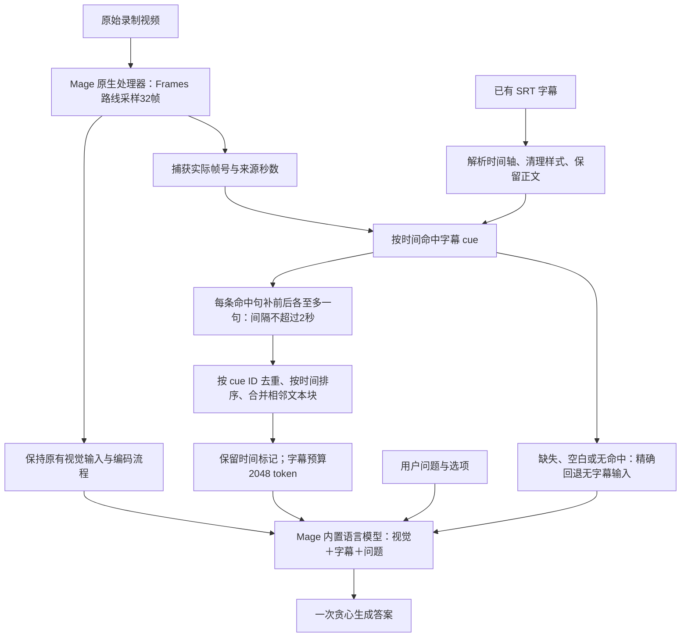
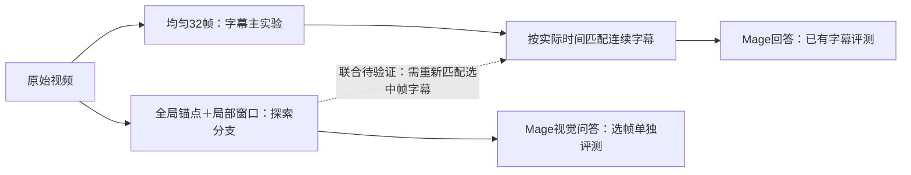

# Mage-VL 视频问答的时间对齐与连续字幕增强：方法与实验汇报

核对日期：2026-11-19。依据远程工程的实际代码、冻结协议和结果 JSON；本次只核对材料、整理说明，没有运行新推理、训练或改动模型。

**汇报主线：在固定 Mage-VL 视觉输入和模型权重的条件下，利用真实视频时间组织字幕证据，补充画面中难以直接观察的语言信息，提高视频问答准确率。**

## 一、背景

### 1.1 为什么视频问答需要字幕

视频包含两类互补信息：画面里的物体、动作和场景，以及解说中的名称、用途、关系和过程解释。模型即使识别了画面，也可能无法仅凭画面得知“这件器物叫什么”“讲解者为什么这样操作”。长视频还有一个问题：输入视觉帧数受限，稀疏采样可能遗漏关键时刻。

本工作在已有 Mage-VL 视频问答框架上增加字幕证据组织。采用已有带时间轴的 SRT 字幕，利用实际输入画面的来源时间找到对应文字，再补充局部连续上下文，供同一个模型一次性回答。

**工作定位：免训练的字幕证据组织与问答增强。** 模型没有重新训练；未修改 Mage-VL 的 ViT、注意力结构或内置语言模型。效果指标是公开视频选择题的回答正确率。

### 1.2 对应文旅场景：录制结束后的文化遗产视频回看与查询

游客在参观时拍摄一段有导游讲解的古建筑或器物视频，结束后上传。用户可以浏览原视频，并询问“讲解者提到这件器物的用途是什么”“刚才那一步工艺为什么需要加热”。画面提供对象与动作，字幕提供讲解内容。

以“游客拍摄一件青铜器并录入导游声音”为例：画面帮助模型判断正在展示器口、器身还是纹饰；字幕中的用途解释帮助模型回答“为什么有这种结构”。名称、年代等信息应以视频中可获得的讲解为依据，不能承诺从外观推断全部历史知识。

上述是**拟应用案例**，不是本次已评测样本。当前实验使用 Video-MME 本地子集，没有专门文旅实测数据。已有 SRT 是实际输入；从游客录音自动生成字幕的 ASR 接入仍待验证。视频录制后上传处理，不涉及现场实时或流式服务。

同一视频可以另行抽帧用于三维重建，但本问答流程直接处理原视频，**不输入三维模型、点云或重建新视角，也不需要等重建结束。**

### 1.3 到底在哪个分支

| 分支 | 本次核对到的情况 | 汇报时怎样使用 |
|---|---|---|
| `vlm` | `b0aa4db`，提交说明为冻结字幕评测、图表和文档归档 | 字幕工作早期稳定归档入口 |
| `feat/air-visual-evidence` | `2e30b06`；包含已提交的 practical 字幕代码和字幕文档；工作区归档还记录 AIR 选帧探索 | 查阅字幕＋时间选帧的主要历史上下文 |
| `feat/project-video-demo` | 当前与 `feat/air-visual-evidence` 同一提交 `2e30b06` | 不是另一套独立字幕算法 |
| `feat/project-video-deme` | `38d2e87`，增加本地视频解说演示 | 演示支线，不能把演示功能计为字幕实验收益 |
| `feat/sparse-vcar-seg` | 当前所在分支，提交同为 `38d2e87`；工作区实际存在本次核对的最新代码与结果 | 本次读取所在位置，不是字幕算法的独立新版本 |
| `Mage_LoRA` | `739d225`，未查到同一路径的 practical 字幕目录 | 不能因为名字含 LoRA 就把当前字幕收益称为微调收益 |
| `feat/sd15-stronger-base-lora` | `d110eb3`，未查到同一路径的 practical 字幕目录 | 本次字幕汇报不以此为入口 |
| `main` | 当前同为 `2e30b06`，也包含相同的 practical 字幕代码 | 不能据分支名判断是否包含完整最新实验 |

**重要的工程状态：** 上述六个包含 practical 目录的分支，其已提交的该目录 tree hash 相同，为 `81a8f8f33fc2f8252820ff7f9cd986950d2849ed`。因此字幕基础实现并不只存在于一个分支。另一方面，当前最新 `VLM/mage_vl/air_v1/`、`codec_full714_32768/` 等目录显示为未跟踪文件；不能声称这些后续工作已完整提交进 `feat/air-visual-evidence`。

历史提交使用 `VLM/`；当前工作区实际文件位于 `VLM/`，旧 `VLM/` 大量显示为删除。**后续追溯请同时记录“分支/提交＋工作区路径”，只 checkout 某个提交不保证得到全部最新成果。** 本次没有切换分支或整理这些改动。

## 二、为了解决什么问题

### 2.1 仅看稀疏画面，缺少语言证据

原无字幕控制组只向 Mage 输入视频视觉证据与题目。画面没有直接表达的名称、用途、讲解逻辑，容易缺失。字幕提供额外语言证据，是整体准确率提升的主要研究动机。

### 2.2 只取“采样时刻命中的字幕”，上下文可能断裂

均匀采样的视频帧只是离散时间点。字幕句子可能跨多个 cue，某一命中句可能只有“因此这样处理”，真正的原因在前一句；也可能命中“这个构件”，名称在后一条字幕中。仅命中当前句，仍可能缺少理解所需上下文。

本方法在命中句周围补有限邻句，兼顾连续性与文本长度，而不是直接塞入整段视频全部字幕。

### 2.3 增加文字时仍要保证可比性与可追溯性

必须保持模型权重、视觉帧和处理流程不变，才能避免把“换了画面”“多采样帧”“换模型”造成的收益混入字幕收益。还需要避免无字幕时人为加入空模板改变输入，以及根据正确答案挑选证据。

因此代码对真实帧号、秒数、视觉张量、模板、来源哈希和回答记录进行核对；没有字幕时精确回退原无字幕输入。

## 三、字幕方法使用了什么方法和流程

### 3.1 整体架构



### 3.2 第一步：保留原 Mage 的视觉输入，记录真实时间

Frames 主路线使用原生处理器的 `video_backend='frames'`、`num_frames=32`，视觉像素预算 `max_pixels=150000`、`min_pixels=3136`。字幕增强组与无字幕控制组使用相同帧号、视觉网格、像素张量和视觉 token 数。

通过 `CaptureVideoProcessor` 捕获原生 `frame_timestamps`，而不是用“第几帧÷32”猜时间。每个输入帧的真实来源秒数决定它可以匹配哪条字幕。

### 3.3 第二步：解析和清理 SRT

`subtitle_common.py` 中 `parse_srt()` 和 `clean_text()` 负责：解析开始/结束时间；清除 HTML/font/样式控制而保留台词；统一换行和空白；检查时间顺序与格式。

缺失文件、空字幕可以走回退流程。**存在但损坏的字幕会报错，不会悄悄当成无字幕。** 不做翻译、摘要、知识补写或外部大模型重写。

### 3.4 第三步：按实际帧时间命中 cue

对于输入帧来源时间 \(t\) 和字幕 cue 区间 \([s_i,e_i)\)，命中条件为：

\[
 s_i\leq t<e_i.
\]

代码以微秒比较减少浮点边界歧义。若多个帧命中同一条字幕，只保留一次 cue；重叠字幕按规则保留所有命中的非空 cue。排序依据是字幕时间，而不是问题相关性或答案。

**去重单位是 cue ID。相同文字如果出现在不同时间，不会仅因文字相同而被全局删掉。** 这能避免删掉真实的重复解说或强调。

### 3.5 第四步：有限邻句补全

`continuous_common.py::continuous_evidence()` 是连续字幕策略的核心：

1. 把实际时间命中的字幕设为锚点句。
2. 在非空字幕序列中，为每个锚点最多补前一句、后一句。
3. 邻句与锚点的时间间隔必须不超过 2000 ms；重叠时按零间隔处理。
4. 邻句集合去重，与所有锚点合并。
5. 按字幕顺序组织；只有序列相邻且间隔不超过2秒的 cue 才合并成一个文本块。

这是一套**固定、局部、免训练规则**，不是问题引导的语义检索。相同视频、相同视觉采样时间通常复用同一字幕证据包，不会为每道题利用答案挑句子。

下面仅是解释规则的示意，不是实验成功案例：若采样帧命中了“因此需要反复加热”，前一条字幕是“这种材料温度降低后难以塑形”，补入邻句可能帮助模型解释操作原因。它说明设计动机，不能替代真实案例核验。

### 3.6 第五步：文本块编号和时间标记

每个合并块以类似格式输入：

```text
S12 [00:01:20.000 --> 00:01:24.500] 对应字幕正文
```

编号关联来源 cue，时间区间关联原视频，帮助组织文本顺序与追溯。这里保留的是合并块的时间范围；**不代表已经实现逐句回答引用、证据定位界面或事实核验。**

### 3.7 第六步：2048 token 预算控制

预算只针对字幕文本，不是全部模型输入。实际 token 数使用模型 tokenizer 计算。

- 所有原命中锚点优先保留。
- 如果加入全部邻句超预算，沿时间轴均匀选取更少的完整邻句。
- 不切断句子，不按问题、选项或 GT 排序邻句。
- 如果锚点句加时间格式本身已超预算，直接停止报错；不会静默截断或扩大上限。

因此不是“把完整 SRT 截取前2048 token”，也不是“每题固定新增2048 token”。实际长度取决于命中的字幕与可容纳邻句。

### 3.8 第七步：将字幕加入问题文本，同一 Mage 一次回答

`subtitle_prompt()` 在原问题模板中加入字幕段，保持原问题、选项和答案要求。原生视觉输入与新的文本输入合并后，仍由同一 Mage 一次生成，`do_sample=False`、`max_new_tokens=32`，没有投票、多轮 Agent 或外部裁判替换答案。

运行代码核对缓存组装输入与原生处理器直接生成输入是否逐张量一致，同时保存视觉布局、提示词和证据哈希。缓存复用依赖身份核对，不能把复用算成新的模型调用。

缺失、空白、无命中字幕时，字幕文本为空，原问题逐字回退；归档评测精确复用对应无字幕输入/回答，不额外调用模型，也不加入“没有字幕”的新模板。

### 3.9 用到了 Mage-VL 的哪些部分

| 模块 | 实际作用 | 本工作的改动 |
|---|---|---|
| Mage 自带 ViT 视觉编码 | 编码视频帧/视觉图块 | 保持原结构与权重 |
| Mage 多模态输入处理 | 形成视觉网格、位置和语言输入 | 使用原生接口，增加输入一致性核查 |
| 内置语言骨干 | 配置为 `Qwen3-4B-Instruct-2507`，融合输入并回答 | 沿用；不是外接 Qwen3 API |
| 字幕前处理 | 命中、补邻句、合并、时间标记、预算、回退 | 本次方法实现和集成重点 |
| ASR | 音频转字幕 | 当前结果未使用新接入的 ASR |
| LoRA / 参数微调 | 调整模型权重 | 本次字幕实验没有使用 |

### 3.10 Codec 路线的后续扩展

Codec 原生 HEVC 路线将视频中保留的图块组织成画布，`target_canvas=32` **不等于只采样32帧**。本工作不改原生 Codec 图块选择，而是根据保留图块的真实来源帧号和 FPS 建立字幕时间锚点。

已完成两组 Codec 字幕配置：

| 配置 | 字幕锚点来源 | 字幕预算 |
|---|---|---|
| `codec_anchor32_2048` | 从实际来源时刻中均匀选最多32个锚点 | 2048 token |
| `codec_complete32768` | 全部实际保留图块的来源时刻 | 32768 token；本地实际最长14217 |

两者均沿用时间命中和连续邻句组织。完整配置保证此次数据中保留完整邻句；它覆盖的来源时刻和文本更多，**不是与2048配置等文本预算的对比**。“完整”指实际保留视觉来源对应的字幕及邻句，不等于视频全量 SRT。

### 3.11 为什么可能比无字幕或只命中字幕好

| 比较 | 改变了什么 | 合理解释 | 证据边界 |
|---|---|---|---|
| 无字幕 → 对齐字幕 | 加入时间对应语言证据 | 补足画面难以直接提供的讲解信息 | 可以验证整体问答正确率变化 |
| 对齐字幕 → 连续字幕 | 补邻句、合并连续文本、加入时间组织 | 减少断句、指代和解释上下文缺失 | 现有增益点估计为正，独立稳定优势未充分证实 |
| Codec少量锚点 → 全来源字幕 | 增加来源时刻和文本覆盖 | 减少视觉保留内容与字幕覆盖的脱节 | 同时增加输入量，不能独立归因于某个组件 |

以上是结合代码设计的解释，不等于已逐题证明模型真的采用了所述推理路径。需要人工核查原视频和证据，才能进一步做机制分析。

## 四、已经取得的效果提升多少

### 4.1 数据和评测口径

评测是 Video-MME 本地选择题子集：**714题、238个视频**，每题输出选项，按正确数/总题数算准确率。不是官方完整 Video-MME，也不是开放式解说质量评价。

| 数据池 | 题数 / 视频数 | 角色 |
|---|---:|---|
| short219 | 219 / 73 | 历史短视频开发覆盖 |
| dev180 | 180 / 60 | 开发 |
| val90 | 90 / 30 | 已做过诊断的补充验证 |
| test225 | 225 / 75 | 原冻结中长视频评测池；后续也用于事后诊断 |
| 合计 | 714 / 238 | 本地互斥覆盖统计，不能称为714道全新独立测试 |

划分在题号和视频ID上互斥。旧 smoke/dev30 是其中子集，不再重复计数；早期文档把 test225 称为冻结测试，后续复用情况应一起披露。本报告统一称“原 test225 评测池”。

### 4.2 Frames 主实验：最适合汇报的结果

| 同一视觉路线的配置 | 本地714题 | 原test225 |
|---|---:|---:|
| Mage Frames-32，无字幕 | 474/714，66.39% | 140/225，62.22% |
| 同视觉＋只命中的对齐字幕 | 496/714，69.47% | 154/225，68.44% |
| **同视觉＋连续字幕2048** | **511/714，71.57%** | **163/225，72.44%** |
| 连续字幕相对无字幕 | **+37题，+5.18个百分点** | **+23题，+10.22个百分点** |
| 连续字幕相对对齐字幕 | +15题，+2.10个百分点 | +9题，+4.00个百分点 |

**最稳妥表述：在固定视觉输入和模型权重下，连续字幕增强相对无字幕 Mage，在原225题中长视频评测池上从62.22%提升到72.44%，提高10.22个百分点。** 这里说“百分点”，不是把10.22写成相对提升百分比。

原225题中相对无字幕救回30题、误伤7题，净增23题；按视频聚类的95% bootstrap 区间为 **[5.33,15.11] 个百分点**。这一结果支持该评测池上的整体字幕增强收益。

相对已有对齐字幕的额外提升4.00个百分点，区间为 **[-0.44,8.46]**，跨零。不能写成“连续补句相对原对齐字幕已稳定显著更好”，更不能把全部10.22个百分点都归因于补句。

### 4.3 消融：邻句趋势较明确，时间标记额外贡献较弱

| 配置 | 714题正确数 / 准确率 | 原225题正确数 / 准确率 |
|---|---:|---:|
| 完整连续字幕 | 511 / 71.57% | 163 / 72.44% |
| 去掉编号与时间标记 | 509 / 71.29% | 162 / 72.00% |
| 去掉邻句补充 | 502 / 70.31% | 158 / 70.22% |

完整方法相对去邻句多对9/714、5/225；相对去编号/时间仅多对2/714、1/225。两个组件的配对聚类区间均跨零。

可以说“邻句补充呈现正向趋势，时间标记独立贡献较弱”；不能分别宣称两项组件都已显著有效。去标记同时去掉编号，去邻句也会影响覆盖时间，这不是严格解耦的2×2因果实验。

### 4.4 Codec 扩展：两种视觉路线分别与自身基线比较

| 配置 | 本地714题 | 原test225 |
|---|---:|---:|
| Codec，无字幕 | 459/714，64.29% | 131/225，58.22% |
| Codec，最多32字幕锚点＋2048 | 504/714，70.59% | 149/225，66.22% |
| **Codec，全来源连续字幕** | **521/714，72.97%** | **158/225，70.22%** |
| 全来源连续字幕相对Codec无字幕 | **+62题，+8.68个百分点** | **+27题，+12.00个百分点** |

Codec 原225题相对自身无字幕救回35题、误伤8题。注意它的无字幕起点低于 Frames。**不能用+12.00大于+10.22，就得出 Codec 最终更强。** 相同225题上，Frames连续字幕163题正确，Codec完整字幕158题正确；714题合计则Codec多对10题。两路线总体配对差异区间跨零，尚无稳定胜负结论。

### 4.5 收益伴随的输入成本

原225题，Frames三组视觉token总量均为1,036,800，字幕增强没有多加视觉帧。

| 配置 | 字幕token总量 | 总输入token | 每题平均总输入token |
|---|---:|---:|---:|
| 无字幕 | 0 | 1,136,682 | 5051.92 |
| 对齐字幕 | 79,260 | 1,217,715 | 5412.07 |
| 连续字幕2048 | 304,368 | 1,442,820 | 6412.53 |

连续字幕总输入相对无字幕增加约26.93%。因此目前证明的是**固定视觉条件下引入字幕后的准确率改善**，不是等总token、更省显存或端到端更快。复用缓存和共享预处理影响计时，不能直接以归档生成耗时作为部署速度结论。

### 4.6 与“字幕选区”的关系：要分清三件事

| 容易混淆的说法 | 实际含义 | 能否归入上述字幕增益 |
|---|---|---|
| 字幕选择 | 根据实际视觉来源时间命中cue、补邻句、组织文本 | 是，属于本次字幕策略 |
| Mage 原生 Codec 选图块 | 原模型依据Codec路径形成稀疏视觉输入 | 沿用基础能力，不能作为自己的新选区算法 |
| 全局锚点＋局部窗口选帧 | 问题相关CLIP检索，决定输入哪些时间画面 | 独立探索，未接入上述已验证字幕对照 |

时间选帧候选的流程为：视频1fps粗特征＋问题/选项及显式子事件的CLIP查询 → 6个12秒局部窗口、每窗口4帧 → 合入8个全局锚点 → 去重、按原时序输入最多32帧 → Mage回答。它是时间选帧，不是图像里的空间ROI框选。

该候选在已见的30题开发诊断上，均匀32帧16/30，去观察查询候选18/30，+6.67个百分点，但视频聚类95%区间[-6.67,20.00]跨零，新增18题两者均为12/18。更早的180题上，AIR适配107/180低于均匀110/180；全局16＋局部16混合111/180，仅多1题。**还不能称为稳定有效的选帧改进。**



当前不能把两条单独实验的收益相加，也不能声称“语义选区＋字幕联合增强已验证”。

### 4.7 汇报时可直接使用的陈述

> 本工作面向视频画面与讲解信息互补的问答需求，在不修改Mage-VL模型权重和视觉编码器的前提下，设计并实现了基于实际视觉来源时间的字幕证据组织流程。该流程按时间命中字幕，补充有限邻句，合并连续文本并保留时间标记，在固定文本预算内输入原模型，并支持缺字幕时回退视觉问答。在本地原225题中长视频评测池上，相对无字幕Frames-32，正确率由62.22%提高至72.44%，提高10.22个百分点；本地714题覆盖统计提高5.18个百分点。与已有对齐字幕相比仍有正向点估计，但额外收益的统计确定性有限。当前结果支持字幕辅助问答，文旅实测、独立泛化评测和与时间选帧的联合收益仍待验证。

## 五、后续最值得补的验证

1. **字幕only／视觉only／视觉＋字幕**：区分“字幕本身能答题”和“跨模态互补”贡献。
2. **等文本预算的时间对齐／固定错位／乱序**：控制文字量，验证时间对应与连续组织是否优于单纯多给文字。
3. **新视频评测池**：先冻结规则，再评测；不继续用原test225选择规则。
4. **另一VLM的同条件对比**：例如独立Qwen3-VL-4B-Instruct，统一题目、字幕条件及可比视觉预算；这与Mage内部Qwen3语言骨干不同。
5. **少量可核验文旅案例**：原视频、核对字幕、问题、答案与依据完整保留。ASR版本应另外报告识别及时间误差对问答的影响。
6. **选帧＋字幕联合实验**：字幕必须按新的实际选中帧重新匹配；重新记录视觉和文本成本，不能套用旧字幕包。

## 六、代码、数据和归档索引

以下路径均为远程绝对路径。历史文档中的 `VLM/` 对应当前工作区的 `VLM/`；不表示所有脚本内部旧路径已经全部修复。

### 方法实现

| 内容 | 当前远程路径 / 函数 |
|---|---|
| SRT清理、解析、时间命中、缺失回退 | `/root/autodl-tmp/Sparse-3DGS-heritage-VQA/VLM/mage_vl/practical/subtitle_common.py`：`parse_srt`、`make_alignment`、`subtitle_prompt` |
| 邻句、文本块和预算核心 | `/root/autodl-tmp/Sparse-3DGS-heritage-VQA/VLM/mage_vl/practical/continuous_common.py`：`continuous_evidence` |
| 模型推理及输入一致性 | `/root/autodl-tmp/Sparse-3DGS-heritage-VQA/VLM/mage_vl/practical/continuous_mage.py`：`run_gpu` |
| 225题后续入口 | `/root/autodl-tmp/Sparse-3DGS-heritage-VQA/VLM/mage_vl/practical/continuous_test225.py` |
| 字幕组件消融 | `/root/autodl-tmp/Sparse-3DGS-heritage-VQA/VLM/mage_vl/subtitle_ablation_v1/subtitle_ablation.py` |
| Codec全来源字幕 | `/root/autodl-tmp/Sparse-3DGS-heritage-VQA/VLM/mage_vl/codec_full714_32768/codec_full714.py`：`align`、`evidence` |
| 内部语言模型配置 | `/root/autodl-tmp/Sparse-3DGS-heritage-VQA/VLM/mage_vl/models/config.json` |
| 独立时间选帧候选 | `/root/autodl-tmp/Sparse-3DGS-heritage-VQA/VLM/mage_vl/air_v1/condition_clips_noobs_qa30.py` |

### 真实结果与说明

- Frames五组结果与配对统计：`/root/autodl-tmp/Sparse-3DGS-heritage-VQA/VLM/eval_results/practical_mage_v1/20_subtitle_ablation_v1/frozen_r1/results/full714/summary.json`。
- Codec三组及Frames参考结果：`/root/autodl-tmp/Sparse-3DGS-heritage-VQA/VLM/eval_results/practical_mage_v1/24_codec_full714_32768_v1/results/full714/summary.json`。
- 时间选帧候选：`/root/autodl-tmp/Sparse-3DGS-heritage-VQA/VLM/eval_results/practical_mage_v1/18_air_frames_v1/condition_clips_noobs_qa30/results/summary.json`。
- 原字幕归档、输入成本与案例索引：`/root/autodl-tmp/Sparse-3DGS-heritage-VQA/docs/SUMMARY_mage_subtitle_final_results_20261103.md`。
- 组件结论：`/root/autodl-tmp/Sparse-3DGS-heritage-VQA/docs/ANALYSIS_subtitle_ablation_full714_20261106.md`。
- 选帧归档与边界：`/root/autodl-tmp/Sparse-3DGS-heritage-VQA/docs/SUMMARY_air_semantic_frames_archive_20261105.md`。

本报告附带 `核对数据/`，保存本次读取的Frames、Codec原始summary快照、分支身份信息及文件SHA256索引。报告表格正确数和百分点由这些summary交叉核对；没有重新推理，也没有逐题重放模型。本次结果应按历史协议及数据使用边界理解。
