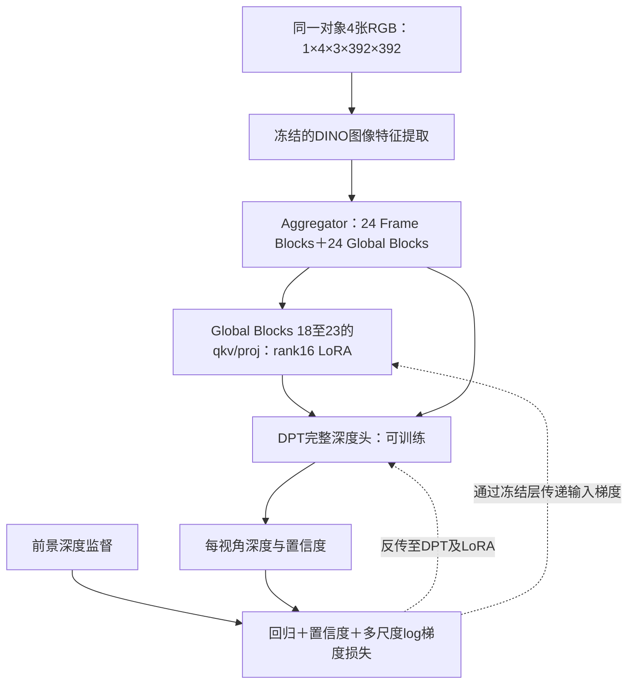

# VGGT：DPT全参数＋Aggregator LoRA微调的实现与实测报告

核对日期：2026-11-20。只读核对代码、数据清单、训练记录和结果文件；本次未修改代码、数据、损失或权重，未启动训练。

**研究实现：保留预训练VGGT主体，完整微调DPT深度头，同时仅在Aggregator后6个Global Attention块的qkv/proj中加入rank16 LoRA。** 本次实验为A16、20个optimizer steps的可训练性验证，不是大规模正式训练，也不是对LoRA贡献的充分消融。

## 0. 实验身份与结论概览

| 项目 | 本次实际值 |
|---|---|
| 远程根目录 | `/root/autodl-tmp/Sparse-3DGS-heritage-VQA` |
| 工程 | `VGGT-Object` |
| 分支／提交 | `feat/sparse-vcar-seg`／`38d2e87aa0232de58c18fa315a877e258c16f8ad` |
| 实验／phase | `A16`／`agg_smoke` |
| 输出目录 | `VGGT-Object/experiments/aggregator_lora_r16_smoke_v1` |
| 初始化 | 本地原始VGGT `3DGS/vggt/models/model.pt`；`initialization_adapter=null` |
| 数据 | Smithsonian 10物体、240视角；7 train／2 val／1 test |
| 本次训练 | 20优化步，4视角，392×392，梯度累积2 |
| 参数 | DPT 32,654,562＋LoRA 589,824＝33,244,386可训练参数 |
| GPU | NVIDIA GeForce RTX 4090 D |
| 峰值训练显存 | allocated 6.9429 GiB；reserved 7.0684 GiB |
| 工程验证 | LoRA与DPT均更新、冻结参数检查通过、无OOM/非有限值、重载输出误差0 |
| 验证集结果 | 尺度对齐AbsRel：0.02212352→0.02049880，下降约7.34% |

没有从先前DPT-only的400步权重继续训练。该400步结果仍是另一个实验；不能拿20步A16与400步DPT-only直接比较来证明LoRA增益。

## 一、目标与选择DPT全量＋LoRA的原因

### 1.1 目标是什么

将通用VGGT的多视图深度预测能力适配到小型实物、文物等对象域，改善前景深度和局部几何，从而为后续点云补全、几何初始化或三维重建提供更适合对象域的深度先验。

**本次实际验证的是深度适配训练能否运行和更新。** 本实验没有训练3DGS，也没有在这些权重上验证PSNR/SSIM/LPIPS、下游重建质量或几何补点收益。把“深度变好”转成“3DGS最终更好”仍需独立下游实验。

### 1.2 为什么全参数训练DPT

DPT把Aggregator的多尺度特征转换为像素深度及置信度，是最直接接触监督信号的模块。完整更新深度头能联合调整投影、上采样、特征融合和输出层，而不局限于部分卷积的低秩增量。当前DPT约3265万参数，远小于VGGT整体，便于控制优化范围。

这是本工程采用该方案的设计理由，不意味着DPT全参数在所有数据条件下必然优于Depth Head LoRA。工程保留了早期卷积LoRA对照；A16使用`adapter_kind=depth_full`，不是对DPT再套一层卷积LoRA。

### 1.3 为什么再给Aggregator加LoRA

DPT-only只能解释既有特征；当跨视图聚合特征与文物域存在差异时，深度头可能受限。给后段Global Attention加入小规模可训练增量，可让深度监督适度影响跨视图聚合，同时保留主体预训练权重。

选择最后6层而不是所有层，是为了控制激活显存、训练参数和对预训练表征的扰动。LoRA减少的是可训练权重及优化器状态，**不会免除这些层的前向计算，也不保证激活显存按参数比例下降**。

当前只有10个对象、7个训练对象，过拟合风险仍然存在。20步成功只是确认方案可训练；新增LoRA是否必要，应在同数据、同初始化、同预算下对比DPT-only与A16。

## 二、数据集、规模、划分与中间数据

### 2.1 必须区分“原包声明”“服务器文件现状”“本次实际训练”

| 数据源 | 原包对象数 | 原包RGB视角数 | 本次服务器原images非零文件核查 | 本次A16参与情况 |
|---|---:|---:|---:|---|
| omni3d（已有物体包） | 20 | 4000（200/对象） | **0非零／4000文件，4000为零字节** | 未参与；未作为GT |
| Smithsonian | 10 | 240（24/对象） | 240非零／240文件 | 唯一实际使用的数据源 |
| CO3Dv2 | 10序列 | 320（32/序列） | 320非零／320文件 | 未参与 |
| 总计 | 40 | 原包计划4560 | 原images非零合计560 | A16清单仅240 |

零字节统计是2026-11-20对`data/omni3d/<id>/images`的只读快照，不涵盖images_2/4/8等金字塔，不等于整个磁盘没有Omni有效图像；但原images这4000个占位文件不能当作已上传可训练照片。本次没有补传、删除或重整原件。非零也仅证明文件有内容；Smithsonian另有实际训练与质量检查支持其可读性，CO3D没有因此自动完成监督质量审查。

未来计划的OmniObject3D 1200、Smithsonian 120、CO3Dv2 80，不是这次实际规模，不应写入本次训练数量。

### 2.2 原包划分与实际训练划分

原包`VGGT_finetune_v1/manifests/all_objects.json`采用按物体/序列划分：

| 数据源 | train | val | test | 比例 |
|---|---:|---:|---:|---|
| omni3d | 16物体／3200图（声明） | 2／400 | 2／400 | 80%／10%／10% |
| Smithsonian原包 | 8／192 | 1／24 | 1／24 | 80%／10%／10% |
| CO3Dv2 | 8／256 | 1／32 | 1／32 | 80%／10%／10% |
| 合计原包 | 32／3648 | 4／456 | 4／456 | 80%／10%／10% |

**本次读取的是`objects_review_v2.json`，并非直接使用原包划分：** Smithsonian中一件雕像从原train调到val，形成7／2／1。清单记录这是此前模型比较前的调整，原test对象保留；划分变更不是本次报告操作。

| 本次集合 | 独立物体数 | RGB／深度／mask数量（各自） | 比例 | 实际用途 |
|---|---:|---:|---:|---|
| train | 7 | 各168 | 70% | 随机采样物体及4视角反传 |
| validation | 2 | 各48 | 20% | 更新前与20步后评测、选best |
| test | 1 | 各24 | 10% | 本次未执行测试评测 |
| 总计 | 10 | 各240 | 100% | 对象不跨集合 |

这是**物体级隔离**，不是每件文物随机拆照片。验证同一个对象的多组视角不会增加独立验证对象数量。

### 2.3 每个对象实际属于哪个集合

| 物体ID | 集合 | 视角数 |
|---|---|---:|
| `model-of-the-greek-slave-8edffe56` | val | 24 |
| `kneeling-winged-monster-0dc68216` | train | 24 |
| `baluster-vase-one-of-three-in-a-five-piece-garniture-f1980-1-d8c62634` | train | 24 |
| `buddha-draped-in-robes-portraying-the-realms-of-desire-d8c62be8` | train | 24 |
| `ewer-349e8fa2` | train | 24 |
| `ritual-wine-ewer-gong-with-masks-taotie-dragons-and-real-ani-d8c646aa` | train | 24 |
| `beaker-shaped-vase-from-a-five-piece-garniture-d8c64b96` | train | 24 |
| `lidded-incense-burner-xianglu-with-geometric-decoration-and-ce850625` | train | 24 |
| `colonoware-pot-from-cooper-river-charleston-county-sc-79da3e3f` | val | 24 |
| `ritual-wine-container-fangyi-with-masks-taotie-serpents-and-d8c62f94` | test | 24 |

### 2.4 各数据源用了哪些原始数据

**Smithsonian：** 数据包记录来源为Smithsonian Open Access 3D网格，GLB经重打包取得。原始物体GLB、物体元数据、目录尺寸、材质用于生成合成RGB-D；训练阶段直接读取已渲染RGB、float32深度、前景mask和相机矩阵，不直接把GLB输入网络。单个核对样例许可证为CC0-1.0；数据集权利应仍按每个原始对象元数据核查。

**omni3d：** 原包包含RGB、COLMAP相机和稀疏几何、ZoeDepth预测、mask及金字塔。ZoeDepth属于伪深度，不能称为文物真实深度GT；桥接导入器明确不将其混进当前GT监督清单。也不能仅据目录名把这批已有物体包描述为完整官方OmniObject3D RGB-D训练集。

**CO3Dv2：** 原包10序列均有RGB、mask、相机，其中5条有geometric depth（vase、bowl、teddybear、suitcase、toaster），另5条无深度。即使某些原清单字段写`is_ground_truth=true`，本工程仍将其视为重建估计深度，非传感器真值。本次mix只含smithsonian，因此CO3D低权重0.1没有生效。

### 2.5 零复制中间索引

原始目录保持在：

```text
VGGT-Object/data/
  omni3d/
  VGGT_finetune_v1/
    smithsonian/<object>/
    co3dv2/<sequence>/
    scripts/render_smith.py
    manifests/
  processed/bundle_index_cdc81eb386/smithsonian/<hash>/cameras.json
  manifests/objects.json
  manifests/objects_review_v2.json
```

`bundle.py`为每个对象生成小型统一`cameras.json`，将源RGB/NPY/mask转换成绝对路径引用，组装K，并将OpenCV c2w求逆成E=w2c；`copied_media_bytes=0`。不重复拷贝图像、不重新生成一套全量深度缓存。

本次Smithsonian统一记录`depth_encoding=float32_npy`、`depth_type=camera_z_depth`、`depth_scale=1.0`。数据源meta中的`scene_scale_m`被保留为provenance，没有自动把每个NPY乘成米制再输入本次训练。

### 2.6 读取、缩放、规范化和采样

1. 每次加载一个训练对象的4个视角：RGB转RGB三通道、float[0,1]；加载float32 NPY及mask。
2. 有效像素：mask>127、深度有限且>1e-6；无效深度置0。背景不参与监督。
3. 统一到392×392；RGB双线性，depth/mask最近邻。保持宽高比并letterbox，同步缩放和偏移K。Smithsonian本身512方图，因此本次无需补边；缩放后fx/fy约544.4444、cx/cy=196。
4. 以输入第一相机为坐标规范：`E_rel=E @ inverse(E_first)`。将有效GT反投影点变换到第一相机坐标，以其到原点欧氏距离的均值为一套视角共享scale；depth及相机平移一起除以scale。
5. **不逐张独立归一化深度**。scale使用GT几何定义，因此这些结果不是“无GT条件下恢复绝对米制尺度”的验证。
6. 物体采样采用打乱队列，队列空后重新打乱；当前只有Smithsonian一个数据源。`overlap_mix`约70%选择一个锚点及邻近相机，并补一个随机覆盖相机；约30%随机4视角。4视角按索引排序输入。
7. RGB增强：同一组共享brightness与contrast，均匀[0.9,1.1]；另加标准差0.002高斯噪声，截断[0,1]。无空间增强，K/E/depth不变。

20优化步×2累积＝40次物体组采样，每组4图＝160次图像输入出现；可以重复，不等于160张不同图，也不是看完168张训练图的一整轮。

## 三、模型结构、LoRA位置、参数量和冻结范围

### 3.1 结构与数据流



实际实现使用VGGT原有交替Frame/Global结构，上图LoRA是嵌入后6个Global块，不是另接一套Aggregator。原Aggregator默认embed_dim=1024、num_heads=16、depth=24，patch_embed为dinov2_vitl14_reg。DPT使用第4、11、17、23层索引对应的输出特征（均为0起始索引），融合Frame与Global特征，dim_in=2048。深度头output_dim=2，对应深度和置信度；VGGT实例显式指定深度activation="exp"、conf_activation="expp1"，不能将DPT类通用默认inv_log误写成本次深度激活，也不应将confidence直接称为0到1概率。后6块影响其中最终深层输出，其余冻结特征仍供DPT融合。

### 3.2 LoRA具体参数化

每个目标线性层保留原矩阵W，并计算：

\[
y=Wx+b+\frac{\alpha}{r}B A\,\mathrm{Dropout}(x).
\]

默认`r=16`、`alpha=32`、缩放alpha/r=2、dropout=0.05。A用Kaiming初始化，B全零，初始增量为0；原W及bias冻结，不训练偏置。

目标为`aggregator.global_blocks.18..23.attn.qkv`与`.attn.proj`，0起始索引，共6块×2＝12个Linear。qkv为1024→3072，proj为1024→1024。

每个qkv的LoRA参数为16×(1024+3072)=65,536；每个proj为16×(1024+1024)=32,768；每块98,304，6块共589,824。没有为MLP、所有Frame Attention、DINO或Camera Head添加LoRA。

### 3.3 参数量：增加模块不等于训练改变参数个数

| 状态 | 活跃模型总参数 | 可训练参数 | 冻结参数 |
|---|---:|---:|---:|
| 相同活跃结构，注入前的DPT-only训练设置 | 1,157,941,492 | 32,654,562 | 1,125,286,930 |
| 注入A16后的训练设置 | 1,158,531,316 | 33,244,386 | 1,125,286,930 |
| 20步训练完成 | 1,158,531,316 | 同上设置 | 同上设置 |

原始预训练全冻结推理时可训练参数为0；表中注入前可训练数量指DPT-only适配设置。以上统计是当前实例化的活跃模型，不是原始checkpoint中包括所有可选head的总tensor数量：工程启用camera/depth，不实例化point/track。

A16可训练占总量约2.8695%；其中DPT占可训练量约98.23%，新增LoRA约1.77%。训练20步只改变值，不改变参数个数。备用A8参数294,912、合计可训练32,949,474，但本次没使用。

顶层配置`rank=0`是旧Depth Head卷积LoRA的关闭开关；真正Aggregator LoRA rank在`aggregator_lora.rank=16`。不能把顶层0误读成“本次未启用LoRA”。同理顶层alpha=16不覆盖Aggregator alpha=32。

### 3.4 具体冻结与反传

- DPT：所有参数可训练，包括投影、scratch融合/上采样、深度和置信度输出，不只是`depth_targets`列出的部分。
- Aggregator：原权重全部冻结，仅新增A/B可训练。
- DINO及所有Frame Blocks：冻结。
- Camera Head：实例化但冻结，训练loss不经过该head；验证仍会计算姿态诊断，因此姿态输出可能受Aggregator变化影响。
- Point/Track Heads：未实例化。

DPT-only原先对整个Aggregator使用外层no_grad。本次启用LoRA后取消这层外部no_grad，但不解冻基础权重；后续冻结Frame块必须保持输入梯度通路，否则LoRA接不到深度监督。不能在LoRA后detach特征。

模型train模式下Aggregator主体保持eval，只有LoRA dropout进入train；DPT按训练模式处理。非重入gradient checkpoint安装在Global18..23和其后的Frame19..23，保留随机状态，减少反传激活保存；不修改上游VGGT源文件。

## 四、损失、训练预算及超参数

### 4.1 本次实际目标函数

设有效前景像素集合M，预测深度p、GT深度g、预测置信度c：

\[
L_{reg}=\operatorname{mean}_{M}|p-g|,
\quad L_{conf}=\operatorname{mean}_{M}\left(|p-g|c-0.2\log(\max(c,10^{-6}))\right),
\]

\[
L=L_{reg}+0.05L_{conf}+0.1L_{grad}+0\cdot L_{mv}.
\]

`L_grad`对log(p)−log(g)残差，在stride=1、2、4三个尺度上分别计算水平与垂直一阶差分的绝对均值；每项只用相邻两像素都有效的位置，最后对有有效项的尺度/方向均值再平均。不是对XYZ梯度、图像颜色梯度或深度值做平方差。

Smithsonian supervision_weight=1。MV配置虽保留warmup50、ramp100、stride4、occlusion_relative0.03，本次mv_weight=0，**实际未使用多视图一致性训练损失**。验证仍会计算几何诊断，二者不能混为一谈。

置信度项含负log，因此该项可为负；日志负confidence并不直接表示实现错误。总loss下降也不能全部解释成深度回归改善，应同时看reg和验证集深度误差。有效像素少于100或出现非有限值会中止。

### 4.2 实际训练设置

| 参数 | 本次设置 |
|---|---|
| optimizer | AdamW，betas=(0.9,0.999)，eps=1e-8 |
| weight decay | 0.01；当前统一施加给可训练参数，没有额外bias/norm免衰减分组 |
| DPT最大学习率 | 2e-6 |
| LoRA最大学习率 | 5e-5；与DPT独立参数组 |
| schedule | 5% warmup＋cosine，两个组最终下限均1e-6 |
| warmup | 20步×5%=1步，因此不形成长warmup |
| gradient clipping | 全部可训练参数联合L2范数1.0；非有限梯度报错 |
| optimizer steps | 20，不是20微批 |
| scene batch | 1物体/微批，4视角 |
| gradient accumulation | 2；每次反传loss除以2 |
| 有效batch | 每优化步2个物体组采样、8次视角输入；不保证2个不同物体 |
| input resolution | 392×392，patch14兼容 |
| precision | Aggregator BF16 autocast；DPT与损失FP32 |
| GradScaler | 当前路径未使用FP16 GradScaler |
| random seed | 42；记录并保存采样器/Python/NumPy/Torch/CUDA RNG |
| validation | 训练前一次，step20一次；每物体固定6组4视角 |
| checkpoint | step20保存latest；最低合格val AbsRel保存best |
| early stopping | patience4次验证、min_delta0.001；本次未触发 |
| best准入 | aligned AbsRel改善，且canonical AbsRel≤原baseline×1.25 |

第一步实际学习率DPT=2e-6，LoRA=5e-5。第20步用于更新的学习率分别约1.00681935e-6、1.33414807e-6；更新后scheduler的DPT读数为1e-6。日志`depth_learning_rate`/`lora_learning_rate`记录实际更新使用值，`lr`字段是调度后的读数，不应混读。

### 4.3 训练日志的首末值

| 项目 | step1 | step20 |
|---|---:|---:|
| total loss | 0.03547635 | 0.01481439 |
| depth regression | 0.04055485 | 0.02665695 |
| confidence项（未乘0.05） | -0.10805906 | -0.24120890 |
| gradient项（未乘0.1） | 0.00324464 | 0.00217889 |
| LoRA梯度范数（clip前） | 0.00542645 | 0.00226599 |
| DPT梯度范数（clip前） | 2.10898995 | 1.01124525 |

两次对应不同采样及增强，不是同一个固定训练样本；不能凭首末两点断言已收敛。LoRA和DPT梯度大小也受参数规模和结构影响，不可直接作为贡献大小比较。

## 五、实验环境、耗时与显存

| 项目 | 记录 |
|---|---|
| GPU | NVIDIA GeForce RTX 4090 D |
| Python | 3.10.21，Clang 22.1.3构建 |
| PyTorch | 2.5.1+cu124 |
| CUDA | PyTorch编译版本12.4，不等于单独核实的驱动版本 |
| 系统只读快照 | Linux 5.15.0-94-generic x86_64，glibc2.35 |
| 环境目录 | `/root/autodl-tmp/Sparse-3DGS-heritage-VQA/.venv-ddgs-vggt` |
| 预训练权重 | 本地`3DGS/vggt/models/model.pt`，没有运行时下载 |
| 平均优化步耗时 | 0.84182秒 |
| 后10步中位耗时 | 0.84082秒 |
| 20步记录elapsed | 约16.84秒（至最后一步日志处） |
| complete.duration_seconds | 21.47735秒 |
| 峰值allocated | 6.94291449 GiB |
| 峰值reserved | 7.06835938 GiB |

21.48秒的计时从初始baseline验证之后开始，包含训练及结束验证/保存等，不包含开头加载模型与baseline验证；结尾重新构建模型的smoke验证也在该计时字段之后执行。因此不能把21.48秒写成整个命令端到端耗时。CPU型号、主机总内存、独立驱动版本未在本次训练记录里完整固定，不凭型号推测填写。

reserved为PyTorch缓存分配器预留，不是另一份额外占用与allocated相加；上述是本配置实测，不保证518分辨率、更多视角或更大batch同样占用。没有OOM，没有非有限输出/梯度。

## 六、评测协议、指标和实际结果

### 6.1 本次到底评测了什么

验证前景深度预测。2个验证物体，各固定6组4视角，总12个case；每个case分别计算像素指标，先在每物体内平均6组，再对2物体宏平均。12不是12个独立物体，48次视角出现也不一定是48个不同视角。

评测同时保留两种尺度口径：

- `canonical_unaligned`：输入GT定义的共享规范尺度上直接计算，不额外拟合预测尺度；仍不是原始米制绝对尺度评测。
- `scene_scale_aligned`：每组4视角所有有效像素共享一个median(g/p)乘数后计算，**不是逐帧单独拟合**。best按该口径AbsRel选取。

`depth_metrics`进一步要求预测有限且>1e-6；当前网络深度输出为正值路径，仍应保留这一掩膜定义以供复现。

### 6.2 指标定义

- **AbsRel↓**：mean(|p−g|/g)。
- **RMSE↓**：sqrt(mean((p−g)²))，本实验单位是规范尺度，不是米。
- **RMSE_Log↓**：sqrt(mean((ln p−ln g)²))，使用自然对数。
- **δ1/δ2/δ3↑**：max(p/g,g/p)<1.25、1.25²、1.25³的像素比例。
- 每个case还保存深度边界F1：log深度跳变阈值0.05、匹配半径2像素，无边界返回None；并保存多视图相对几何误差、姿态rotation/translation方向误差及AUC30等诊断。

聚合summary只明确汇总六项深度指标。边界/姿态等存在逐case记录，不应凭记录存在就声称训练优化了这些目标。

### 6.3 更新前与step20的验证集宏平均

| 尺度口径 | 指标 | 更新前 | 20步后 |
|---|---|---:|---:|
| canonical_unaligned | AbsRel | 0.02379735 | 0.02197543 |
| canonical_unaligned | RMSE | 0.04869619 | 0.04276887 |
| canonical_unaligned | RMSE_Log | 0.03924804 | 0.03617691 |
| canonical_unaligned | delta1 | 0.99275046 | 0.99339897 |
| canonical_unaligned | delta2 | 0.99666154 | 0.99730081 |
| canonical_unaligned | delta3 | 0.99857745 | 0.99902622 |
| scene_scale_aligned | AbsRel | 0.02212352 | 0.02049880 |
| scene_scale_aligned | RMSE | 0.04737629 | 0.04145343 |
| scene_scale_aligned | RMSE_Log | 0.03767307 | 0.03466461 |
| scene_scale_aligned | delta1 | 0.99298060 | 0.99358448 |
| scene_scale_aligned | delta2 | 0.99678732 | 0.99738540 |
| scene_scale_aligned | delta3 | 0.99861869 | 0.99904480 |

尺度对齐AbsRel绝对下降0.00162472，相对下降约7.34%；canonical AbsRel下降约7.66%。δ1本身已接近1，变化应以百分点表示，而非夸大为大幅识别提升。

**这些是2件物体的小规模验证点估计。** 没有新独立test结果、多随机种子区间或等预算DPT-only对照，不能把改善归因于LoRA，而不是DPT全量更新、样本波动或两者共同作用。

### 6.4 本次工程验证的具体证据

- 第一优化步LoRA与DPT权重均发生更新。
- 全部冻结参数不在optimizer中、没有梯度、version counter保持；CPU小模型测试另做冻结张量逐元素比较。GPU检查不是逐个基础权重重新哈希。
- 更新后同一输入在启用/禁用LoRA时输出有差异；depth/confidence两类输出中的最大绝对差为0.15618896，不能把它解释为深度精度提升0.156。
- 重新实例化原始VGGT，注入相同LoRA，加载DPT及Aggregator适配器，固定输入预测与保存前完全一致；depth最大差0，confidence最大差0。
- `complete.json`、`smoke_verification.json`、`gradient_verification.json`均通过，完整训练20步，没有提前停止。

### 6.5 没有完成的评测

未运行保留test物体最终评测；未比较同预算F0；没有3DGS渲染质量、几何Chamfer/F-score或新增点云质量实验。本工程有相关工具入口，不代表本次已经得到那些结果。

## 七、Blender渲染与深度格式

### 7.1 渲染来源与相机

数据包`data/VGGT_finetune_v1/scripts/render_smith.py`及各对象`meta.json`记录了离线生成过程。本次AutoDL训练读取已生成数据，没有在训练命令里重新运行Blender。

| 项目 | 脚本/元数据记录 |
|---|---|
| Blender | 4.5.9 LTS／bpy 4.5.9 |
| 原渲染环境要求 | Python3.11，NumPy1.26.x，Pillow；与训练Python3.10环境分开 |
| engine/device | Cycles／CPU |
| samples | 16 |
| denoise | 开启，OpenImageDenoise |
| RGB | 512×512，RGBA PNG，8-bit，透明背景 |
| 相机 | pinhole；50mm焦距，36mm sensor；fx=fy=711.1111111，cx=cy=256 |
| FOV | 约39.59775° |
| clip | near0.01／far100 |
| 视角 | 8方位×3仰角＝24：方位0到315°，步长45°；仰角15°、35°、60° |
| 外观 | Standard view transform，look=None，exposure0 |
| 线程 | AUTO |

网格导入后按包围盒中心平移至原点，最长边缩放至1。相机对准原点，其距离由归一化包围球半径r和FOV计算：`d=r/sin(FOV/2)*margin`，本包margin=1.15，故不同对象的相机距离不必相同。

### 7.2 光照设置

固定世界坐标两盏Area灯：key位置(2.5,-2.5,3.0)、energy150、size3；fill位置(-3,2,1.5)、energy80、size3，均朝向原点。环境背景色(0.55,0.55,0.55)，strength0.7。透明胶片背景不等于没有环境照明。

### 7.3 EXR、NPY、mask与预览图

1. 一次render同时产生RGB和Render Layers Depth输出。Depth经compositor写32-bit OPEN_EXR临时文件。
2. 重新读取EXR并设Non-Color，取第一个通道；Blender读取行方向bottom-up，代码上下翻转至与PNG一致。
3. 非有限、≤0或≥1e9背景哨兵转0；alpha>127定义前景，mask存0/255 PNG，背景depth置0。
4. `fill_edge_depth`最多4轮，用4邻域正深度均值补前景mask内的深度空洞；因此边界少量像素含后处理补值，并非所有像素都未经处理的原始Z pass。
5. `depth/00000.npy`为二维float32、512×512，是训练深度；`depth/00000.png`为逐视角归一化、近亮远暗的16-bit可视化，**不能作为毫米深度或训练GT读取**。
6. RGB为RGBA，训练通过convert('RGB')去掉alpha；有效前景监督单独由mask控制，RGB背景不被作为深度GT。

本次只读样例：NPY dtype=float32、shape512×512、最小0、最大约2.059225，统一索引depth_scale=1。它是规范物体场景单位，不能直接声称2.059225米。

### 7.4 坐标与物理尺度

Blender相机转换为OpenCV c2w使用轴翻转diag(1,-1,-1)，统一为x右、y下、z前；桥接时对c2w求逆成w2c。

原GLB的单位可能不一致；脚本通过包围盒与目录尺寸在m/mm/cm/inch候选中做log空间匹配，记录`scene_scale_m`。这属于基于目录尺寸的单位推定，不是传感器米制标定。训练索引没有把Smithsonian NPY和相机平移统一乘成米，而是在读入后做GT共享规范尺度归一化。

### 7.5 深度语义仍需保留的一项核验

**代码/元数据将渲染Depth输出直接标为camera-space Z。** 本次核对发现`compose()`对Depth pass仅执行翻转、过滤、mask和边缘填值，**没有显式ray-distance→camera-Z换算**；而读取CO3D的路径在声明ray_distance时，确实会按K计算射线长度并除以该长度。

因此本报告能确认“当前训练如何解释这些数据”，不能仅凭脚本注释证明Blender该pass的实际几何定义。正式论文应通过解析平面/网格射线交点等独立几何校验，确认所用Blender版本与输出通道究竟符合光轴Z还是射线距离，并检查现有跨视图质量结果。若不一致，训练与投影的深度契约需另行处理；本次按用户要求只出报告，没有改数据或代码，也未宣称已经解决这一核验项。

## 八、权重保存、重载和省盘机制

`best/`和`latest/`只存DPT权重与Aggregator LoRA，不保存完整VGGT基础权重：

- `depth_head.safetensors`：完整DPT状态。
- `aggregator_lora.safetensors`：目标模块A/B；不含全部Aggregator基础W。
- `model_info.json`：配置、step、来源、manifest SHA、环境等。
- `latest/trainer.pt`：optimizer、scheduler、RNG、采样队列等断点恢复状态；best通常不保存完整trainer。

按FP32原始参数量估计，DPT权重约130.62MB（124.57MiB），LoRA约2.36MB（2.25MiB），另加metadata及latest优化器状态；整次目录前次核实约508MB，不能把它误读成完整VGGT仅508MB。重载必须使用相同原始模型、注入结构和配置，再加载这两部分。

## 九、对结果的判断与下一阶段含义

已经证实：rank16后6层Global Attention LoRA与DPT联合训练可运行，梯度通过冻结层传递，权重保存/重建正确，在本小样本验证集观察到较低深度误差。

尚未证实：新增LoRA优于同预算DPT-only；对真实文物拍摄、未见对象和下游3DGS有稳定收益；具备绝对米制深度精度；大数据训练已充分收敛。

若扩大到1400个训练物体，当前每步2次物体组采样，400步仅800次，平均0.57次/物体；400步更适合作为先导预算。按物体均匀采样时，平均5—10次访问约需3500—7000步，仍只是覆盖预算估算，最终应由验证曲线决定，不把该估算直接当成最佳超参数。混合采样还要按`steps×effective_scene_batch×dataset_probability/N_train_dataset`分别核算；访问对象一次也不等于看完所有图。

下一步正式比较应保持数据划分、初始化、392分辨率/4视角或后续统一配置、有效batch、步数及评测协议一致，仅改变Aggregator LoRA开关；最终test保留到配置冻结后。旧400步基线原位保留，但与未来大数据或不同预算实验应分开报告。

## 十、追溯与报告附件

远程共同前缀：`/root/autodl-tmp/Sparse-3DGS-heritage-VQA/VGGT-Object/`。

| 内容 | 相对该前缀的文件 |
|---|---|
| 实际配置 | `experiments/aggregator_lora_r16_smoke_v1/config.json` |
| 参数与注入位置 | 同目录`parameter_report.json` |
| 模型初始化、冻结、前向 | `vggt_object/model.py` |
| LoRA注入/梯度检查 | `vggt_object/aggregator_lora.py` |
| 优化器/调度/训练计时 | `vggt_object/train.py` |
| 保存/恢复/禁用对照 | `vggt_object/checkpoint.py`、`aggregator_smoke.py` |
| 数据接入/读取/规范化 | `vggt_object/bundle.py`、`data.py`、`geometry.py` |
| 损失与评测 | `vggt_object/losses.py`、`evaluate.py`、`metrics.py` |
| 实际训练划分 | `data/manifests/objects_review_v2.json` |
| 渲染源脚本 | `data/VGGT_finetune_v1/scripts/render_smith.py` |
| 真实首末验证 | 实验目录`baseline_validation.json`、`validation_latest.json` |
| 工程通过证据 | 实验目录`smoke_verification.json`、`gradient_verification.json`、`complete.json` |

本地附带`核对数据/`保存实际配置、参数、验证、训练日志、manifest、代码/渲染脚本快照及SHA256索引；用于追溯，不复制模型、原视频或数据集。Git提交不能完全代表未提交工作区，因此报告同时保留本次读取源码快照。
