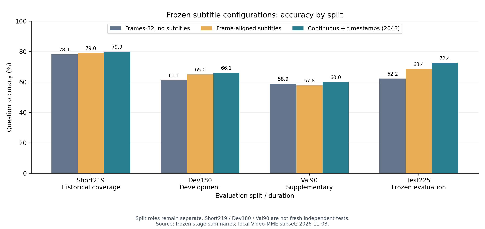
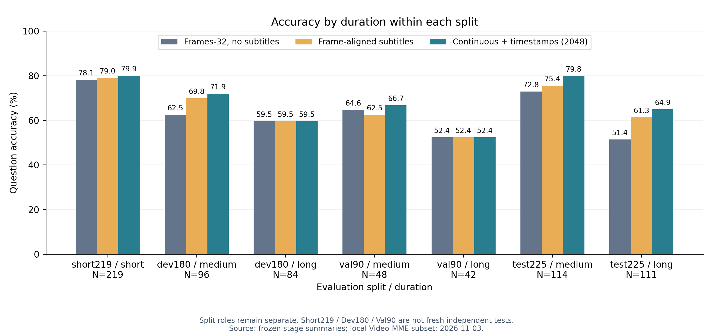
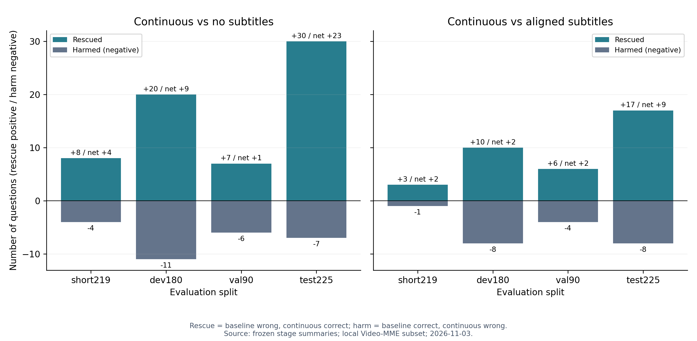
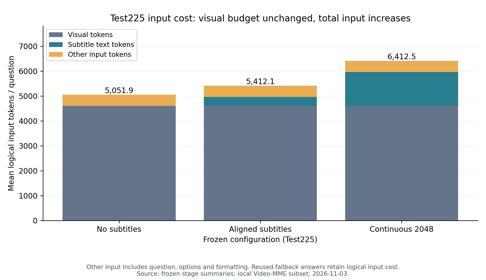
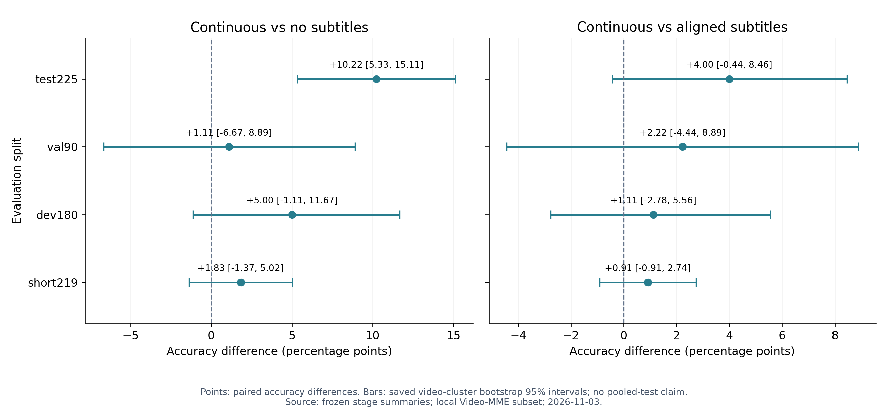

# Mage连续字幕：冻结配置的最终结果与完整成果索引

更新：2026-11-03（Asia/Shanghai），分支vlm。本页为当前结论；此前实验及负结果原位保留。

## 1. 当前结论

固定2048连续字幕在test225上由无字幕140/225（62.22%）提高至163/225（72.44%），救回30、误伤7，净增23题（+10.22个百分点），视频聚类95%区间[5.33,15.11]。相对原对齐字幕154/225（68.44%）净增9题（+4.00个百分点），区间[-0.44,8.46]仍跨零，不能宣称补句模块独立显著优于原对齐字幕。

测试中等114题83→91；长视频111题57→72（救回18、误伤3）。开发和补充验证的长视频均持平，必须同时披露，不能写成所有划分均稳定提升。置信区间来自预存视频聚类bootstrap，问题级McNemar是辅助统计；不以小题型的事后结果作为确定性结论。

保留连续字幕2048为当前系统问答配置；原对齐、无字幕均保留为必要基线。3072开发预算对照119→117，保留为负向消融；不因测试中4个视频省略邻句而再调预算。换序、加帧、置信度选边的负结果继续保留。DeepSeek pilot没有显示叠加价值，Agent/API路线暂停。

## 2. 分阶段报告，禁止混成新测试集

| 阶段与角色 | 题/视频 | 无字幕Frames-32 | 原对齐字幕 | 连续字幕2048 |

|---|---:|---:|---:|---:|

| short219：历史开发覆盖 | 219/73 | 171/219（78.08%） | 173/219（79.00%） | 175/219（79.91%） |

| dev180：开发 | 180/60 | 110/180（61.11%） | 117/180（65.00%） | 119/180（66.11%） |

| val90：已诊断的补充验证 | 90/30 | 53/90（58.89%） | 52/90（57.78%） | 54/90（60.00%） |

| test225：冻结最终评测（披露历史使用） | 225/75 | 140/225（62.22%） | 154/225（68.44%） | 163/225（72.44%） |

四个划分在问题索引和视频ID上互斥，219+180+90+225=714题，73+60+30+75=238视频，恰好覆盖当前本地输入清单。test225只有中长视频；没有新增独立短视频测试。旧smoke包含在short219、dev30包含在dev180、API pilot来自开发池，均不重复计入。

本地全覆盖只是覆盖性统计，不等于官方完整Video-MME，也不等于714题都是未见测试题。历史基准使用必须披露。测试结果出来后不再调预算、按时长选答案或修改规则；未来新方案需要新的评测安排。

## 3. 核心方法和贡献边界

实际采样32帧 → 用真实秒数命中[start,end)字幕cue → cue ID去重、时间排序 → 为命中cue最多补前后各一个非空邻句（相隔不超过2秒）→ 合并连续文本块并标时间 → 固定2048字幕文本token → 原Mage一次贪心回答；缺字幕/空白/无命中则精确回退同题无字幕输入和回答。

补句与时间标记联合改变，本实验没有将二者分离，不能分别归因。输入没有问题相关检索、外部裁判、多轮Agent、ASR或新训练。32帧和视觉像素预算固定，新增的是文本证据，总输入预算不固定。原对齐字幕不是“截取完整字幕前2048 token”；它按采样时刻命中，在本批数据中未因文本前缀截断而变短。

定位为免训练的系统集成与实证增强，不包装成新字幕对齐算法。原对齐思想来自已有视频字幕评测方式；本轮没有复制A.I.R./VCD/VideoHV-Agent核心算法，也不能将这些参考仓库列为本次提升的实现来源。重建贡献独立成立；公开视频问答结果没有证明重建质量导致了问答提升，也没有证明文旅资产定位和交互闭环已完成。

可用于论文的陈述：在固定视觉配置下，集成时间对齐、局部连续且带时间标记的字幕证据，并支持缺字幕时的视觉回退。在固定的225题中长视频子集上，相对无字幕Mage准确率提高10.22个百分点；相对原对齐字幕的额外提升为4.00个百分点，但其区间跨零。

## 4. 输入成本与限制

| test225配置 | 视觉token | 字幕token | 总输入token | 每题总输入token |

|---|---:|---:|---:|---:|

| no_sub | 1,036,800 | 0 | 1,136,682 | 5051.92 |

| aligned | 1,036,800 | 79,260 | 1,217,715 | 5412.07 |

| continuous | 1,036,800 | 304,368 | 1,442,820 | 6412.53 |

视觉token三路相同；连续字幕总输入相对无字幕增加约26.93%，相对原对齐增加约18.49%。2048是字幕文本预算，不是每题总输入上限。图中Other input包含问题、选项和格式token。共享预处理及额外原生输入检查使本次计时不适合直接当作公平部署速度基准。

## 5. 图、数据和案例

成果目录：[完整离线成果](../VQA/eval_results/practical_mage_v1/17_subtitle_final_report/20261103_v1/)。原始summary/预测/JSONL原位保留；新source_manifest记录来源大小与SHA，summary快照另存，不复制模型和视频。

- stage_duration_metrics.csv / .json：四阶段、分时长三路准确率。

- paired_comparisons.csv / .json：救回、误伤、净增、区间和辅助统计。

- all_predictions.csv / .json：714题去重明细及阶段角色。

- test225_token_cost.csv / .json：逻辑输入及新增生成成本。

- qualitative_cases.md / .json：按固定规则及索引排序选取的10个成功/失败示例，带问题选项、真值、原始输出、源视频路径、实际采样秒数、字幕原文和记录哈希。它们是看过GT后的定性示例，不是随机效果估计；未重新检查视频画面，不能仅凭字幕和回答断言纠错机制。

- figures/：5组PNG、PDF、SVG，英文坐标可用于论文；PNG预览、PDF/SVG可编辑。

## 6. 图表预览

### 四阶段准确率，保留角色区分

### 各划分内部的分时长准确率

### 纠错与误伤，含净增

### 固定视觉配置下的输入token成本

### 配对准确率差及视频聚类区间

## 7. 收尾与后续

当前不需要再次运行本地full：所有714题已有三路结果，重复全量只是重做已有推理；先离线去重合并并保留来源和评测角色即可。若旧输入、模型、提示词或配置身份不一致，则只调查具体冲突，不盲目复用；本轮逐题和分组统计已通过核验。

仍需补的论文工作：人工核查成功/失败案例中的真实画面证据；按相同字幕条件做外部模型对比时另立协议；文旅场景独立评测与重建—问答联系验证。以上均为待做，不是本次已完成能力。当前不启动新实验，Agent继续暂停。
