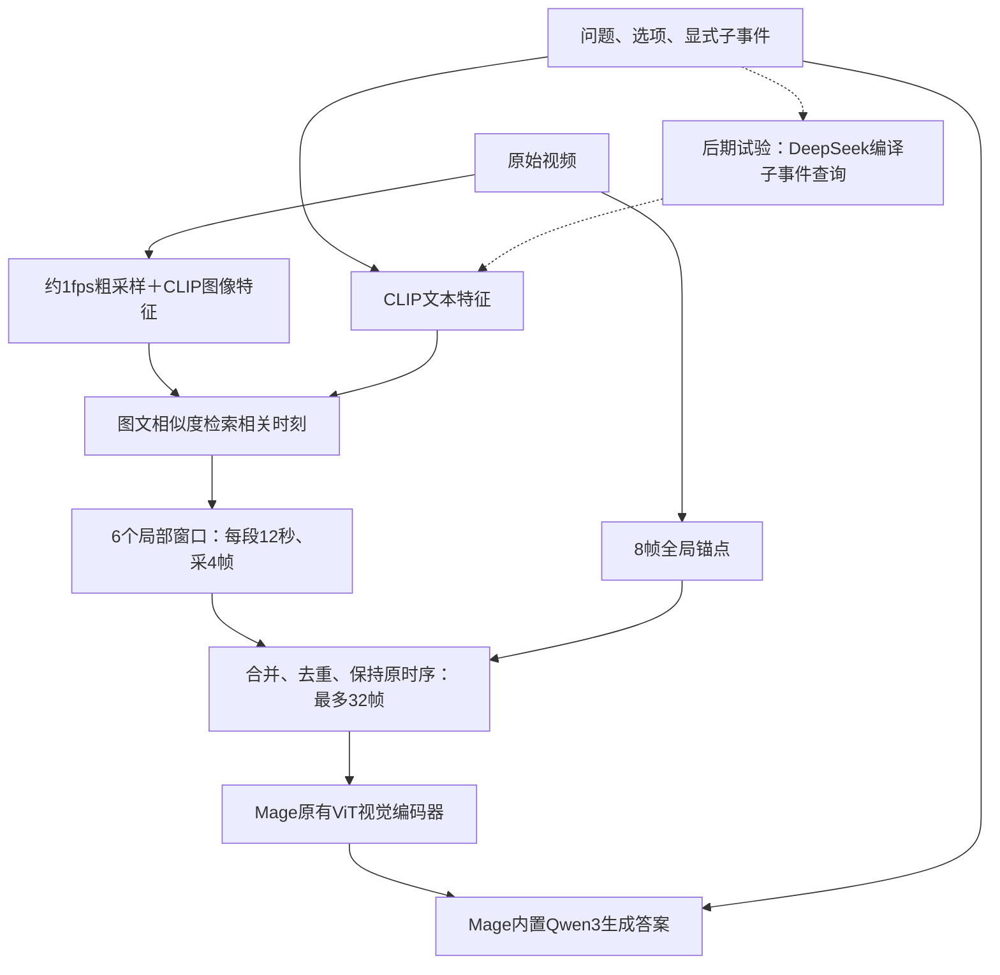

# 语义选区尝试汇报——问题相关的时间选帧

核对日期：2026-11-10；分支`feat/air-visual-evidence`。依据实际代码、逐阶段结果和失败审阅整理。

## 一、背景／为了解决什么问题

**均匀抽32帧能覆盖全片，但可能错过回答问题的关键几秒。** 本尝试希望根据问题找到相关片段，把有限帧数用在关键证据上，提高视频问答正确率。

这里的“选区”是**选视频时间窗口与帧，不是框选图片里的空间区域**。路线受A.I.R.启发，属于适配实验，不是原论文的完整复现。

## 二、文旅的实际应用场景

| 场景 | 用户问题示例 | 希望选到的证据 |
|---|---|---|
| 非遗制作视频 | “上色前先进行了什么处理？” | 上色前后的连续动作，而不只是出现颜料的画面 |
| 古建筑导览 | “导览最先介绍的是哪处结构？” | 首次介绍及其前后文，不能只检索到该结构 |
| 博物馆讲解 | “讲解员展示器物之后做了什么？” | 同一人物、器物和前后顺序对应的片段 |

**以上为拟应用场景，尚无文旅实测数据。** 当前实验使用公开视频，未接入3DGS重建画面。

## 三、方法示意图

实线为保留的低成本候选：**全局覆盖＋局部补证**。早期还试过Mage观察/评分，后期试过条件解析与子事件定位；这些版本分别评测，没有一起算成主方案收益。此处没有接字幕，也没有接Codec。

## 四、使用到的Mage-VL部分

| 部分 | 使用情况与归属 |
|---|---|
| Mage-ViT | 沿用原编码器，未改权重或注意力结构 |
| Mage内置Qwen3 | 作为最终问答语言模型，**不是外接Qwen3 API** |
| CLIP-L/14 | 在Mage编码之前计算图文相关性，用于检索时间位置；不是Mage-ViT的替代品 |
| 时间选帧前端 | 本次适配与组织：问题相关窗口、全局锚点、帧预算和时序保持 |
| Mage自身Codec选区 | 本轮未改、未接入；不能把结果写成Codec稀疏图块改进 |
| 外部DeepSeek | 后期仅做受约束的文本查询编译，不看图代答；新增定位试验没有带来额外正确题 |

均未进行模型微调。字幕路线是另一条独立工作，联合收益尚未验证。

## 五、已有结果与结论

### 1. 早期开发对比：局部收益没有在扩样中保持

均使用同一Mage回答，比较均匀32帧、早期A.I.R.适配，以及固定16全局＋16局部混合。

| 方法 | 首批90题 | 新增90题 | 合计180题 |
|---|---:|---:|---:|
| 均匀32帧 | 56/90 | 54/90 | **110/180（61.11%）** |
| 早期A.I.R.适配 | 56/90 | 51/90 | 107/180（59.44%） |
| 16全局＋16局部 | 58/90 | 53/90 | 111/180（61.67%） |

**混合方案只净增1题，早期适配反而少对3题。** 首批原评分有2条格式非法，旧审计失败记录保留；不能包装为无实现偏差的官方A.I.R.复现。

### 2. 后期30题诊断：复杂模块没有新增收益

| 方法 | 正确数／准确率 | 相对均匀采样 |
|---|---:|---:|
| 均匀32帧 | 16/30（53.33%） | 基线 |
| 带Mage观察查询的窗口选帧 | 19/30（63.33%） | 净增3题 |
| **去观察查询的低成本候选** | **18/30（60.00%）** | 救回4、误伤2，净增2题 |
| 后续条件解析＋子事件定位 | 18/30（60.00%） | 相对低成本候选新增0题 |

30题来自前述开发180题，含已诊断的12题，**不能相加为210题或当独立测试**。低成本候选的提升区间为−6.67至20.00个百分点，跨0；新增18题为12→12，救回和误伤均为0。

后续定位实际只改变7题输入，另外23题核验后复用；7题答案均未改变。不能把原有2题收益归因于DeepSeek或新增定位模块。

### 3. 证明了什么，下一步与谁比？

**已证明工程能运行、部分相关片段能被找到；尚未证明稳定提高问答正确率，也没有公平的端到端加速证据。**

另有13题具公开时间证据标注：均匀采样的平均必需场景命中率42.31%，低成本候选73.08%；但命中不等于能答对，且标注区间较粗。这是覆盖诊断，不是QA涨幅。

若继续，优先在**新视频、冻结规则、相同32帧和相同Mage**下比较：均匀采样、简单CLIP Top-K、覆盖/去重选帧、当前全局＋局部候选。字幕组合另做“无选帧/有选帧 × 无字幕/有字幕”四组；之后再考虑Qwen3-VL等外部模型验证，避免同时更换所有环节。

## 六、失败原因总结——最重要的发现

| 失败环节 | 实际证据 | 应如何理解 |
|---|---|---|
| **相关对象不等于完整题意** | 找到红车，却漏掉最先出发的黄车；找到食物，却没覆盖广告插入时刻 | 相似度能找“有什么”，不能自动验证“首次、之后、原因、完整数量” |
| **局部集中挤掉全局背景** | 早期一个正分帧就可能替换整片输入；有约32分钟视频只剩1帧，主旨题也被局部比赛带偏 | 早期选择规则过激；保留全局锚点只能缓解，不能保证涨点 |
| **相邻重复没有增加证据** | 多帧集中同一镜头；满32帧仍有误伤 | 更多相似帧不等于更多独立信息，帧预算被重复消耗 |
| **画面到了，模型仍会数错或认错** | 颜料颜色已出现仍答错；四件雕塑同场仍映射错排列；7道早期误伤中2道属于此类 | 不能把所有错误归为漏帧，也不能保证换帧就能修复 |
| **观察与解析本身不可靠** | 复杂报告v1有88/96任务报告非法；v2的240段短观察中87段只输出字母；解析曾混淆已知/未知顺序 | 格式约束不等于理解正确；同一Mage自评再自答也不是独立核验 |
| **新增模块没改变最终判断** | 条件定位改变7题输入，答案却逐一相同；某些新窗口还丢掉原有关键场景 | 解析成功、图文匹配和QA改善是三件事；不能只凭流程更复杂宣称有效 |
| **验证范围不足，容易贴合已知错误** | 30题中的收益集中在已诊断案例，新增18题持平 | 当前只能报告开发诊断结果，继续同池叠规则会加重选择偏差 |

5道早期误伤有明显背景/关系覆盖问题，2道证据已到仍识别失败；这是对7道特定案例的审阅，不是全数据错误比例或严格因果归因。

**汇报结论：这次尝试定位出了“相关性检索→条件满足→最终作答”之间的断层。保留全局＋局部候选，暂停复杂裁判和继续堆规则；先补独立验证，而不是宣称语义选区已有效。**

---

追溯入口（相对服务器项目根目录`/root/autodl-tmp/Sparse-3DGS-heritage-VQA`）：

- 总归档：`docs/SUMMARY_air_semantic_frames_archive_20261105.md`。
- 失败审阅：`docs/ANALYSIS_air_dev30_rescue_harm_20261104.md`、`docs/ANALYSIS_leaf_localization_probe_20261105.md`、`docs/ANALYSIS_leaf_frozen7_qa30_outcome_20261105.md`。
- 低成本代码：`VQA/mage_vl/air_v1/condition_clips_noobs_qa30.py`。
- 数据根：`VQA/eval_results/practical_mage_v1/18_air_frames_v1/`；早期结果在`native_uniform_fix1/dev30`、`hybrid_g16l16_v1/dev30`及`extension90_v1/additional90`。
- 后期结果：上述数据根下`condition_clips_noobs_qa30/results/summary.json`、`leaf_frozen7_qa30_v1/results/summary.json`。
- 覆盖诊断：`docs/RESEARCH_semantic_evidence_next_20261105.md`及数据根下`research_conditions_20261105/`。没有把仅做离线诊断的其他论文方法写成已完成QA对比。
