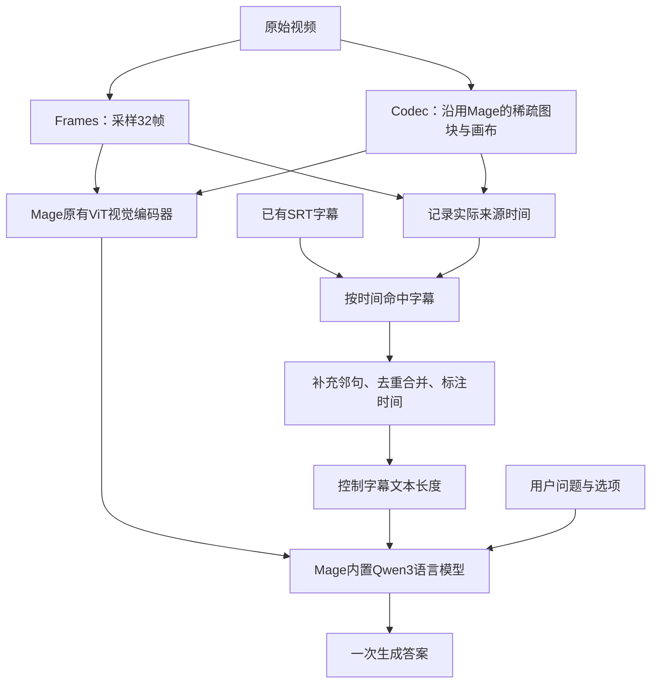

# 字幕辅助视频问答：工作说明

核对日期：2026-11-10；服务器分支：`feat/air-visual-evidence`，提交`2e30b06`及当前工作区。以下依据实际代码与结果文件，不将计划当作成果。

## 一、背景

**视频画面能告诉模型“看到了什么”，字幕能补充“讲解说了什么”。** 稀疏采样容易漏掉名称、年代、人物关系和连续解说，因此研究：在不重新训练Mage-VL的情况下，把时间对应的字幕组织好，能否提高视频问答正确率？

本工作的重点是**字幕证据组织与问答效果验证**，不是改造ViT或训练新大模型。

## 二、文旅的实际应用场景

| 应用场景 | 游客可能问什么 | 字幕的作用 |
|---|---|---|
| 博物馆展品介绍视频 | “这件器物是什么年代、有什么用途？” | 补充画面无法直接给出的馆方讲解 |
| 古建筑导览视频 | “刚才介绍的梁架有什么特点？” | 把相应时间段的解说与画面一起输入 |
| 非遗工艺展示视频 | “这一步叫什么，为什么这样操作？” | 补全动作前后的解释，减少只看单帧的歧义 |

**这些是拟应用场景，尚无专门文旅数据集或实地效果验证。** 当前问答处理原始视频，与3DGS重建独立；没有使用重建新视角或三维信息。

## 三、方法示意图

关键规则：命中句前后最多各补一句，间隔不超过2秒；按时间组织，缺字幕则回退无字幕输入。**不按正确答案选字幕，不调用外部裁判。**

- **Frames路线**：32帧，字幕上限2048 token。
- **Codec路线**：按实际保留图块的来源时间选字幕；比较“最多32个字幕锚点＋2048上限”和“全部来源时刻＋完整邻句”。后者统一上限32768，实际最长14217，**不是每题都填入32768 token**。

## 四、使用到的Mage-VL部分

| 部分 | 实际使用情况 | 工作归属 |
|---|---|---|
| ViT视觉编码器 | 使用Mage自带编码器，把图像块转为视觉特征 | 沿用他人模型，未改造 |
| Codec图块选择与画布 | 后续Codec字幕实验使用原生HEVC路径；32画布不等于32帧 | 沿用Mage能力，不是本次字幕创新 |
| Qwen3 | 配置中的语言骨干为`Qwen3-4B-Instruct-2507` | **Mage内部组成，不是外接Qwen3 API** |
| 字幕组织 | 来源时间匹配、邻句补充、合并与时间标记、预算与缺失回退 | 本次实现、集成与评测的重点 |
| 自己的“选区” | 全局锚点＋局部时间窗口是另一条时间选帧分支 | **未接入下表字幕实验，也不是空间框选** |

当前字幕路线没有额外ASR、外接Qwen3、Agent或模型微调。不能把字幕涨分归因于自己的选区策略。

## 五、已有数据结果与结论

### 1. 比较对象与数据范围

同一Mage权重，对比**无字幕、原时间对齐字幕、连续字幕，以及去组件消融**。指标为视频单选问答准确率，正确数/总题数如下。

| 视觉路线与字幕设置 | 本地714题 | 原test225子集 |
|---|---:|---:|
| Frames-32，无字幕 | 474/714（66.39%） | 140/225（62.22%） |
| Frames-32，原对齐字幕 | 496/714（69.47%） | 154/225（68.44%） |
| **Frames-32，连续字幕2048** | **511/714（71.57%）** | **163/225（72.44%）** |
| 连续字幕：去编号与时间标记 | 509/714（71.29%） | 162/225（72.00%） |
| 连续字幕：去邻句补充 | 502/714（70.31%） | 158/225（70.22%） |
| Codec，无字幕 | 459/714（64.29%） | 131/225（58.22%） |
| Codec，32字幕锚点2048 | 504/714（70.59%） | 149/225（66.22%） |
| **Codec，全部来源连续字幕** | **521/714（72.97%）** | **158/225（70.22%）** |

本地714题/238视频包含历史开发与验证数据；225题/75视频为原先冻结的中长视频评测池，后来也做过诊断。**不是官方完整Video-MME，也不能把后续实验称为全新独立测试。**

### 2. 已经支持什么结论？

- **主要证明：字幕辅助能改善本地选择题问答正确率。** Frames在原225题上相对无字幕提升10.22个百分点，救回30题、误伤7题；Codec相对自身无字幕提升12.00个百分点，救回35题、误伤8题。
- **邻句呈正向趋势，时间标记贡献较弱。** 原225题中，去邻句少对5题，去编号/时间少对1题；两项组件差异的95%区间都跨0，尚不能分别宣称稳定显著有效。补句与时间表达的变化也没有完全解耦。
- **尚不能说Codec优于Frames。** Codec在714题总体多对10题，但原225题比Frames少对5题；配对区间均跨0。
- **不是等总输入成本的提升。** Frames连续字幕在原225题上的总输入token增加约26.93%；Codec完整路线也增加字幕覆盖与文本量。因此尚未证明更快、更省或等预算更强，也未证明开放式讲解质量、事实引用可靠性或文旅落地效果。

### 3. 后续最值得补的对比

| 对比 | 要回答的问题 |
|---|---|
| **字幕only／视觉only／视觉＋字幕** | 提升主要来自字幕本身，还是画面与字幕的互补？ |
| 相同文本预算：时间对齐／固定错位／固定乱序 | 是选对时间、组织连续性有效，还是只因文字更多？ |
| **独立Qwen3-VL-4B-Instruct**，分别无字幕/带字幕 | 增强能否推广到另一VLM？保持同题、可比视觉配置与字幕条件 |
| LongVideoBench或新的未使用评测池 | 增益能否在新视频上保持？ |
| 馆方视频＋核验字幕＋文旅问答标注 | 名称、历史和工艺解释是否正确、是否有依据？ |

新比较先固定协议，不根据旧test225结果继续选参数。**当前最合适的定位：免训练的字幕证据组织增强；已获得问答准确率收益，文旅应用仍待验证。**

---

追溯入口（均相对服务器项目根目录`/root/autodl-tmp/Sparse-3DGS-heritage-VQA`）：

- 方法：`VQA/mage_vl/practical/continuous_common.py`、`continuous_mage.py`；Codec入口：`VQA/mage_vl/codec_full714_32768/`。
- 模型组成：`VQA/mage_vl/models/config.json`、`modeling_mage_vl.py`。
- Frames与消融：`VQA/eval_results/practical_mage_v1/20_subtitle_ablation_v1/frozen_r1/results/full714/summary.json`。
- Codec完整结果：`VQA/eval_results/practical_mage_v1/24_codec_full714_32768_v1/results/full714/summary.json`。
- 分阶段原始结果与成本：`docs/SUMMARY_mage_subtitle_final_results_20261103.md`；组件限制：`docs/ANALYSIS_subtitle_ablation_full714_20261106.md`。
